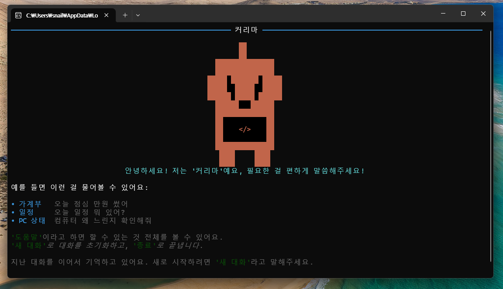
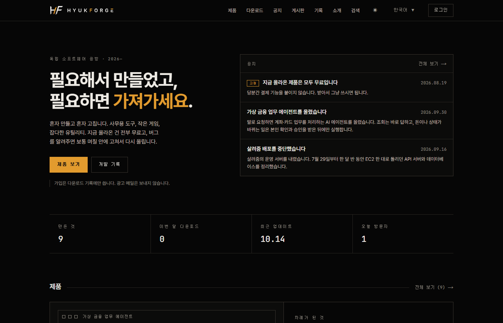
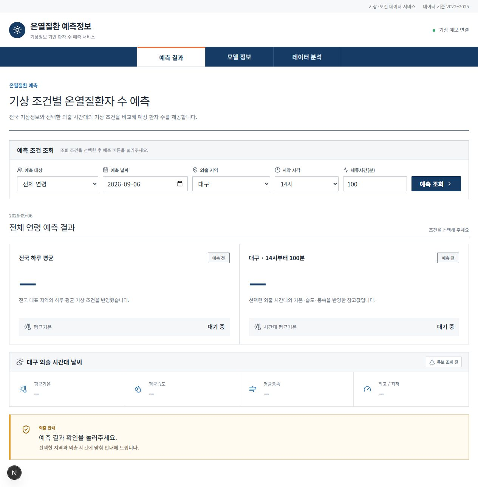

<div align="center">

# 박의혁

### Backend & AI Agent Developer

사용자에게 실제로 닿는 서비스와, **검증 가능한 AI 워크플로우**를 만듭니다.<br>
아이디어를 화면에 옮기는 데서 멈추지 않고 데이터 · 권한 · 테스트 · 배포까지 직접 연결합니다.

[](https://github.com/snail5039-code)
[](mailto:snail5039@gmail.com)
[](https://hyukforge.vercel.app)

**[대표 프로젝트](#대표-프로젝트)** · **[그 밖의 프로젝트](#그-밖의-주요-프로젝트)** · **[전체 프로젝트](#전체-프로젝트)** · **[기술 스택](#기술-스택)** · **[폴더 구조](#폴더-구조)**

</div>

<br>

> **이렇게 만듭니다**
> - 돈 · 상태가 바뀌는 일은 **본인 확인 → 처리안 → 사용자 승인** 뒤에만 실행하고, 숫자는 LLM이 아닌 코드가 계산합니다.
> - AI 답변은 **출처 원문과 다시 대조**해서, 근거 없는 내용은 지우거나 반려합니다.
> - "잘 되는 것 같다"로 끝내지 않고 **Golden Set · 회귀 테스트**로 같은 사례를 반복 채점합니다.

<br>

## 대표 프로젝트

### 01. 전역도우미 &nbsp;

전역한 사람에게 **받을 수 있는 혜택 · 법적 근거 · 신청할 곳**을 찾아 할 일 목록 · 신청 서류 · 기한 알림까지 이어 주는 에이전트 (로그인 없이 사용)

`LangGraph` `RAG · pgvector · BM25` `MCP` `RAGAS` `FastAPI` `Next.js`


- 법령 · 조례 · 안내서 **10,143조각**을 벡터 · HyDE · BM25로 함께 찾고 재정렬, 공공 API(정부24 · 온통청년 · 보훈 채용 등)는 **MCP 도구 10개**로 연결
- 답변 문장마다 원문과 다시 대조하는 근거 검증, 답변의 [n]을 누르면 **조문 원문과 시행일**을 바로 보여 줌
- 신청 서류 도우미, 마감 알림(캘린더 .ics · Web Push · PWA), **7일마다 바뀐 법령 · 조례만 자동 재수집**
- 답변 평가 **205문항 중 202문항 통과** · 검색 84문항 **Recall@6 100%** · RAGAS 근거 충실도 **0.879**

**트러블슈팅**

| 문제 | 원인 | 해결 |
| --- | --- | --- |
| "실업급여" 질문에 고용보험법 조문을 못 찾음 | 벡터 검색이 일상어와 법령 용어("구직급여")를 가깝게 보지 못함 | 일상어를 법령 용어로 바꿔 덧붙이는 용어 사전 추가 |
| 자료 질문은 첫 화면에 내용이 보이기까지 약 13초 | 운영 대시보드로 단계별 시간을 모아 보니 답변 쓰기 7.3초 · 법령 찾기 3.7초 · 필요 없는 프로필 추출 1초 | 단서 없는 질문은 프로필 추출을 건너뛰고 찾은 자료를 답변 전에 먼저 보냄 → 첫 화면 **2.6~3.9초** |
| 나라사랑가게 목록마다 원문에 없는 "대상 · 내용"을 지어 넣음 (키워드 채점은 통과, RAGAS로 발견) | 혜택 카드 틀(대상 · 내용 · 근거)을 장소 목록에도 강제 | 장소는 "이름 : 주소, 전화" 목록으로 바꿔 근거 충실도 **0.09 → 0.97** |

[폴더 보기 →](./ai-agents/jeonyeok-helper) · [원본 저장소 →](https://github.com/snail5039-code/jeonyeok_helper)

<br>

### 02. 가상 금융 업무 에이전트 &nbsp;

말로 요청한 계좌 · 카드 업무를 **본인 확인 → 처리안 → 승인(Human in the Loop)** 을 거쳐 처리하는 에이전트

`LangGraph` `Gemini` `LangSmith` `FastAPI` `Next.js`


- supervisor → 계좌/카드 → 세부 업무 **3단 그래프**, 금액 · 잔액은 Python 함수가 계산
- Golden Set 40개로 답변 · 승인 순서 · 데이터 변경을 함께 채점 → **세 평가 모두 40 / 40**

**트러블슈팅**

| 문제 | 원인 | 해결 |
| --- | --- | --- |
| 처리안을 보여준 뒤 승인 전에 잔액이 바뀔 수 있음 | 처리안 시점의 검사만으로는 실행 시점 잔액을 보장하지 못함 | 승인 뒤 실행 직전에 다시 검사해, 잔액이 부족하면 이체하지 않음 |
| "이번 달 출금 내역" 평가가 내역 없이도 통과 | 실행한 날(10/1)에 따라 데이터가 달라지는데 채점 기준이 느슨함 | "지난 달"로 바꾸고 기준에 건수 · 금액까지 적음 |

[폴더 보기 →](./ai-agents/virtual-bank-agent)

<br>

### 03. 자연어 투자 에이전트 &nbsp;

"SK하이닉스 4주 사줘"라고 말하면 **투자 AI 제안 → 검증 AI 원문 대조 → 사용자 승인**을 거친 주문만 증권사로 보내는 앱

`LangGraph` `FastAPI` `pgvector` `Flutter` `KIS 모의투자 API` `Qwen2.5 LoRA`


- 틀린 제안을 일부러 넣는 평가에서 평균 **19.3 / 20 차단**, 정상 제안 오탐 **0**
- 모의 자동매매 9거래일(10/8~10/21, 1,000만 원) 누적 **−8.98%** vs 코스피 −15.70%. **수익은 아직 없고**, 덜 빠진 것은 대부분 현금 비중 덕
- 떨어지는 날엔 덜 빠지지만 오르는 날엔 덜 오르는 패턴을 찾아, 장중 단기 신호만으로는 팔지 않도록 수정
- 장이 끝나면 판단 기록을 다시 보고 9일 동안 판단 · 검증 로직 **50개 이상** 수정 (문제 → 위치 → 테스트로 기록)
- 매수 수량은 1년 백테스트로 정함: 변동성 기준 수량 + 주식 비중 70% 상한 → 수익률 +37%, 최대 낙폭 −33% (이전 규칙 −51%)

**트러블슈팅**

| 문제 | 원인 | 해결 |
| --- | --- | --- |
| 모의 자동매매 첫날 하락 중인 종목을 사서 손실 | AI가 받는 지표가 PER · PBR · 실적뿐이라 "언제 살지" 볼 근거가 없음 | 추세 · VWAP · 5분 저가 하락 지표를 넣고, 하락 중 매수는 코드가 직접 차단 → 그날 자료로 재현하면 12번 모두 거름 |
| AI가 맞게 쓴 공시 금액을 검사 코드가 9번 반려 | 검사 코드가 공시 표의 금액을 잘못 읽음 | 장 마감 뒤 판단 기록을 다시 보고 검사 코드 수정, 검사가 판단을 막는 것도 버그로 관리 |
| 첫 반등장(10/16) 오후에 계좌가 +0.76% → −0.93%로 내려오는 동안 매도 판단이 없었음 | 14:32에 하루 AI 분석 한도(100)가 차서 보유 종목 점검 17번이 거절됨 | 한도를 150으로 늘리고 그중 30번은 보유 종목 매도 점검 전용으로 남김, 오늘 최고가에서 1.5%p 내려오면 바로 점검 |

[폴더 보기 →](./ai-agents/invest-agent) · [원본 저장소 →](https://github.com/snail5039-code/financial-ai-agent)

<br>

### 04. 금융 문서 Multi-Agent RAG &nbsp;-7C3AED?style=flat-square)

금융 PDF 23개(490쪽)를 근거로, 여러 Agent가 검색 결과를 평가 · 재검색해 **파일명 · 쪽 근거가 있는 답변**을 만드는 RAG

`LangGraph` `PostgreSQL · pgvector` `Gemini` `RapidLayout · OCR` `LLM Judge`


- 맡은 일: **PDF 추출 파이프라인**(표 · 차트 · 펼침면 처리)과 **Multi-Agent 구조 개선**, 팀원 브랜치 통합
- 270문항 × 3회 평균으로 Judge 정확성 **0.792 → 0.883**, 실패 문항 131 → 81건 · 근거 충실도 0.996
- 프롬프트 문구 수정 6번은 변동 범위(±0.03) 안이었고, **답하기 전에 질문 요소 점검표를 먼저 쓰게 한 구조 변경**에서 +0.064

**트러블슈팅**

| 문제 | 원인 | 해결 |
| --- | --- | --- |
| 추가 PDF 범위 검색에서 무작위 질의 300개 중 134개가 0건 | pgvector HNSW 인덱스와 문서 범위 필터를 함께 쓰면 결과가 누락됨 | 범위를 지정한 검색은 정확 검색으로 바꿈 |
| 재검색을 해도 답이 나아지지 않음 (재검색 22문항 중 9문항) | 문맥이 이미 8개 문서로 꽉 차 새 근거가 들어갈 자리가 없음 | 재검색 전에 평가 Agent가 고른 문서만 남기고, 새 문서가 0개면 바로 종료 |

[폴더 보기 →](./ai-agents/finance-doc-rag) · [원본 저장소 →](https://github.com/snail5039-code/rag_mini_project)

<br>

## 그 밖의 주요 프로젝트

<details>
<summary><b>커리마 · 출퇴근 생존일지 · HyukForge · 온열질환자 수 예측 — 펼쳐 보기</b></summary>

<br>

#### 커리마 &nbsp;

터미널에서 말로 가계부 · 할 일 · 일정 · PC 작업을 처리하는 **개인비서 에이전트** (Windows 설치 파일 제공)

`Python` `Gemini Function Calling` `Rich` `PyInstaller`



- 말을 걸면 Gemini가 가계부 · 할 일 · 메일 · 캘린더 · 파일 · PC 제어 도구 중 맞는 것을 골라 실행
- 여러 도구를 엮는 일은 `skills/` 폴더에 마크다운 절차로 적어 두면 코드 수정 없이 추가
- 가계부 · 파일 이동 · 일정 추가까지 **"방금 그거 취소해줘"로 되돌리기**

**트러블슈팅**

| 문제 | 원인 | 해결 |
| --- | --- | --- |
| 개발 환경에선 되는데 설치한 exe에서만 트레이 앱이 바로 꺼짐 | 콘솔 없는 실행 파일에서는 `sys.stdin` · `sys.stdout`이 `None` | 콘솔이 없을 때를 따로 처리하고, exe 빌드마다 확인할 체크리스트로 정리 |
| 음성 안내가 두 번째부터 실패 | TTS가 쓰는 COM이 스레드마다 초기화되지 않음 | 음성 호출마다 `CoInitialize` · `CoUninitialize`로 감쌈 |

[폴더 보기 →](./services/curima) · [설치 파일 받기 →](https://github.com/snail5039-code/personal-financial-management/releases/tag/v1.1.0-installer)


---

#### 출퇴근 생존일지 &nbsp;

근무 기록부터 정정 · 휴가 · 재택 승인과 월 마감까지 연결한 근태 관리 서비스

`Next.js` `Supabase · PostgreSQL` `Gemini` `Electron`


- 임금에 영향을 주는 계산은 전부 PostgreSQL 함수에 두고 **SQL 회귀 테스트 216개**로 검증
- 기록은 직접 고칠 수 없고, 정정은 다른 사람이 승인해야 하며 감사 로그에 남음

**트러블슈팅**

| 문제 | 원인 | 해결 |
| --- | --- | --- |
| AI 응답이 항상 중간에 끊김 | Gemini가 출력 토큰 500개 중 476개를 보이지 않는 "생각"에 씀 | 생각 예산을 0으로 끄고 출력 토큰 상향 |
| 지도에 경로선이 전혀 안 보임 | 전역 CSS의 `svg {{ max-width: 100% }}`가 카카오맵 SVG 폭을 0으로 만듦 | 리셋에서 `svg`를 빼고 `img`만 남김 |

[폴더 보기 →](./services/commute-battle) · [서비스 열기 →](https://commute-battle.vercel.app)


---

#### HyukForge &nbsp;

직접 만든 제품 · 릴리스 · 개발 기록을 한곳에서 배포하는 **1인 소프트웨어 스튜디오 사이트**

`Next.js 16` `Supabase` `next-intl` `Tailwind CSS`



- 제품 9개 · 공지 · 게시판 · 개발 기록을 운영하고, 화면 문구를 **10개 언어**로 제공
- 관리자 권한은 Supabase RLS로 막고, 권한을 바꾸면 검사 스크립트로 다시 확인

**트러블슈팅**

| 문제 | 원인 | 해결 |
| --- | --- | --- |
| 배포본에서만 밤 9시 이후 글의 날짜가 하루 앞으로 보임 | 로컬은 KST, Vercel은 UTC라 날짜 함수가 서버 시간대를 씀 | 날짜 표시를 `Asia/Seoul` 시간대로 고정한 함수로 통일 |
| 다운로드 버튼이 404 | 다국어 `Link`가 `/api/download` 앞에도 언어 접두사(`/ko`)를 붙임 | API 주소는 언어 접두사 없는 링크로 분리. curl로는 302라 통과해서 화면이 실제로 거는 주소로 확인 |

[폴더 보기 →](./services/hyukforge) · [사이트 열기 →](https://hyukforge.vercel.app)


---

#### 온열질환자 수 예측 &nbsp;

2022~2025년 기상 · 신고 자료로 **전국 일일 온열질환자 수**를 예측하는 서비스 (Streamlit · Next.js)

`Python` `scikit-learn` `Streamlit` `Next.js`



- 전체 연령 · 65세 이상 모델을 분리해 Random Forest로 학습 (무작위 분할 R² 0.846 · 0.837)
- 예측 결과를 "외출 가능" 같은 단정 대신 위험 단계 표현으로 안내

**트러블슈팅**

| 문제 | 원인 | 해결 |
| --- | --- | --- |
| 무작위 분할 평가(R² 0.846)가 실제 성능보다 좋아 보임 | 같은 연도의 날짜가 학습 · 테스트에 섞임 | 과거 연도로 학습하고 2025년을 예측하는 연도 분리 평가 추가 (R² 0.686), 한계를 README에 명시 |
| 고령자 원본과 공식 연보의 연도별 합계가 다름 | 집계 기준 차이로 보이지만 원인 확인 불가 | 임의로 삭제 · 보정하지 않고 처리 노트에 미해결로 기록 |

[폴더 보기 →](./ai-apps/heatwave-risk-ml) · [서비스 열기 →](https://web-wine-one-11.vercel.app/)


</details>

> 수치와 상태는 각 저장소의 README · 테스트 기록 · 배포 결과를 기준으로 적었습니다. (2026-10-22 기준)

## 전체 프로젝트

#### AI 에이전트

| 프로젝트 | 한 줄 소개 | 상태 |
| --- | --- | :--: |
| [전역도우미](./ai-agents/jeonyeok-helper) | 전역자 혜택을 법령 근거와 함께 안내하고 서류 · 기한 알림까지 챙기는 RAG + MCP 에이전트 |  |
| [자연어 투자 에이전트](./ai-agents/invest-agent) | 제안 · 검증 · 승인을 분리한 투자 에이전트와 모의 자동매매 |  |
| [가상 금융 업무 에이전트](./ai-agents/virtual-bank-agent) | 계좌 · 카드 업무를 승인 흐름으로 처리하는 LangGraph 에이전트 |  |
| [금융 문서 Multi-Agent RAG](./ai-agents/finance-doc-rag) | 금융 PDF 23개 근거로 평가 · 재검색하는 Multi-Agent RAG, 정확성 0.792 → 0.883 (3인 팀) |  |
| [고객 VOC 분석](./ai-agents/n8n-voc-analysis) | n8n 문의 분류 · 감정 분석 · 긴급 알림 자동화 |  |
| [금융 뉴스 브리핑](./ai-agents/n8n-finance-news-briefing) | n8n 금융 뉴스 수집 · 중복 제거 · 요약 · 발송 자동화 |  |

#### AI · 데이터 응용

| 프로젝트 | 한 줄 소개 | 상태 |
| --- | --- | :--: |
| [온열질환자 수 예측](./ai-apps/heatwave-risk-ml) | 기상 자료로 전국 일일 온열질환자 수를 예측하는 ML 대시보드 | [](https://web-wine-one-11.vercel.app/) |
| [J·E TRACE](./ai-apps/je-trace) | AI 대화와 수정 과정을 남기는 교육 기록 플랫폼 |  |
| [GestureOS](./ai-apps/gesture-os) | 손 제스처로 Windows 입력 · PPT · 그리기를 제어하는 시스템 |  |

#### 서비스 · 제품

| 프로젝트 | 한 줄 소개 | 상태 |
| --- | --- | :--: |
| [HyukForge](./services/hyukforge) | 직접 만든 제품 · 릴리스 · 개발 기록을 운영하는 1인 소프트웨어 스튜디오 | [](https://hyukforge.vercel.app) |
| [출퇴근 생존일지](./services/commute-battle) | 근무시간 산정, 승인 라인, 월 마감을 갖춘 근태 관리 서비스 | [](https://commute-battle.vercel.app) |
| [LastCall](./services/lastcall) | 주변 응급실 · AED를 찾는 모바일 앱 (AWS EC2 운영 후 중단) | [](https://github.com/snail5039-code/lastcall/releases/tag/v1.0.0-rc4)  |
| [커리마](./services/curima) | 가계부 · 할 일 · 일정 · PC 작업을 자연어로 처리하는 개인비서 CLI | [](https://github.com/snail5039-code/personal-financial-management/releases/tag/v1.1.0-installer) |
| [WorkLog](./services/worklog) | 업무 기록을 보고서 · 인수인계 · 팀 협업으로 연결하는 서비스 |  |
| [나만의 작은 맛집](./services/my-little-restaurant) | 맛집 저장 · 리뷰 · 소셜 로그인 웹 서비스 | [](https://my-little-restaurant.vercel.app) |

#### 학습 · 실습

| 프로젝트 | 한 줄 소개 | 상태 |
| --- | --- | :--: |
| [한국어 문서 RAG Agent](./study/rag-agent-practice) | 금융 · 공공 · 의료 PDF 59개로 답하고 근거가 없으면 보류하는 RAG 에이전트. 단계별 실패 분석으로 정답률 0.79 → 0.90 (3인 실습) |  |

학습 기록 : [AI Agent 학습 저장소](https://github.com/snail5039-code/aim-ai-agent-my) · [TIL](https://github.com/snail5039-code/TIL) · 직접 만든 에이전트 스킬 : [personal-agent-skills](https://github.com/snail5039-code/personal-agent-skills) (TIL 정리 · 자기소개서 · RAG 에이전트 구축 · 채용공고 탐색)

## 기술 스택

| 영역 | 주로 쓰는 기술 |
| --- | --- |
| **AI · Agent** | LangGraph · LangChain, RAG(pgvector · Chroma · BM25 Hybrid), MCP, LangSmith · RAGAS, Gemini · OpenAI |
| **Backend** | Python · FastAPI, Java · Spring Boot |
| **Frontend · Mobile** | Next.js · React · TypeScript, React Native, Flutter |
| **Data · Infra** | PostgreSQL · Supabase, MySQL, Docker, AWS EC2, Vercel |
| **Test** | Pytest, JUnit, Playwright, SQL 회귀 테스트 |

## 폴더 구조

```text
portfolio/
├── ai-agents/      전역도우미, 자연어 투자 에이전트, 가상 금융 업무 에이전트, 금융 문서 Multi-Agent RAG, n8n 자동화 2개
├── ai-apps/        온열질환자 수 예측, J·E TRACE, GestureOS
├── services/       HyukForge, 출퇴근 생존일지, LastCall, 커리마, WorkLog, 맛집
└── study/          한국어 문서 RAG Agent (실습)
```

각 폴더는 별도 저장소의 최신 시점을 옮긴 스냅샷이며, 비밀키와 환경 변수는 포함하지 않습니다.<br>
`study/rag-agent-practice`는 원본 문서에서 뽑아낸 이미지 · 조각 · 평가 데이터(약 270MB)를 빼고 코드 · 문서 · 실험 결과만 옮겼습니다. `ai-agents/finance-doc-rag`도 문항별 RAG 실행 기록(`06_results/rag`, 약 88MB)은 원본 저장소에만 둡니다.<br>
**개발 중** 프로젝트는 원본 저장소가 계속 바뀌므로 최신 내용은 원본 저장소 링크에서 확인할 수 있습니다. · [커밋 규칙](./COMMIT_CONVENTION.md)

---

<div align="center">

[GitHub](https://github.com/snail5039-code) · [Email](mailto:snail5039@gmail.com) · [HyukForge](https://hyukforge.vercel.app)

</div>
