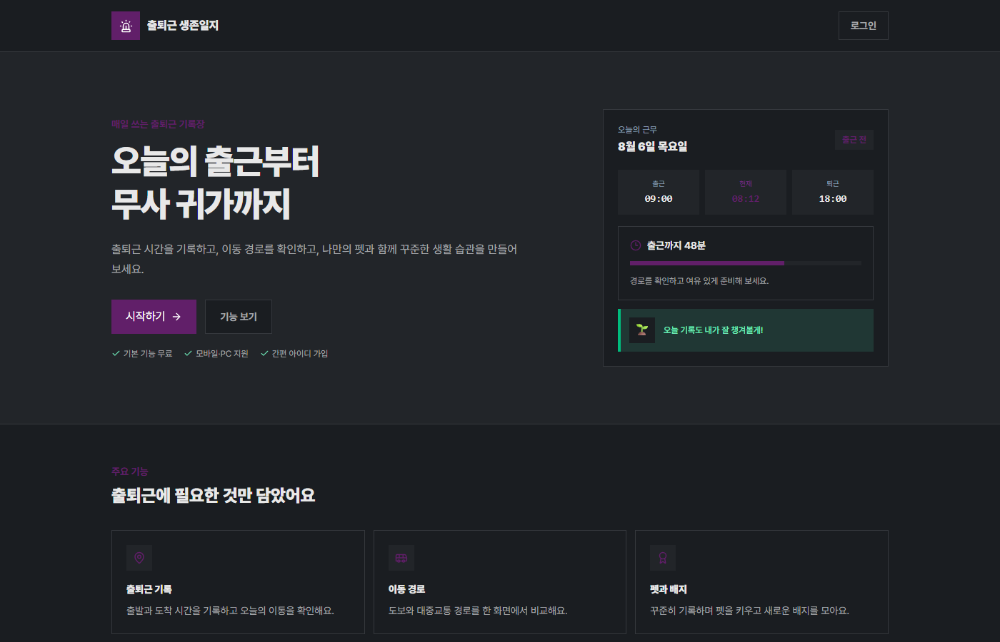
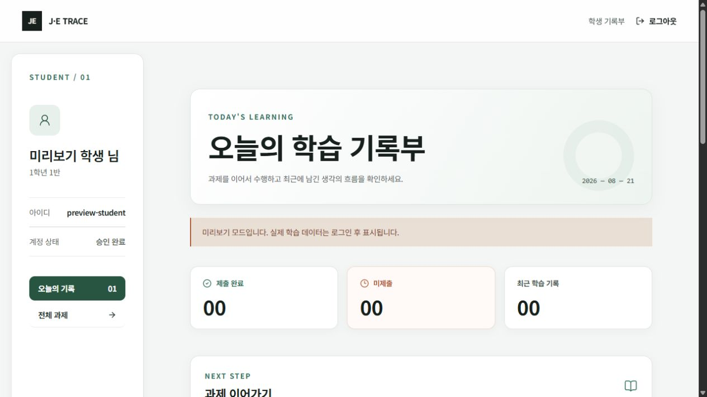

<div align="center">

# 박의혁

### Backend & AI Agent Developer

사용자에게 실제로 닿는 서비스와, **검증 가능한 AI 워크플로우**를 만듭니다.<br>
아이디어를 화면에 옮기는 데서 멈추지 않고 데이터 · 권한 · 테스트 · 배포까지 직접 연결합니다.

[](https://github.com/snail5039-code)
[](mailto:snail5039@gmail.com)
[](https://hyukforge.vercel.app)

**[대표 프로젝트](#대표-프로젝트)** · **[전체 프로젝트](#전체-프로젝트)** · **[기술 스택](#기술-스택)** · **[폴더 구조](#폴더-구조)**

</div>

<br>

> **이렇게 만듭니다**
> - 돈 · 상태가 바뀌는 일은 **본인 확인 → 처리안 → 사용자 승인** 뒤에만 실행하고, 숫자는 LLM이 아닌 코드가 계산합니다.
> - AI 답변은 **출처 원문과 다시 대조**해서, 근거 없는 내용은 지우거나 반려합니다.
> - "잘 되는 것 같다"로 끝내지 않고 **Golden Set · 회귀 테스트**로 같은 사례를 반복 채점합니다.

<br>

## 대표 프로젝트

### 01. 전역도우미 &nbsp;

전역한 사람에게 **받을 수 있는 혜택 · 법적 근거 · 신청할 곳**을 찾아 할 일 목록으로 이어 주는 에이전트

`LangGraph` `RAG · pgvector` `MCP` `FastAPI` `Next.js`


- 법령 · 조례 · 안내서 **10,143조각**을 검색하고, 공공 API(정부24 · 온통청년 등)는 MCP 도구로 연결
- 답변 문장마다 원문과 다시 대조하는 근거 검증 단계
- 규정 검색 84문항 **Hit@6 100%** · 답변 평가 63문항 중 **61문항 통과**

**트러블슈팅**

| 문제 | 원인 | 해결 |
| --- | --- | --- |
| "실업급여" 질문에 고용보험법 조문을 못 찾음 | 벡터 검색이 일상어와 법령 용어("구직급여")를 가깝게 보지 못함 | 일상어를 법령 용어로 바꿔 덧붙이는 용어 사전 추가 |
| 600쪽 안내서가 검색 상위를 독점해 평가가 24/30으로 하락 | 한 문서의 조각이 상위 6개를 다 차지해 법령 근거가 밀려남 | 같은 문서는 2개까지만 남기도록 제한 |

[폴더 보기 →](./ai-agents/jeonyeok-helper) · [원본 저장소 →](https://github.com/snail5039-code/jeonyeok_helper)

<br>

### 02. 자연어 투자 에이전트 &nbsp;

"SK하이닉스 4주 사줘"라고 말하면 **투자 AI 제안 → 검증 AI 원문 대조 → 사용자 승인**을 거친 주문만 증권사로 보내는 앱

`LangGraph` `FastAPI` `pgvector` `Flutter` `KIS 모의투자 API`

- 틀린 제안을 일부러 넣는 평가에서 평균 **19.3 / 20 차단**, 정상 제안 오탐 **0**
- 모의투자로 **AI 자동매매를 매일 운영**하며 판단 로직을 고치는 중 (수익은 아직 없음)

**트러블슈팅**

| 문제 | 원인 | 해결 |
| --- | --- | --- |
| 모의 자동매매 첫날 하락 중인 종목을 사서 손실 | AI가 받는 지표가 PER · PBR · 실적뿐이라 "언제 살지" 볼 근거가 없음 | 추세 · VWAP · 5분 저가 하락 지표를 넣고, 하락 중 매수는 코드가 직접 차단 → 그날 자료로 재현하면 12번 모두 거름 |
| AI가 맞게 쓴 공시 금액을 검사 코드가 9번 반려 | 검사 코드가 공시 표의 금액을 잘못 읽음 | 장 마감 뒤 판단 기록을 다시 보고 검사 코드 수정, 검사가 판단을 막는 것도 버그로 관리 |

[폴더 보기 →](./ai-agents/invest-agent) · [원본 저장소 →](https://github.com/snail5039-code/financial-ai-agent)

<br>

### 03. 가상 금융 업무 에이전트 &nbsp;

말로 요청한 계좌 · 카드 업무를 **본인 확인 → 처리안 → 승인(Human in the Loop)** 을 거쳐 처리하는 에이전트

`LangGraph` `Gemini` `LangSmith` `FastAPI` `Next.js`


- supervisor → 계좌/카드 → 세부 업무 **3단 그래프**, 금액 · 잔액은 Python 함수가 계산
- Golden Set 40개로 답변 · 승인 순서 · 데이터 변경을 함께 채점 → **세 평가 모두 40 / 40**

**트러블슈팅**

| 문제 | 원인 | 해결 |
| --- | --- | --- |
| 처리안을 보여준 뒤 승인 전에 잔액이 바뀔 수 있음 | 처리안 시점의 검사만으로는 실행 시점 잔액을 보장하지 못함 | 승인 뒤 실행 직전에 다시 검사해, 잔액이 부족하면 이체하지 않음 |
| "이번 달 출금 내역" 평가가 내역 없이도 통과 | 실행한 날(10/1)에 따라 데이터가 달라지는데 채점 기준이 느슨함 | "지난 달"로 바꾸고 기준에 건수 · 금액까지 적음 |

[폴더 보기 →](./ai-agents/virtual-bank-agent)

<br>

### 04. 출퇴근 생존일지 &nbsp;

근무 기록부터 정정 · 휴가 · 재택 승인과 월 마감까지 연결한 근태 관리 서비스

`Next.js` `Supabase · PostgreSQL` `Gemini` `Electron`



- 임금에 영향을 주는 계산은 전부 PostgreSQL 함수에 두고 **SQL 회귀 테스트 216개**로 검증
- 기록은 직접 고칠 수 없고, 정정은 다른 사람이 승인해야 하며 감사 로그에 남음

**트러블슈팅**

| 문제 | 원인 | 해결 |
| --- | --- | --- |
| AI 응답이 항상 중간에 끊김 | Gemini가 출력 토큰 500개 중 476개를 보이지 않는 "생각"에 씀 | 생각 예산을 0으로 끄고 출력 토큰 상향 |
| 지도에 경로선이 전혀 안 보임 | 전역 CSS의 `svg {{ max-width: 100% }}`가 카카오맵 SVG 폭을 0으로 만듦 | 리셋에서 `svg`를 빼고 `img`만 남김 |

[폴더 보기 →](./services/commute-battle) · [서비스 열기 →](https://commute-battle.vercel.app)

<br>

### 05. J·E TRACE &nbsp;

학생의 AI 대화와 수정 과정을 기록하고 교사가 피드백하는 교육 플랫폼

`Spring Boot` `React Router` `MySQL` `OpenAI` `Playwright`



- 보안 · 권한을 포함한 저장소 전체 점검 후 백엔드 테스트 **68개**, E2E **45개** 통과

**트러블슈팅**

| 문제 | 원인 | 해결 |
| --- | --- | --- |
| 요청의 사용자 ID만 바꾸면 남의 데이터가 보임 | API가 프론트 `localStorage`의 역할 값만 믿고 응답 | HttpOnly 세션 쿠키 + 경로별 역할 검사, 사용자 ID는 세션 값으로 강제 |
| 비밀번호가 평문으로 저장됨 | 초기 구현에 해시 처리가 없었음 | BCrypt로 저장하고, 기존 계정은 로그인할 때 해시로 바꿔 저장 |

[폴더 보기 →](./ai-apps/je-trace)

<br>

> 수치와 상태는 각 저장소의 README · 테스트 기록 · 배포 결과를 기준으로 적었습니다.

## 전체 프로젝트

#### AI 에이전트

| 프로젝트 | 한 줄 소개 | 상태 |
| --- | --- | :--: |
| [전역도우미](./ai-agents/jeonyeok-helper) | 전역자 혜택을 법령 근거와 함께 안내하는 RAG + MCP 에이전트 |  |
| [자연어 투자 에이전트](./ai-agents/invest-agent) | 제안 · 검증 · 승인을 분리한 투자 에이전트와 모의 자동매매 |  |
| [가상 금융 업무 에이전트](./ai-agents/virtual-bank-agent) | 계좌 · 카드 업무를 승인 흐름으로 처리하는 LangGraph 에이전트 |  |
| [고객 VOC 분석](./ai-agents/n8n-voc-analysis) | n8n 문의 분류 · 감정 분석 · 긴급 알림 자동화 |  |
| [금융 뉴스 브리핑](./ai-agents/n8n-finance-news-briefing) | n8n 금융 뉴스 수집 · 중복 제거 · 요약 · 발송 자동화 |  |

#### AI · 데이터 응용

| 프로젝트 | 한 줄 소개 | 상태 |
| --- | --- | :--: |
| [온열질환자 수 예측](./ai-apps/heatwave-risk-ml) | 기상 자료로 전국 일일 온열질환자 수를 예측하는 ML 대시보드 | [](https://web-wine-one-11.vercel.app/) |
| [J·E TRACE](./ai-apps/je-trace) | AI 대화와 수정 과정을 남기는 교육 기록 플랫폼 |  |
| [GestureOS](./ai-apps/gesture-os) | 손 제스처로 Windows 입력 · PPT · 그리기를 제어하는 시스템 |  |

#### 서비스 · 제품

| 프로젝트 | 한 줄 소개 | 상태 |
| --- | --- | :--: |
| [HyukForge](./services/hyukforge) | 직접 만든 제품 · 릴리스 · 개발 기록을 운영하는 1인 소프트웨어 스튜디오 | [](https://hyukforge.vercel.app) |
| [출퇴근 생존일지](./services/commute-battle) | 근무시간 산정, 승인 라인, 월 마감을 갖춘 근태 관리 서비스 | [](https://commute-battle.vercel.app) |
| [LastCall](./services/lastcall) | 주변 응급실 · AED를 찾는 모바일 앱 (AWS EC2 운영 후 중단) | [](https://github.com/snail5039-code/lastcall/releases/tag/v1.0.0-rc4)  |
| [커리마](./services/curima) | 가계부 · 할 일 · 일정 · PC 작업을 자연어로 처리하는 개인비서 CLI | [](https://github.com/snail5039-code/personal-financial-management/releases/tag/v1.1.0-installer) |
| [WorkLog](./services/worklog) | 업무 기록을 보고서 · 인수인계 · 팀 협업으로 연결하는 서비스 |  |
| [나만의 작은 맛집](./services/my-little-restaurant) | 맛집 저장 · 리뷰 · 소셜 로그인 웹 서비스 | [](https://my-little-restaurant.vercel.app) |

학습 기록 : [AI Agent 학습 저장소](https://github.com/snail5039-code/aim-ai-agent-my) · [TIL](https://github.com/snail5039-code/TIL)

## 기술 스택

| 영역 | 주로 쓰는 기술 |
| --- | --- |
| **AI · Agent** | LangGraph, RAG(pgvector), MCP, LangSmith, Gemini · OpenAI |
| **Backend** | Python · FastAPI, Java · Spring Boot |
| **Frontend · Mobile** | Next.js · React · TypeScript, React Native, Flutter |
| **Data · Infra** | PostgreSQL · Supabase, MySQL, Docker, AWS EC2, Vercel |
| **Test** | Pytest, JUnit, Playwright, SQL 회귀 테스트 |

## 폴더 구조

```text
portfolio/
├── ai-agents/      전역도우미, 자연어 투자 에이전트, 가상 금융 업무 에이전트, n8n 자동화 2개
├── ai-apps/        온열질환자 수 예측, J·E TRACE, GestureOS
└── services/       HyukForge, 출퇴근 생존일지, LastCall, 커리마, WorkLog, 맛집
```

각 폴더는 별도 저장소의 최신 시점을 옮긴 스냅샷이며, 비밀키와 환경 변수는 포함하지 않습니다.<br>
**개발 중** 프로젝트는 원본 저장소가 계속 바뀌므로 최신 내용은 원본 저장소 링크에서 확인할 수 있습니다. · [커밋 규칙](./COMMIT_CONVENTION.md)

---

<div align="center">

[GitHub](https://github.com/snail5039-code) · [Email](mailto:snail5039@gmail.com) · [HyukForge](https://hyukforge.vercel.app)

</div>
