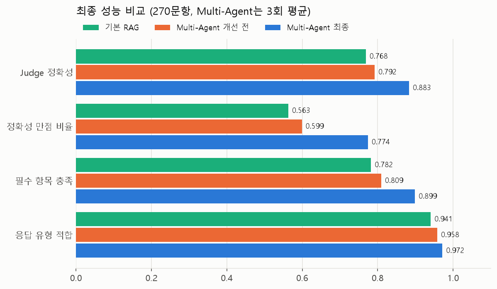
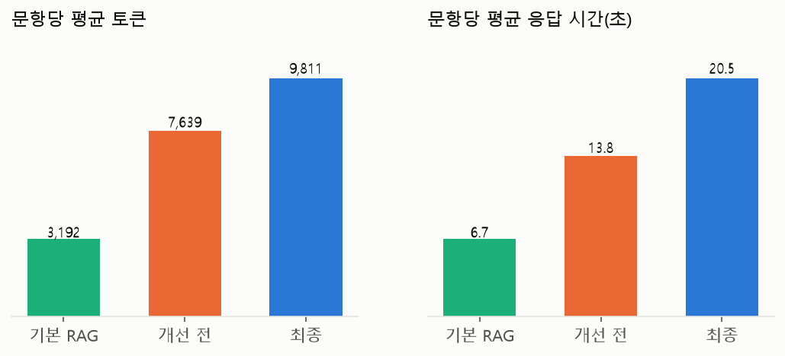
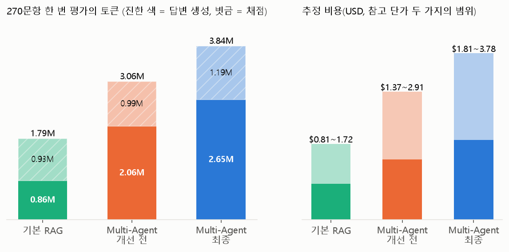
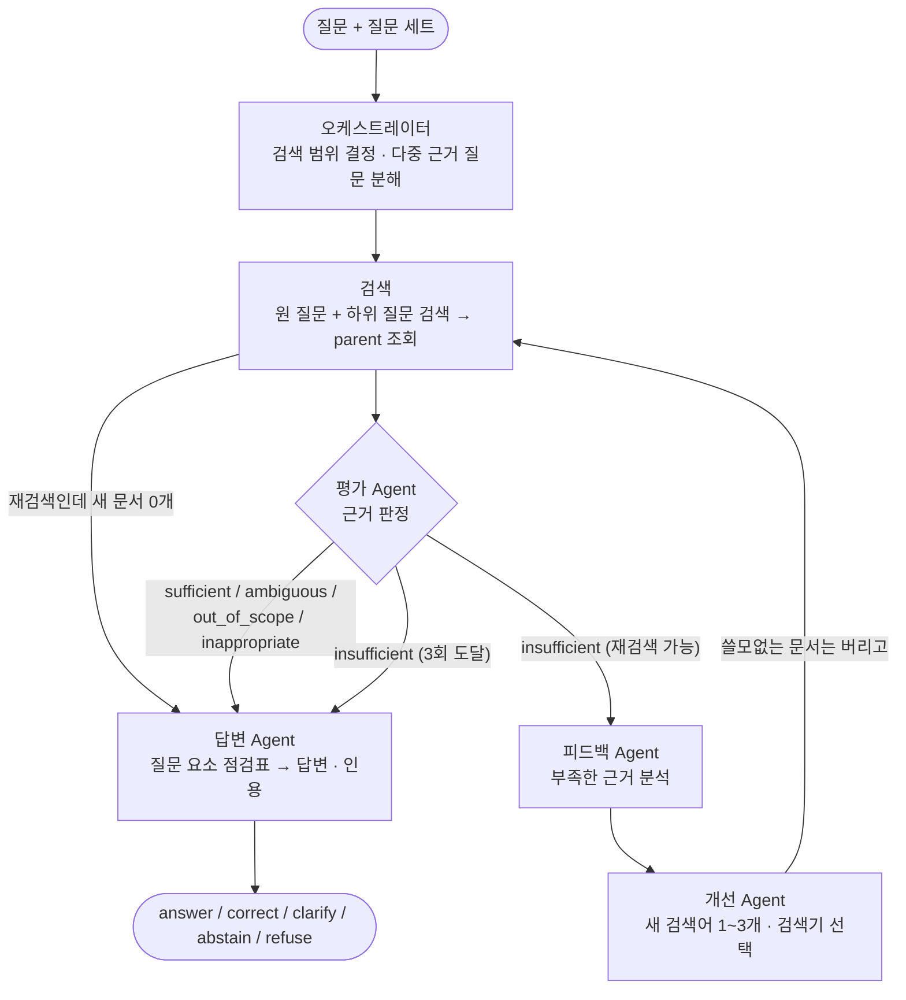
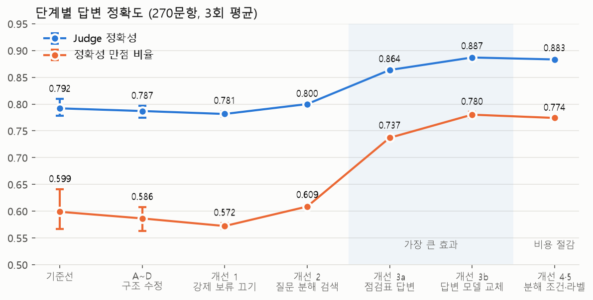
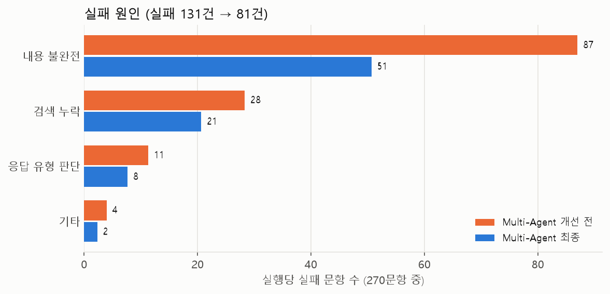

# 금융 문서 기반 Multi-Agent RAG

금융 PDF 23개(490쪽)를 검색 가능한 데이터로 가공하고, 여러 Agent가 검색 결과를 평가·보완해 근거(파일명·PDF 페이지)가 있는 한국어 답변을 만드는 프로젝트입니다.

## 결과 요약

> **Multi-Agent RAG의 답변 정확도를 0.792 → 0.883으로 올렸습니다.** 정확성 만점 비율은 0.599 → 0.774, 실패 문항은 131건 → 81건입니다.

270문항(제공 180 + 팀 골든셋 90), 같은 설정을 3회 실행한 평균, LLM Judge(`gemini-3.8-flash`) 채점입니다.



| 지표 | 기본 RAG | Multi-Agent (개선 전) | **Multi-Agent (최종)** |
|---|---:|---:|---:|
| Judge 정확성 (0~1) | 0.769 | 0.792 | **0.883** |
| 정확성 만점 비율 | 0.563 | 0.599 | **0.774** |
| 필수 항목 충족 | 0.782 | 0.809 | **0.899** |
| 응답 유형 적합 (완화) | 0.941 | 0.958 | **0.972** |
| 근거 충실성 | 0.996 | 0.996 | 0.996 |
| 평균 토큰 / 응답 시간 | 3,192 / 6.7초 | 7,639 / 13.8초 | 9,811 / 20.5초 |

- 최종 Multi-Agent의 세트별 Judge 정확성은 **제공 180: 0.914**, **팀 골든셋 90: 0.822**입니다. 처음 보는 질문에 가까운 팀 골든셋 수치를 최종 성능으로 봅니다.
- **정원하의 v7과 같은 기준으로 비교한 결과**(팀 골든셋 90문항): 엄격 채점(judge_v1) 0.794 → **0.822**, 완화 채점(judge_v2, 질문이 직접 묻는 핵심만 반영) 0.961 → **0.967**. 같은 채점 모델·같은 문항이며, 구조 개선이 더해진 만큼 조금 높습니다. 기본 RAG는 0.694 → 0.706(엄격), 0.917 → 0.911(완화)로 사실상 같습니다. 완화 기준에서는 Multi-Agent 최종이 전체 270문항에서 **0.977**(기본 RAG 0.941)입니다.
- 개선의 대부분은 **답변 Agent가 질문 요소 점검표를 먼저 쓰게 한 것**(+0.064)과 **답변 모델 교체**(+0.023)에서 나왔습니다. 과정은 [6장](#6-개선-과정)에 있습니다.
- 지어낸 내용은 거의 없습니다(충실성 0.996). 남은 감점은 대부분 "핵심은 맞지만 단서·예외 항목 하나가 빠진" 경우입니다.
- 대신 문항당 비용이 기본 RAG의 약 3배입니다(아래 그림). 정확도가 중요한 금융 상담에서는 감수할 만하다고 판단했습니다.



### 토큰·비용 (채점 포함)

270문항을 한 번 평가하는 데 드는 토큰입니다. 답변 생성과 **채점(LLM Judge)** 을 따로 적었고, Multi-Agent는 3회 평균입니다.



| | 기본 RAG | Multi-Agent (개선 전) | Multi-Agent (최종) |
|---|---:|---:|---:|
| 답변 생성 입력 / 출력 토큰 | 80.5만 / 5.7만 | 192.5만 / 13.7만 | 241.7만 / 23.2만 |
| 채점(Judge) 입력 / 출력 토큰 | 86.3만 / 6.9만 | 92.4만 / 6.9만 | 112.2만 / 6.9만 |
| **합계** | **179만** | **306만** | **384만** |
| 추정 비용 (USD) | $0.81 ~ 1.72 | $1.37 ~ 2.91 | $1.81 ~ 3.78 |
| 문항당 모델 호출 (답변 생성) | 1.0회 | 2.4회 | 2.8회 |

- **추정 비용은 참고용입니다.** 이 프로젝트의 모델(`gemini-3.6/3.7/3.8-flash`) 단가표를 확인하지 못해, 같은 계열 모델의 단가 두 가지(100만 토큰당 입력/출력 $0.30/$2.50와 $0.75/$3.75)로 범위를 잡았습니다. 응답 본문 토큰만 기록해 모델의 생각(thinking) 토큰은 빠져 있으므로 실제 청구액은 더 클 수 있습니다. 정확한 금액은 결제 내역에서 확인하세요.
- **최종 버전이 개선 전보다 채점 토큰도 늘었습니다**(92만 → 112만). 점검표 덕분에 답변이 길어져 Judge가 읽을 양이 늘었기 때문입니다. 정확도가 더 필요하면 비용이 함께 늘어나는 구조입니다.
- **프로젝트 전체 사용량**(저장소에 기록된 모든 실행 67개와 채점 65개, 정원하 브랜치의 실험 포함): 답변 생성 입력 9,251만 + 출력 801만 토큰, 채점 입력 4,826만 + 출력 330만 토큰, 합계 약 1.5억 토큰(추정 $70 ~ 148). 채점이 전체의 약 1/3을 차지합니다.
- 추출 단계의 Gemini Vision 비용(약 $0.25 ~ 0.49)은 1장에 있고, 위 표에는 포함하지 않았습니다.

## 문서

| 문서 | 내용 |
|---|---|
| [기획서.md](./기획서.md) | 목표, 역할, 평가 체계 (기획 단계) |
| [docs/report.md](./docs/report.md) | **정원하의 실험 보고서**: 청킹·검색 비교, 답변 실험 v1~v11, 완화 채점(judge_v2), 골든셋 결과 |
| [docs/how_to_run.md](./docs/how_to_run.md) | 실행 방법: 환경 준비부터 RAG 실행·채점까지 |
| [docs/pipeline.md](./docs/pipeline.md) | 파이프라인 상세 설계: 스키마, 근거 ID 매핑, 실행 기록 형식 |
| [docs/agent_graph.md](./docs/agent_graph.md) | Multi-Agent 그래프의 노드·종료 조건·공통 상태 |
| [docs/agent_fixes_1022.md](./docs/agent_fixes_1022.md) | **구조 문제 원인 분석과 개선 1~3의 측정 결과** |
| [docs/eval_changes_log.md](./docs/eval_changes_log.md) | 프롬프트 수정 시도(P1·P2·P3)와 변동 폭 측정 |
| [docs/guardrail_review_1021.md](./docs/guardrail_review_1021.md) | 안정성·가드레일 검토, [적대적 문항](./docs/adversarial_set_1022.md) |
| [team_golden_set/README.md](./team_golden_set/README.md) | 팀 골든셋 구성과 검수 방법 |
| [docs/handoff.md](./docs/handoff.md) | 인수인계: 환경 준비(pgvector 설치 포함), 평가 실행 |

## 역할 분담

| 담당 | 역할 | 결과물 |
|---|---|---|
| 박의혁 | PDF 추출 및 검수 | `extraction/`, `04_extracted/` |
| 정원하 | 파이프라인 설계, 청킹·임베딩, 검색 평가, 기본 RAG·Multi-Agent RAG | `docs/pipeline.md`, `rag/`, `scripts/`, `db/` |
| 한용님 | 골든셋 작성·검수, 답변 품질·경로 평가, 실패 분석과 개선, 안정성·가드레일 | `team_golden_set/`, `adversarial_set/`, `scripts/eval_*.py`, `scripts/analysis/`, `docs/eval_*.md` |

## 전체 구조


| 단계 | 시점 | 하는 일 |
|---|---|---|
| ① 인덱싱 | 설정이 바뀔 때만 | 추출 JSONL을 parent(구조 단위)와 child(작은 단위)로 나누고, child만 임베딩해 PostgreSQL에 저장 |
| ② 질의 실행 | 문항마다 | Multi-Agent가 질문을 나눠 검색하고, 근거가 충분한지 평가하고, 답변 |
| ③ 기록·평가 | 실행 후 | 실행 기록을 저장하고 채점한 뒤, 실패 원인을 분석해 한 요소만 바꿔 재평가 |

**폴더**

| 경로 | 내용 |
|---|---|
| `01_data/` | 원문 PDF 23개 |
| `02_questions/`, `03_answers/` | 제공 질문 180개와 기준 답안 |
| `extraction/`, `04_extracted/` | PDF 추출 코드와 결과(`extracted_pages.jsonl`) |
| `rag/` | 청킹, 임베딩, 검색기, 기본 RAG, Multi-Agent RAG, 가드레일 |
| `scripts/` | 실행 순서대로 쓰는 파이프라인: `init_db` → `build_chunks` → `load_chunks` → `eval_retrieval` → `run_rag` → `eval_judge`(`eval_ragas`, `eval_trajectory`) |
| `scripts/analysis/` | 결과 분석: 실패 원인(`analyze_failures`), 실행 비교(`compare_*`, `variance`), 재채점(`rescore_*`) |
| `scripts/figures/` | README·문서의 그림 생성 (저장된 결과만 읽음, LLM 호출 없음) |
| `scripts/dev/` | 개발 중 빠른 확인용 (`check_retrieval`, `compare_quick`) |
| `tests/` | 가짜 LLM 테스트 (API 비용 없음, 로컬 DB 필요) |
| `db/schema.sql` | PostgreSQL + pgvector 스키마 |
| `06_results/` | 검색 평가(`retrieval/`), RAG 실행 기록(`rag/`), 채점·분석 결과(`eval/`) |
| `team_golden_set/` | 팀 골든셋 90문항, 검수 결과, 생성 코드(`builders/`) |
| `adversarial_set/` | 가드레일 측정용 적대적 문항 36개와 생성 코드 |

**질문 세트**

| 세트 | 제공 문항 | 팀 골든셋 | 검색 범위 |
|---|---|---|---|
| 기본 positive | POS001~060 | POS091~120 | 금융용어집 + 표준약관 |
| 기본 negative | NEG001~040 | NEG041~060 | 금융용어집 + 표준약관 |
| 금융생활 | POS061~080 | POS081~090 | 금융생활 가이드북 |
| 추가 문서 | ADD-*01~10 | ADD-*11~15 | 추가 PDF 6개 |

질문과 기준 답안은 검색 DB와 프롬프트에 넣지 않습니다. 세트마다 검색 범위를 `file_name` 필터로 강제합니다.

## 1. PDF 추출

**담당: 박의혁**

| 문서 | 특징 | 방식 |
|---|---|---|
| 표준약관 15개, 용어집 | 1단 텍스트 | `pdfplumber` 페이지 전체 |
| 금융생활 가이드북 | 책 2쪽이 PDF 1쪽에 들어간 펼침면 | `RapidLayout` 영역별 |
| 추가 PDF 6개 | 2단 편집, 표·차트 다수 | `RapidLayout` 영역별 |

```text
페이지 렌더링 → RapidLayout으로 text·title·table·chart·image 영역 탐지
 → 글: pdfplumber 글자 배정, 텍스트 레이어가 없으면 RapidOCR
 → 표: pdfplumber 표 → 실패 시 RapidTable → 그래도 실패하면 Vision
 → 차트·큰 그림: Gemini Vision(gemini-3.5-flash)으로 텍스트화
 → 워터마크 제거 후 페이지별 JSONL 저장
```

- 결과: PDF 23개, 490쪽 → 블록 3,277개. 추출 약 18분(CPU). Gemini Vision 296회 호출, 비용 약 $0.25~$0.49.
- `page_no`는 PDF 실제 쪽 순서(1부터)로, 기준 답안의 `source_pages`와 같은 기준입니다.
- 알려진 추출 오류 후보(재검증 필요): 주택 정책금융 21쪽 표 각주, 퇴직연금 23쪽 표 숫자, 퇴직연금 17쪽 차트 값.

## 2. 청킹·임베딩

**담당: 정원하** · 상세: [docs/pipeline.md 1장](./docs/pipeline.md#1-인덱싱-파이프라인)

핵심은 **Parent-Child**입니다. 작은 child(약 300자, 겹침 60)로 검색해 정밀도를 높이고, `parent_id`로 근거가 포함된 구조 단위(조항, 소제목 문단, 용어 정의)를 통째로 가져와 답변 Agent가 읽습니다.

- 모든 청크에 기준 답안과 같은 형식의 `source_ids`를 붙여, 청킹 방식을 바꿔도 같은 정답 ID로 채점합니다.
- 임베딩 `gemini-embedding-2`(1536차원), 기준 실험 `parent_child_300_60__gemini-embedding-2_1536`.

## 3. 데이터베이스와 검색

**PostgreSQL + pgvector**에 청크, parent 원문, 임베딩, 실행 기록, 평가 결과를 저장합니다([db/schema.sql](./db/schema.sql)).

| 검색기 | 구현 (`rag/retrieval.py`) |
|---|---|
| Vector | pgvector cosine 거리. 세트별 범위 필터와 함께 **정확 검색**(HNSW 인덱스는 범위 필터와 쓰면 결과가 누락돼 끔, [원인](./docs/agent_fixes_1022.md#a-범위-검색-누락-검색-버그)) |
| BM25 | Kiwi 토큰화, 메모리 인덱스 |
| Hybrid | Vector와 BM25 순위를 RRF로 결합 |

**검색 평가** (제공 positive 140문항, 범위 필터 없음)

| 실행 | child MRR | child Hit@5 | child Recall@5 | parent Recall@5 |
|---|---:|---:|---:|---:|
| **Parent-Child 300/60 · Vector** | **0.885** | **0.993** | **0.840** | **0.901** |
| Parent-Child 300/60 · Hybrid | 0.854 | 0.957 | 0.818 | 0.878 |
| Recursive 300/60 · Hybrid | 0.786 | 0.921 | 0.780 | - |
| Recursive 1000/60 · Vector | 0.684 | 0.829 | 0.694 | - |
| Parent-Child 300/60 · BM25 | 0.662 | 0.807 | 0.670 | 0.723 |

기준 설정은 **Parent-Child 300/60 + Vector**입니다. 추가 PDF 세트는 Hybrid가 조금 높아, 재검색 때 개선 Agent가 `vector`와 `hybrid` 중에서 고릅니다.

## 4. Multi-Agent RAG

**담당: 정원하(설계·구현), 한용님(개선)** · 구현: `rag/multi_agent.py` (LangGraph)



| 노드 | 종류 | 하는 일 |
|---|---|---|
| 오케스트레이터 | 코드 + LLM | 세트별 검색 범위 결정. 서로 다른 근거가 필요한 질문이면 하위 질문 검색어 0~2개 생성 |
| 검색 | 코드 | 검색어별 child 8개 → parent 조회(검색어당 최대 5), 검색어별 순위를 번갈아 담아 문맥 최대 8 parent |
| 평가 Agent | LLM | 질문 + 문서 → `sufficient` / `insufficient` / `ambiguous` / `out_of_scope` / `inappropriate`, 쓸 문서 번호 |
| 피드백·개선 Agent | LLM | 부족 원인 분석 → 새 검색어. 재검색 전에 평가가 고른 문서만 남겨 새 근거가 들어갈 자리를 만듦 |
| 답변 Agent | LLM (`gemini-3.7-flash`) | 질문 요소 점검표(요소별 근거·조건·예외)를 먼저 쓰고 모든 요소에 답함. 보류·되묻기 시 필요한 정보·이유·확인처 안내 |

- 생성 모델은 `gemini-3.6-flash`, 답변 Agent만 `gemini-3.7-flash`입니다(`rag/config.py`, `ANSWER_MODEL`).
- 종료 조건: 평가가 `insufficient`가 아님, 검색 3회 도달, 재검색에서 새 문서 0개.
- 응답 유형: `answer`·`correct`(근거로 답하거나 잘못된 전제를 정정), `clarify`(대상이 특정되지 않음), `abstain`(문서로 확인 불가), `refuse`(개인 맞춤 추천, 규정 우회, 기만, 인젝션). 평가가 `inappropriate`·`ambiguous`이면 코드가 `refuse`·`clarify`로 고정합니다.

**공통 미들웨어**

| 위치 | 역할 |
|---|---|
| 입력 | 세트별 검색 범위 강제, 빈 질문·2,000자 초과는 LLM 없이 안내 (`rag/guardrail.py`) |
| 검색 | 이미 쓴 검색어 차단, 라운드당 검색어 최대 3개, 문맥 최대 8 parent |
| 출력 | 인용 번호 검증(`invalid_citations`), 인용 없는 답변·개인정보 패턴·투자 권유 표현을 `guardrail_flags`에 기록 |
| 오류 대응 | 인증·결제 오류(401·402·403)는 즉시 중단, 구조화 출력 파싱 실패는 1회 재호출 (`rag/llm.py`) |
| 대체 경로 | 임베딩 실패 → BM25, 평가·피드백·개선 실패 → 현재 문맥으로 답변, 답변 실패 → 안전 응답. `degraded`로 표시하고 점수에서는 실패로 셈 |
| 기록 | 문항별 trace·사용량을 PostgreSQL과 `06_results/rag/*.jsonl`에 저장 |

문서 본문과 질문 속 지시문(이전 지시 무시, 출처 바꾸기 등)은 따르지 않도록 지시 영역과 문서 영역을 분리합니다.

## 5. 평가 방법

**골든셋·평가 담당: 한용님**

| 구분 | 확인 내용 | 방법 |
|---|---|---|
| 검색 | 정답 근거를 상위 결과에서 찾았는가 (Hit@k, Recall@k, MRR) | 코드, child·parent 단계 |
| 응답 유형 | 기대 행동과 맞는가 | 코드. **완화**(허용 유형 안)를 주 지표로, 엄격(첫 유형과 일치)은 참고 |
| 인용 | 받은 문맥·인용에 정답 근거가 있는가 | 코드 |
| 답변 | 정확성(0~2), 필수 항목 충족, 금지 내용 위반, 근거 충실성 | LLM Judge (`scripts/eval_judge.py`) |
| 경로 | 불필요한 재검색, 헛된 재검색 | 코드 지표 + AgentEvals (`scripts/eval_trajectory.py`) |
| 효율 | 모델 호출·토큰·응답 시간 | 실행 기록 집계 |

- **반복 실행**: 같은 코드도 실행마다 점수가 흔들립니다(Judge 정확성 ±0.03). 변경 효과는 270문항 3회 평균이 이 범위를 넘을 때만 인정합니다.
- **엄격 점수를 주 지표로 쓰지 않는 이유**: `answer`와 `correct`의 구분이 실행마다 흔들립니다. 최종 버전의 엄격 점수는 0.68로 개선 전(0.83)보다 낮은데, 점검표 규칙 때문에 `answer` 기대 문항에 `correct`를 붙이는 경우가 늘었기 때문입니다(실행당 32 → 73건). 완화 기준 실패는 오히려 줄었습니다.
- 팀 골든셋은 제공 세트와 따로 집계합니다. 제공 세트는 개선 과정에서 반복해서 봤으므로 팀 골든셋이 최종 성능에 더 가깝습니다.

## 6. 개선 과정



| 단계 | 바꾼 것 | Judge 정확성 | 만점 비율 | 평균 토큰 | 판정 |
|---|---|---:|---:|---:|---|
| 기준선 | Multi-Agent 초기 버전 | 0.792 | 0.599 | 7,639 | |
| P1·P2·P3 | 답변·평가 프롬프트 문구 수정 6번 | 변동 범위 안 | | -8% | 정확성 효과 없음 ([기록](./docs/eval_changes_log.md)) |
| A~D | 범위 검색 누락 버그, 재검색 문맥 정리, 종료 조건, 응답 유형 결정 | 0.787 | 0.586 | 7,312 | 답할 수 없는 질문에 답함 6.7 → 2.0건 |
| 개선 1 | 효과 없던 강제 보류 전환 끄기 | 0.782 | 0.572 | 7,549 | 중립, 정리 |
| 개선 2 | 다중 근거 질문 분해 검색 | 0.800 | 0.609 | 9,743 | 검색 누락 24 → 18건, 비용 +29% |
| 개선 3a | 답변 Agent에 질문 요소 점검표·보류 안내 규칙 | 0.864 | 0.737 | 10,221 | **가장 큰 효과** |
| 개선 3b | 답변 모델 → `gemini-3.7-flash` | 0.887 | 0.780 | 10,282 | |
| **개선 4·5** | 80자 미만 질문은 분해 생략, `answer`/`correct` 기준 명시 | **0.883** | **0.774** | **9,811** | **최종** (정확성은 변동 범위 안, 비용 -4.6%·시간 -10.5%) |

실패 원인별로 보면, 가장 컸던 "내용 불완전"이 87건에서 51건으로 가장 많이 줄었습니다.



배운 점:
- **프롬프트에 지시 한 줄을 더하는 방식은 효과가 없었고, 구조를 바꾼 것이 효과가 있었습니다.** 답변 완전성은 "빠짐없이 쓰라"는 지시(P1)로는 오르지 않았습니다. 반면 답하기 전에 질문 요소와 근거를 **출력 구조로 먼저 쓰게 하자**(3a) +0.064가 올랐습니다. 이 규칙은 정원하 브랜치(`feature/chunking-retrieval`)의 v4·v5에서 가져왔습니다.
- **원인을 프롬프트가 아니라 코드와 실행 기록에서 찾아야 했습니다.**
  - 추가 PDF 범위의 벡터 검색은 무작위 질의 300개 중 134개가 0건을 반환했습니다. HNSW 인덱스와 범위 필터를 함께 쓴 탓입니다.
  - 재검색 22문항 중 9문항은 문맥이 이미 꽉 차서 새 근거가 들어가지 못했습니다.
  - 상세: [docs/agent_fixes_1022.md](./docs/agent_fixes_1022.md)
- **실패 문항만 골라 테스트하면 효과가 과대평가됩니다.** A~D는 실패 위주 38문항에서 엄격 점수가 +0.13 올랐지만, 270문항에서는 변동 범위 안이었습니다.

## 7. 안정성·가드레일

상세: [docs/guardrail_review_1021.md](./docs/guardrail_review_1021.md), [docs/adversarial_set_1022.md](./docs/adversarial_set_1022.md)

| 구분 | 막는 문제 | 검증 |
|---|---|---|
| 오류 구분·재시도 | 결제 오류 뒤에도 계속 호출(실제로 크레딧 소진으로 52문항 실패), 파싱 실패 한 번에 질문 실패 | 가짜 클라이언트 테스트 8개, 실제 402에서 즉시 중단 확인 |
| 대체 경로 | 노드 하나의 실패가 질문 전체 실패로 번짐 | 오류 주입 테스트 14개, 실제 모델 25문항에서 기본 RAG 수준 유지 |
| 입력 검증·출력 검사 | 빈 질문·과도한 길이, 인용 없는 답변·개인정보·투자 권유 표현 | 단위 테스트 24개, 기준선 270문항 소급 적용 신호 0건 |
| 적대적 문항 36개 | 인젝션, 내부 정보 빼내기, 개인정보, 권유·기만 우회 | 지시를 따르거나 비밀을 노출한 문항 0건, 정상 질문 오거절 0건(Multi-Agent) |

적대적 문항 측정은 개선 전 코드 기준이고, 36문항이라 방향성만 봅니다.

## 8. 보완할 점

| # | 보완할 점 | 이렇게 수정합니다 |
|---|---|---|
| 1 | 채점을 사람 기준으로 확인 | `06_results/eval/judge_calibration_sample.md` 30문항에 사람 판단을 채워 Judge와의 일치율을 내고, 낮은 항목은 기준표를 고쳐 다시 채점합니다. Claude 교차 채점에서는 편향이 보이지 않았습니다([상세](./docs/agent_fixes_1022.md#8-남은-과제-처리-결과)) |
| 2 | 팀 골든셋 원문 검수 | `team_golden_set/verification/`의 "PDF 원문 확인" 칸을 채우고, 핵심/부가 분류 오분류 후보 19개([목록](./06_results/eval/must_include_core_review.md))를 사람이 확정해 점수를 다시 집계합니다 |
| 3 | 추출 오류 수정 | 주택 정책금융 21쪽, 퇴직연금 23쪽·4쪽 표의 해당 블록만 고치고 그 문서만 다시 적재한 뒤, 270문항 3회로 새 기준선을 잡습니다([상세](./docs/extraction_check_1022.md)) |
| 4 | 답변 누락(실패의 절반 이상) | 점검표 단계에서 단서·예외를 더 찾게 하고, 그래도 빠지는 문항에는 답변 뒤 누락 점검 단계를 둡니다(근거가 여러 개인 문항에만 적용해 비용 억제) |
| 5 | 다중 근거 질문의 검색 누락 | `child_k` 8→12, `max_parents` 5→7을 비교하고 분해 검색어를 다듬습니다 |
| 6 | 비용(기본 RAG의 약 3배) | 쉬운 질문(첫 검색으로 충분한 경우)은 평가 호출을 건너뛰는 경로를 둡니다 |
| 7 | `answer`/`correct` 라벨 흔들림 | 허용 유형을 정리하고, 완화 점수를 주 지표로 유지합니다 |
| 8 | 가드레일 재측정 | 최종 코드로 적대적 문항 36개를 다시 돌려 취약점이 없는지 확인합니다 |
| 9 | 정원하 브랜치 병합 | `feature/chunking-retrieval`을 현재 `main` 기준으로 맞춰 충돌 4개 파일(`rag/multi_agent.py` 등)을 정리합니다 |

## 실행 방법

PostgreSQL에 pgvector 확장이 필요합니다. `.env`에 `GEMINI_API_KEY`와 `POSTGRES_USER` / `POSTGRES_PASSWORD` / `POSTGRES_DB`(또는 `DATABASE_URL`)를 설정합니다.

```bash
pip install -r requirements.txt

# 1. 인덱싱 (추출 결과는 04_extracted/에 있음)
python scripts/init_db.py
python scripts/build_chunks.py
python scripts/load_chunks.py --method parent_child_300_60

# 2. 검색 평가
python scripts/eval_retrieval.py --experiments parent_child_300_60

# 3. RAG 실행 (--golden both: 제공 + 팀 골든셋)
python scripts/run_rag.py --pipeline basic --golden both
python scripts/run_rag.py --pipeline multi --golden both --workers 12

# 4. 채점·분석
python scripts/eval_judge.py --run <run_id> --workers 12
python scripts/analysis/analyze_failures.py --runs 라벨=<run_id>
python scripts/analysis/compare_fixes.py --before <run_id> ... --after <run_id> ...
python scripts/figures/make_final_figures.py   # README 그림 (저장된 결과만 사용)

# 5. 테스트 (가짜 LLM, API 비용 없음, 로컬 DB 필요)
python tests/test_agent_fixes.py
python tests/test_g1_fault_tolerance.py
python tests/test_g2_fallback.py
python tests/test_gr_guardrail.py
```

PDF를 다시 추출할 때만 `extraction/extract_pdfs.py` → `vision_fill.py` → `report.py` 순서로 실행합니다.
