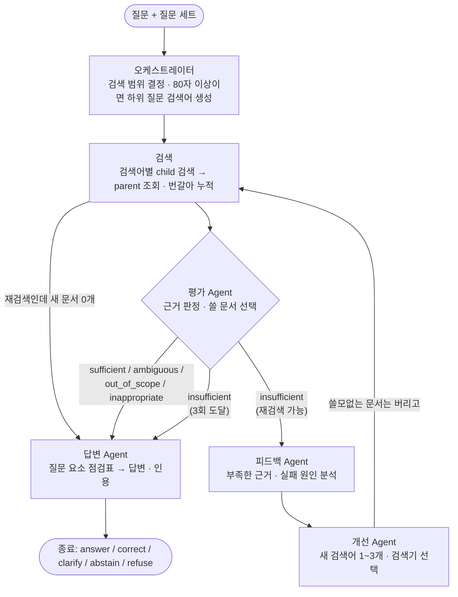

# Multi-Agent RAG 그래프 구조

구현: [`rag/multi_agent.py`](../rag/multi_agent.py) (LangGraph). 기본 RAG와의 비교 기준선은 [`rag/basic_rag.py`](../rag/basic_rag.py)입니다.
현재 구성은 정원하의 v7(답변 Agent의 질문 요소 점검표·보류 안내 규칙, 모델 `gemini-3.7-flash`)에 구조 개선 A~D와 개선 1~5를 더한 것입니다. 버전별 결과는 [report.md](report.md)(정원하), [agent_fixes_1022.md](agent_fixes_1022.md)(구조 개선)를 보세요.

## 노드

| 노드 | 종류 | 입력 → 출력 |
|---|---|---|
| 오케스트레이터 | 코드 + LLM | 질문 세트 → 검색 범위(`file_name` 목록), 반복 횟수·사용량 초기화. 질문이 80자 이상이면 서로 다른 근거가 필요한 하위 질문 검색어 0~2개 생성(분해 실패 시 원 질문만 검색) |
| 검색 | 코드(도구) | 검색어 목록 → child 검색(top 8, 범위 필터와 함께 **정확 검색**), parent 조회(검색어당 최대 5), 검색어별 순위를 번갈아 담아 누적 문맥 최대 8 parent. 재검색 전에 평가가 고른 문서만 남김 |
| 평가 Agent | LLM | 질문 + 누적 문서 → `sufficient` / `insufficient` / `ambiguous` / `out_of_scope` / `inappropriate`, 쓸 문서 번호, 부족한 정보 목록 |
| 피드백 Agent | LLM | 평가 결과 + 사용한 검색어 + 검색된 제목 → 부족 원인, 찾아야 할 근거 |
| 개선 Agent | LLM | 피드백 → 새 검색어 1~3개, 검색기(`vector` / `hybrid`) |
| 답변 Agent | LLM (`gemini-3.7-flash`) | 질문 + 문서 + 평가 → ① 질문 요소 점검표(요소별 근거: 조건·기한·예외·미이행 시 결과) ② 응답 유형, 답변, 인용 문서 번호. 평가가 `inappropriate`·`ambiguous`이면 코드가 `refuse`·`clarify`로 고정. 보류·되묻기·거절 때는 빠진 정보, 확인할 수 없는 이유, 확인할 곳을 적음 |

답변 검토 Agent(정원하 v6)는 실험에서 효과가 없고 토큰이 +47%라 구현에 포함하지 않았습니다.

## 종료 조건

| 조건 | 결과 |
|---|---|
| 평가가 `insufficient`가 아님 | 답변 Agent로 이동 |
| 검색 3회(첫 검색 + 재검색 2회) 도달 | 답변 Agent로 이동 (`stop_reason=max_rounds`) |
| 재검색에서 새 parent가 하나도 없음 | 검색 직후 평가를 건너뛰고 답변 Agent로 이동 (`stop_reason=no_new_evidence`) |

## 공통 상태

질문, 질문 세트, 검색 범위, 반복 횟수, 사용한 검색어, 다음 검색어, 검색기, 누적 child·parent, 평가, 피드백, 최종 답변, 사용량(모델 호출·검색 호출·토큰), 실행 경로(trace)

## 미들웨어 (코드)

| 위치 | 역할 |
|---|---|
| 입력 | 질문 세트별 검색 범위 강제 (기본·negative: 용어집+약관, 금융생활: 가이드북, 추가: 추가 PDF) |
| 검색 전 | 이미 쓴 검색어 차단, 라운드당 검색어 최대 3개, 누적 문맥 최대 8 parent |
| 출력 | 인용 번호가 실제 문맥에 있는지 검증, 없는 번호는 `invalid_citations`로 기록 |
| 전체 | 문항별 trace·사용량을 PostgreSQL(`rag_case_results`)과 `06_results/rag/*.jsonl`에 저장 |
