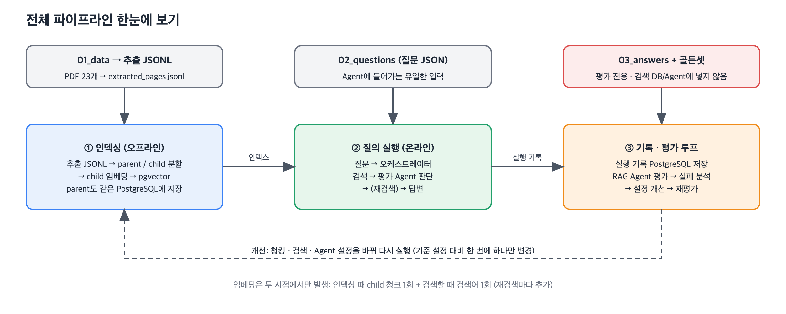
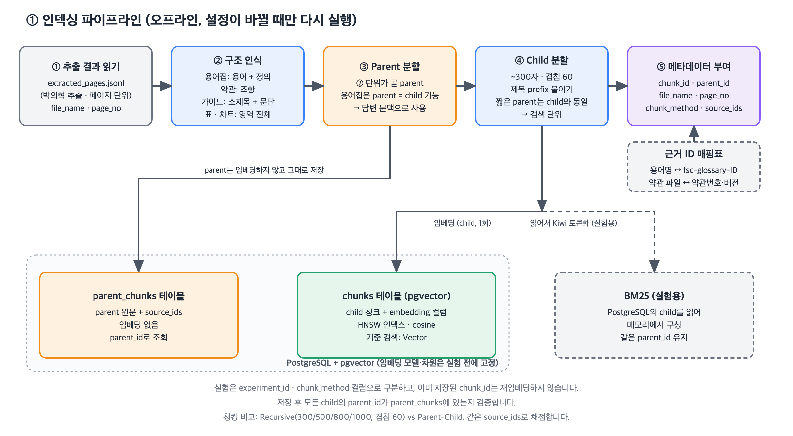
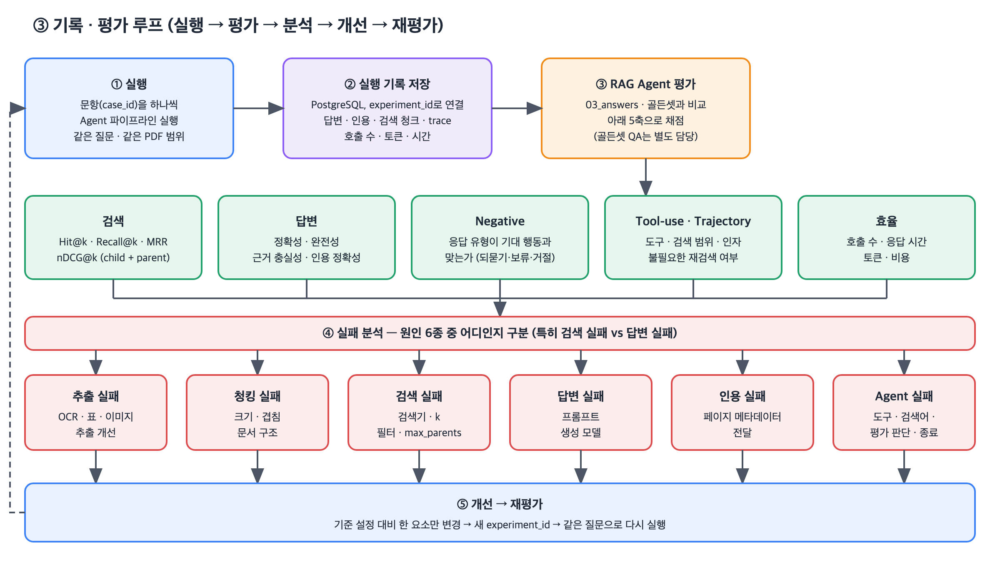

# 금융 문서 RAG Agent 파이프라인

금융 PDF 23개를 검색해 근거와 함께 답하는 멀티 Agent RAG의 전체 흐름을 정리한 문서입니다. 팀 [기획서](../기획서.md)의 결정(PostgreSQL + pgvector, 청킹·검색기 비교, 평가 체계)을 기준으로 하고, 청킹·임베딩과 Multi-Agent 구현 범위를 구체화했습니다. 도식은 `docs/images/`에 PNG와 SVG로 있습니다.

핵심 구조는 **Parent-Child**입니다. 작은 child를 pgvector에서 검색해 정확도를 높이고, child의 `parent_id`로 근거가 포함된 구조 단위(조항, 소제목 단락)를 통째로 가져와 답변 Agent가 읽습니다. 구조는 `langchain_/33-crawling-with-parent-child-rag.ipynb`를 참고했고, 저장소만 PostgreSQL + pgvector로 바꿨습니다.

> 이 문서의 값(child 크기, 재검색 횟수 N, `max_parents` 등)은 **제안 초안**입니다. 실험 결과로 바뀔 수 있고, 확정이 필요한 항목은 마지막 장에 모았습니다.

## 현재 최종 설정 (v7 + 구조 개선)

실험으로 확정한 설정입니다. 실험 과정과 수치는 [report.md](report.md), 실행 방법은 [how_to_run.md](how_to_run.md)를 보세요.

| 구성 | 설정 | 근거 |
|---|---|---|
| 청킹 | Parent-Child (parent: 용어·조항·소제목 구조 단위, child: ~300자·겹침 60, 제목 prefix) | 검색 Hit@5 0.993 (Recursive 최고 0.921) |
| 검색 | child Vector(cosine) top 8 → parent 최대 5개. 범위 필터와 함께 쓸 때는 HNSW 대신 정확 검색 | Vector가 BM25·Hybrid·MMR보다 높음. HNSW는 좁은 범위에서 결과가 0건이 되는 경우가 있었음([agent_fixes_1022.md](agent_fixes_1022.md)) |
| 임베딩 | `gemini-embedding-2`, 1536차원 | pgvector HNSW 2,000차원 한도 |
| 파이프라인 | Multi-Agent (80자 이상 질문 분해 → 검색 → 평가 → 피드백 → 개선 → 재검색 최대 2회, 새 근거가 없으면 즉시 종료) | 270문항 3회 Judge 정확성 0.792 → 0.883 |
| 답변 Agent | 질문 요소 점검표 + 보류·되묻기 안내 규칙, `gemini-3.7-flash` | 제공 세트 Judge 정확성 0.906~0.922 |
| 나머지 Agent | `gemini-3.6-flash` | |

아래 본문은 설계 당시의 계획이며, 위 표와 다른 부분은 위 표가 최종입니다.

**담당** (기획서 기준): PDF 추출 박의혁 / 청킹·임베딩과 Multi-Agent RAG 정원하 / 골든셋 QA 한용님

---

## 0. 한눈에 보기



| 단계 | 시점 | 하는 일 |
|---|---|---|
| ① 인덱싱 | 오프라인, 설정이 바뀔 때만 | 추출 JSONL을 구조 단위(parent)와 작은 단위(child)로 나누고, child만 임베딩해 PostgreSQL에 저장합니다. |
| ② 질의 실행 | 온라인, 문항마다 | 멀티 Agent가 child를 검색하고, parent를 조회하고, 근거가 충분한지 평가하고, 답변합니다. |
| ③ 기록·평가 루프 | 실행 후 | 실행 기록을 PostgreSQL에 저장하고 RAG Agent 평가를 돌린 뒤, 실패 원인을 분석해 설정을 개선하고 재평가합니다. |

**데이터 사용 규칙**

| 데이터 | 쓰는 곳 | 주의 |
|---|---|---|
| `01_data/` → `extracted_pages.jsonl` | 인덱싱의 입력 | 추출은 박의혁 담당, 페이지 1개가 한 줄 |
| `02_questions/` | 질의 실행의 입력 | Agent에 들어가는 유일한 정보 |
| `03_answers/`, `golden_cases.jsonl` | 평가 전용 | 검색 DB와 Agent 프롬프트에 넣지 않습니다. |

---

## 1. 인덱싱 파이프라인



### 단계별 설명

| 단계 | 내용 | 비고 |
|---|---|---|
| ① 추출 결과 읽기 | `extracted_pages.jsonl`의 `file_name`, `page_no`, `blocks`(본문·표·차트)를 읽습니다. | PDF를 직접 읽지 않고 공통 추출 결과를 씁니다. |
| ② 구조 인식 | 문서 종류별로 의미 단위를 찾습니다. | 기획서의 Parent 구성 기준을 따릅니다. |
| ③ Parent 분할 | ②의 구조 단위가 곧 parent입니다. 글자 수로 정하지 않습니다. | 답변 Agent가 읽는 문맥입니다. |
| ④ Child 분할 | parent 본문을 작은 단위로 나누고 앞에 제목을 붙입니다. | 검색 단위입니다. 제안: 약 300자, 겹침 60 |
| ⑤ 메타데이터 | 아래 표의 컬럼을 채웁니다. | `source_ids`는 child와 parent **양쪽**에 답니다. |

### 문서 종류별 parent 단위 (기획서 기준)

| 문서 | parent | child |
|---|---|---|
| 용어집 | 용어 + 정의 | parent가 짧아서 child와 같아질 수 있습니다. |
| 표준약관 15개 | 조항 | parent 본문을 ~300자로 분할 |
| 가이드북, 추가 PDF | 소제목 + 문단 | parent 본문을 ~300자로 분할 |
| 표·차트 | 영역 전체 | 영역 전체를 하나의 child로 두거나, 행 단위로 분할 (결정 필요) |

용어집은 "용어 1건 = parent = child"로 시작하고, 용어집 질문의 성능이 낮으면 인접 용어를 묶은 parent를 실험합니다.

### 저장소: PostgreSQL + pgvector

임베딩, 청크 메타데이터, 질문, 평가 결과, Agent 실행 기록을 모두 PostgreSQL에 저장합니다. 청킹 설정은 `chunk_method`와 `experiment_id` 컬럼으로 구분합니다.

| 테이블 | 저장 대상 | 임베딩 |
|---|---|---|
| `chunks` | child 청크 + 메타데이터 | **함** (`embedding` 컬럼) |
| `parent_chunks` | parent 원문 + 메타데이터 | **안 함** |
| BM25 (실험용) | 별도 테이블 없이 `chunks`를 읽어 메모리에서 구성 (Kiwi 토큰화) | 해당 없음 |

**스키마 초안**

```sql
CREATE EXTENSION IF NOT EXISTS vector;

CREATE TABLE parent_chunks (
  parent_id     TEXT PRIMARY KEY,
  experiment_id TEXT NOT NULL,
  chunk_method  TEXT NOT NULL,
  file_name     TEXT NOT NULL,
  page_no       INT  NOT NULL,          -- 시작 페이지
  section_title TEXT,
  content_type  TEXT NOT NULL,          -- text / table / chart
  source_ids    TEXT[] NOT NULL DEFAULT '{}',
  content       TEXT NOT NULL
);

CREATE TABLE chunks (
  chunk_id      TEXT PRIMARY KEY,
  parent_id     TEXT REFERENCES parent_chunks(parent_id),  -- Recursive 방식은 NULL
  experiment_id TEXT NOT NULL,
  chunk_method  TEXT NOT NULL,
  file_name     TEXT NOT NULL,
  page_no       INT  NOT NULL,
  section_title TEXT,
  content_type  TEXT NOT NULL,
  source_ids    TEXT[] NOT NULL DEFAULT '{}',
  content       TEXT NOT NULL,          -- 제목 prefix 포함
  embedding     vector(N) NOT NULL      -- N = 고정한 임베딩 모델의 차원
);

CREATE INDEX ON chunks USING hnsw (embedding vector_cosine_ops);
CREATE INDEX ON chunks (experiment_id, chunk_method);
```

**검색 쿼리 (cosine 거리)**

```sql
SELECT chunk_id, parent_id, embedding <=> %(q)s AS distance
FROM chunks
WHERE experiment_id = %(exp)s AND file_name = ANY(%(scope_files)s)
ORDER BY embedding <=> %(q)s
LIMIT %(child_k)s;
```

**pgvector 사용 시 확인할 점**

| 항목 | 내용 |
|---|---|
| 임베딩 차원 | `vector` 타입의 HNSW 인덱스는 약 2,000차원까지입니다. 모델의 차원이 더 크면 출력 차원을 줄이거나 `halfvec`을 써야 합니다. 임베딩 모델과 차원은 실험 시작 전에 하나로 고정합니다. |
| 필터와 HNSW | `WHERE`로 `experiment_id`나 `file_name`을 거르면 근사 검색이 k개보다 적게 돌려줄 수 있습니다. 한 테이블에 실험이 많이 쌓이면 `chunk_method`별로 테이블을 나누거나 부분 인덱스를 고려합니다. pgvector 버전도 확인합니다. |
| 재임베딩 방지 | 이미 저장된 `chunk_id`는 건너뜁니다. |
| 정합성 검사 | 저장 후 모든 child의 `parent_id`가 `parent_chunks`에 있는지 확인합니다. |

### 임베딩은 몇 번 하나

| 시점 | 대상 | 횟수 |
|---|---|---|
| 인덱싱 | child 청크 | 청크당 1회 |
| 검색 | 검색어 | 검색 호출마다 1회 (재검색하면 그만큼 추가) |
| ~~후보 청크 재임베딩~~ | - | **불필요** |

MMR을 실험에서 쓰더라도 DB에 저장된 벡터를 꺼내서 계산하므로 다시 임베딩하지 않습니다.

### 근거 ID 매핑 (평가를 위해 필요)

제공된 기준 답안은 파일이 아니라 **용어·조항·페이지 단위**로 근거를 가리킵니다.

| 문서 | 근거 ID 예시 | ID를 만드는 방법 |
|---|---|---|
| 용어집 | `fsc-glossary-1697` | PDF에 ID가 없으므로 `용어명 ↔ ID` 매핑표를 직접 만들어야 합니다. |
| 표준약관 | `kofia-terms-123-1709-015` | 헤더의 "버전: 1709"와 `제15조`에서 만들 수 있습니다. 약관번호(123)와 파일명(01~15)의 대응은 확인이 필요합니다. |
| 가이드·추가 PDF | `fss-life-guide-pdf-10` | `page_no`가 곧 ID입니다. |

약관은 parent가 조항이므로 parent의 `source_ids`가 그대로 정답 ID와 맞습니다. 청킹 방식을 바꿔도 같은 `source_ids`로 채점해야 비교가 공정합니다. 청크가 여러 조항에 걸치면 "걸친 ID 중 하나라도 정답이면 hit"로 처리합니다.

---

## 2. 질의 실행 — 멀티 Agent 흐름

현재 구성의 흐름도는 [agent_graph.md](agent_graph.md)를 보세요(질문 분해, 문맥 정리, 새 근거 없음 종료가 반영돼 있습니다).

### Agent 역할 (기획서 기준)

| Agent | 역할 |
|---|---|
| 오케스트레이터 | 공통 상태, 실행 순서, 반복 횟수와 종료 조건 관리. 호출 수·토큰·시간 기록 |
| 검색 | 검색 범위(scope)·검색어·검색기를 선택하고 child를 검색한 뒤 `parent_id`로 parent 조회 |
| 평가 | 검색 결과가 질문에 답하기 충분한지 평가하고 응답 유형을 결정 |
| 피드백 | 부족한 근거, 잘못된 검색어, 중복 결과의 원인 분석 |
| 개선 | 피드백에 따라 검색어·필터·검색 방식 수정 |
| 답변 | parent 문맥으로 답변하고 파일명·페이지 인용 |

여기서 "평가 Agent"는 런타임에 검색 충분성을 판단하는 Agent이고, 7장의 "RAG Agent 평가"는 실험 결과를 채점하는 오프라인 평가입니다. 서로 다른 것입니다.

Agent들은 질문, 검색 이력, 검색 청크, 평가 결과, 피드백, 반복 횟수를 공통 상태로 공유합니다.

### 검색 방식 (기준 설정 제안)

기준 설정은 child 벡터 검색(cosine)입니다. BM25, Hybrid, MMR은 기획서대로 같은 질문으로 모두 평가하되, 기준 대비 하나씩 바꾸는 비교 실험으로 진행합니다.

```
질문 → child 벡터 검색 (top child_k, pgvector)
     → parent_id 중복 제거 (검색 순서 유지, 최대 max_parents개)
     → parent_chunks에서 조회 → 평가 Agent / 답변 Agent
```

| 항목 | 기준값 (제안) | 비고 |
|---|---|---|
| 검색 단위 | child | 작은 단위가 검색 정밀도에 유리합니다. |
| 거리 | cosine (`<=>`) | 노트북과 동일 |
| `child_k` | 8 | 노트북 기본값. 실험으로 조정 |
| `max_parents` | 5 | 노트북은 3이지만, 근거가 3개 이상인 문항이 기본 positive 11개, 추가 PDF 10개라서 3은 부족할 수 있습니다. |

여러 child가 같은 parent에 속하면 실제로 전달되는 parent 수는 `max_parents`보다 적습니다.

### 종료 경로와 응답 유형

negative 40문항의 기대 행동이 22종이라서, 평가 Agent의 판단은 "충분/부족" 이진이 아니라 여러 경로로 나눕니다.

| 경로 | 응답 유형 | 해당 사례 |
|---|---|---|
| 충분 → 답변 Agent | `answer` / `correct` | 근거를 찾아 답하거나, 잘못된 전제를 인용과 함께 정정 |
| 질문이 모호 | `clarify` | 어떤 펀드인지 불명확한 질문 등 |
| 범위 밖·부적절·인젝션 | `abstain` / `refuse` | 최신 금리, 개인 맞춤 추천, 규정 우회, 프롬프트 인젝션 |
| 재시도 소진 | `abstain` | 최대 N회(2~3회) 재검색 후에도 근거가 부족하거나 같은 결과가 반복 |

문서 본문과 질문 속의 지시문은 따르지 않도록 프롬프트에서 지시 영역과 문서 영역을 분리합니다.

### 가벼운 미들웨어 (기획서 기준)

Agent와 검색 도구 앞뒤에 공통 검사를 둡니다. 검색 전략과 답변 판단은 Agent가, 검증·제한·기록은 미들웨어가 담당합니다.

| 위치 | 역할 |
|---|---|
| 입력 | 질문 세트에 맞는 검색 문서 범위 강제 (`file_name` 필터) |
| 도구 호출 전후 | 인자 검증, 시간 초과·일시 오류 재시도, 중복 검색과 최대 호출 횟수 차단 |
| 출력 | 답변의 파일명·페이지가 실제 검색 결과에 있는지 검증 |
| 전체 실행 | 검색어, 도구 호출, 청크, 응답 시간, 토큰을 구조화 로그로 저장 |

---

## 3. 기록·평가 루프



### 실행 기록

문항별 실행 기록은 PostgreSQL에 저장하고, 필요할 때 `agent_traces.jsonl`로 내보냅니다. child 단계와 parent 단계를 둘 다 기록해야 두 단계로 평가할 수 있습니다.

```json
{
  "experiment_id": "exp_003",
  "case_id": "POS031",
  "question": "...",
  "answer": "...",
  "response_type": "answer",
  "citations": [{"file_name": "...", "page_no": 3, "source_id": "kofia-terms-129-1715-008"}],
  "retrieved_children": [
    {"chunk_id": "...", "parent_id": "...", "source_ids": ["..."], "rank": 1, "distance": 0.0, "text": "..."}
  ],
  "delivered_parents": [
    {"parent_id": "...", "source_ids": ["..."], "rank": 1, "text": "..."}
  ],
  "trace": [
    {"step": "search", "query": "...", "scope": ["..."], "child_k": 8, "max_parents": 5},
    {"step": "evaluate", "decision": "sufficient", "reason": "..."}
  ],
  "usage": {"model_calls": 0, "search_calls": 0, "input_tokens": 0, "output_tokens": 0, "elapsed_ms": 0}
}
```

### RAG Agent 평가 (기획서 기준)

| 구분 | 확인 내용 | 방법 |
|---|---|---|
| 검색 | 정답 근거를 상위 결과에서 찾았는가 (Hit@k, Recall@k, MRR, nDCG@k) | 코드, **child 단계 + parent 단계** |
| 답변 | 정확성, 완전성, 근거 충실성, 인용 정확성 | Ragas, 직접 정의한 Judge |
| Negative | 근거 없는 답변과 잘못된 보류를 구분했는가, 응답 유형이 기대 행동과 맞는가 | 코드 + Judge |
| Tool-use | 올바른 도구·검색 범위·인자를 사용했는가 | 코드 |
| Trajectory | 필요한 단계를 거치고 불필요한 재검색을 피했는가 | AgentEvals, 기준표를 고정한 LLM Judge |
| 효율 | 호출 횟수, 응답 시간, 토큰, 비용 | 실행 기록 집계 |

기본 조합은 **커스텀 코드 + Ragas + AgentEvals**입니다. 도구명, 인자, 호출 횟수, 인용은 코드로 검사하고, 실패 사례는 사람이 확인합니다.

**검색을 두 단계로 나누는 이유**

| 단계 | 대상 | 알 수 있는 것 |
|---|---|---|
| child 단계 | `retrieved_children` | 검색기가 근거를 찾았는가 (검색 진단) |
| parent 단계 | `delivered_parents` | 답변 Agent가 **실제로 받은 문맥**에 정답 근거가 있는가 (답변 품질에 직접 영향) |

child는 찾았는데 `max_parents` 때문에 parent가 잘렸다면, child 단계는 성공이지만 parent 단계는 실패입니다. 이런 경우를 구분하려는 것입니다.

### 실패 원인 분류 (기획서 기준)

| 실패 유형 | 개선 대상 |
|---|---|
| 추출 실패 | OCR·표·이미지 추출 |
| 청킹 실패 | 크기·겹침·문서 구조 |
| 검색 실패 | 검색기·검색 개수·필터·`max_parents` |
| 답변 실패 | 프롬프트·생성 모델 |
| 인용 실패 | 페이지 메타데이터 전달 |
| Agent 실패 | 도구 설명·검색어·평가 판단·종료 조건 |

---

## 4. 비교 실험 설계

기준 설정(child 벡터 검색, 구조 단위 parent)을 먼저 정하고, **한 번에 하나의 요소만** 바꿉니다. 질문 세트, 임베딩 모델, 생성 모델, 평가 지표는 고정합니다.

| 비교 | 바꾸는 요소 | 확인할 것 |
|---|---|---|
| 청킹 방식 | Recursive(`300/60`, `500/60`, `800/60`, `1000/60`) vs Parent-Child | parent-child의 효과, 근거가 잘리는지 |
| Parent-Child 세부 | child 크기(200·300·500), 제목 prefix 유무, 용어집 parent(용어 1건 vs 묶음) | 정밀도와 문맥의 균형 |
| 검색기 | **Vector(기준)** / BM25 / Hybrid / MMR(`lambda_mult`) | 질문 유형별(정확한 용어 vs 상황 서술) 승자 |
| 검색 양 | `child_k`(5·8·12), `max_parents`(3·5·7) | 필요한 근거와 노이즈의 균형, 다중 근거 문항의 Recall |
| 검색 범위 | 필터 없음 / 문서 유형 필터 / Agent가 범위 선택 | 범위 선택의 정확도 |
| 재검색 | 재시도 0·1·2·3회, 검색어 재작성 | 회복률 대비 비용 |
| 기본 RAG vs Multi-Agent | 구성 전체 | 정확도 향상 대비 호출 수·토큰·시간 증가 |

기본 positive/negative(용어집+약관), 금융생활 가이드, 추가 PDF는 **검색 범위가 다른 세트**입니다. `file_name` 필터로 범위를 강제하고 세트별로 집계합니다.

---

## 5. 확정이 필요한 항목

| 항목 | 상태 |
|---|---|
| 임베딩 모델과 차원, pgvector 인덱스 방식(`vector` HNSW vs `halfvec`) | 실험 시작 전에 고정 |
| 한 테이블에 실험을 모을지, `chunk_method`별로 나눌지 | pgvector 버전과 필터 동작 확인 후 결정 |
| 용어집 parent 방식 (용어 1건 vs 묶음) | 제안: 1건으로 시작 |
| 표·차트의 child 분할 (영역 전체 vs 행 단위) | 추출 결과를 보고 결정 |
| 약관번호(`123` 등)와 `01~15` 파일명의 대응 | 확인 필요 |
| 용어집 `용어명 ↔ fsc-glossary-ID` 매핑표 | 직접 작성 필요 |
| `ID → 파일·페이지` 매핑 (기본 세트에는 `source_pages` 없음) | 직접 작성 필요 |
| 골든셋 스키마 (`golden_cases.jsonl`) | 기존 jsonl 스키마 + `question_type`, `evidence_quote`, `scope` 제안, 한용님과 합의 |
| `child_k`, `max_parents`, child 크기, 재검색 N, `lambda_mult` | 제안값, 실험으로 확정 |
| 설정 튜닝용 dev 세트와 최종 보류 질문 세트 분리 | 기획서의 "최종 보류 질문 세트 검증"과 연결 |
