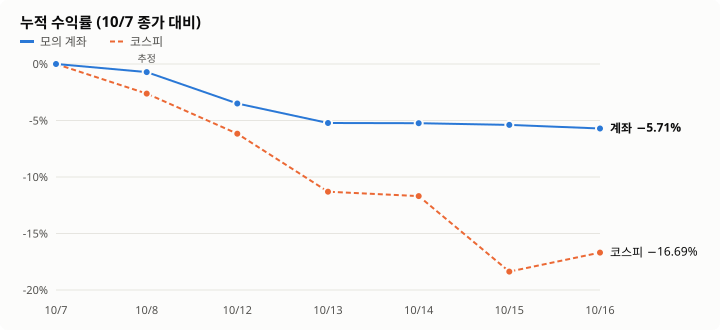

# 모의 자동매매 성과 모음

KIS 모의투자 계좌(10/8 시작 1,000만 원)로 앱이 사람 손 없이 사고판 기록. 사람은 매일 아침 계획(살 총액, AI 매도 허용)만 승인했다.

## 날짜별 요약

그래프는 `python docs/reports/charts.py`로 다시 만든다 (새 날은 스크립트 표에 한 줄 추가). 10/8 계좌는 평가손익만 반영한 추정이다. 10/19 계좌는 KIS 모의 종가(18시 조회), 10/20·10/21은 정규장 종가(15:47 조회, 16시 뒤 시간외 값은 쓰지 않음)로 계산했다.

| 날 | 코스피 | 계좌 (그날) | 체결 | AI 제안 · 검증 반려 | 그날 바꾼 것 | 리포트 · 원자료 |
|---|---|---|---|---|---|---|
| 10/8 (1일차) | −2.62% | 매수 4,727,750원 → **−1.52%** | 매수 4 (2종목, 1건 호출 제한 실패 후 재전송) | 10 · 1 | 하락 중 매수를 AI가 거절할 수 있게, 뉴스 출처 | [리포트](2026-10-08-mock-auto-trading.html) · [원자료](data/live-20261008.json) |
| 10/12 (2일차) | −3.65% | 보유 −4.03% (평가) | 매수 2, 매도 0 | 36 · 3 | AI 매도 판단(30분), 시장 지수, 절반 매도 | [리포트](live-20261012.md) · [원자료](data/live-20261012.json) |
| 10/13 (3일차) | −5.46% | **−1.78%** | 매도 8, 매수 0 | 55 · 48 | 검증 보완, 모의 한도 해제, 사는 판단 주기화, 급등·거래대금 후보 | [리포트](live-20261013.md) · [원자료](data/live-20261013.json) |
| 10/14 (4일차) | −0.44% | **−0.03%** | 0 | 36 · 30 | 매매 기준 점검 반영(추세·VWAP·하락 중 매수 차단 등), 장중 검증 보완. 마감 뒤: 절반 매수, 지시 균형, 관찰 판단 점수 | [리포트](live-20261014.md) · [원자료](data/live-20261014.json) |
| 10/15 (5일차) | **−7.57%** | **−0.16%** | 0 (매수 시도 3번 모두 실시간 급락 확인 뒤 관찰) | 53 · 16 | 장중: 후보를 상승 추세·강한 순으로, 반등 확인 절반 매수, 뉴스 반려 완화. 마감 뒤: 상승 추세 관찰 종목 실시간 재판단, 흑자 전환 지표, 강제 손절(−10% 절반·−15% 전부), 하락장 절반 매수 | [리포트](live-20261015.md) · [원자료](data/live-20261015.json) |
| 10/16 (6일차) | **+2.05%** | **−0.34%** (장중 최고 +1.64%) | **매수 6** (773만 원), 매도 0 | 106 · 17 | 장중: 재승인 버그, 흑자 전환 지표 ID 떼기, 서버 자동 시작·놓친 브리핑. 마감 뒤: 분석 한도 150·보유 몫 30, 이익 돌려줌·마감 전 점검, 하루 흐름 자료, 판다·든다 같은 무게 비교 | [리포트](live-20261016.md) · [원자료](data/live-20261016.json) · [캡처](img/live-20261016/) |
| 10/19 (7일차) | **+1.76%** | **−0.04%** (장중 최저 −2.05%) | **매도 4** (확정 −249,100원), 매수 3 (184만 원) | 127 · 9 | 마감 뒤: 급등 경고에 실제 상승률(+10%), 자동매매 주문은 습관에서 뺌, 횡령·배임·불성실공시 1등급 + 모의는 1등급도 AI 판단, 장 시작 30분 시장 급락 알림, 기록 매수·매도 필터, 자산 그래프 | [리포트](live-20261019.md) · [캡처](img/live-20261019/) |
| 10/20 (8일차) | **−3.73%** | **−3.28%** (코스피보다 0.45%p 덜 빠짐) | **매도 2** (확정 −84,300원, 둘 다 종가보다 높게), 매수 1 (58만 원) | 146 · 20 | 장 전: 시장 탓 하락이면 매도 30분 미룸, 손절선도 장 시작 30분 대기, "시장 하락만으로 팔지 않는다", 판 종목 점수. 장중(서버만): 장중 공시, 관찰이면 처리안 없음, 출처 ID 바로잡기 2번, 분석 한도 200 | [리포트](live-20261020.md) · [캡처](img/live-20261020/) |
| 10/21 (9일차) | **+3.29%** | **−0.15%** (코스피보다 3.4%p 뒤짐) | **매도 5** (확정 −52,836원, 3건은 판 뒤 더 오름), 매수 4 (164만 원), HLB 매도 1건 체결 0주 | 147 · 5 | 장중: 산 뒤 30분 매도 판단 안 함, 사람 확인 매수는 그날 다시 안 물음, 자동 주문에 '사용자 지시' 금지, 출처 ID. 마감 뒤: 장중 단기 신호만으로는 팔지 않음, 오늘 판 기록을 AI에게, 체결 안 된 자동 매도 되돌리기, 자동 매도 한 호가 낮게. 앱: 종목 탭, 그래프 달력·날짜별 표, 오늘·시작 대비 | [리포트](live-20261021.md) · [캡처](img/live-20261021/) |

**누적 (시작 1,000만 원 → 10/21 종가)**: 계좌 9,102,175원 (**−8.98%**), 코스피 6,803.90 → 5,735.66 (**−15.70%**).
5일차까지는 현금 비중(약 89%)이 커서 덜 빠졌다. 6일차 반등장에서 처음 주식 비중이 92%가 됐는데, 장중 +1.64%를 지키지 못하고 −0.34%로 마감했다. 7일차는 아침 급락에 4종목을 팔아 비중이 약 70%로 내려갔고, 오후 반등으로 거의 다 회복했다. 9일차까지 반등일 3번(10/16·10/19·10/21) 모두 코스피보다 크게 뒤졌다: 떨어지는 날엔 덜 빠지고 오르는 날엔 덜 오른다.

## 날마다 배운 것

| 날 | 잘된 것 | 잘못된 것 |
|---|---|---|
| 10/8 | 검증·한도·주문 흐름이 사람 없이 끝까지 동작 | 하락 중에 샀다 (반대 근거에 적고도 매수). 시장 지수를 안 봤다 |
| 10/12 | 코드 검사가 틀린 근거 제안 3건을 장중에 반려 | 분석 한도가 차서 3시간 판단 정지, 실패를 "보유"로 기록. 조건부 승인(숫자 틀림)으로 매수 |
| 10/13 | 절반 매도 동작, 하락장에서 매수 0 | 시초가 급락 때 판 3종목 모두 종가가 더 높았다 (약 7.9만 원). 검증 반려 48건 중 35건이 "뉴스를 사실로" 반복 |
| 10/14 | 시초가에 팔지 않음, 뉴스 반려가 크게 줄어 결론까지 가는 판단이 늘어남 | 상승 추세 후보(삼성SDI +5.00%)를 위험을 이유로 안 삼. 검사 코드 버그로 셀트리온 판단 9번 반려, 후보 다시 찾기 3번 거절 |
| 10/15 | 폭락일에 매수 시도 3번을 실시간 시세로 멈춤 (삼성SDI 종가 −9.81%, 피에스케이홀딩스 −12.44%). 관찰 11종목 모두 손실 피함 | 반등 매수 규칙이 서버 브리핑 단계에서 막혀 시험 못 함. 흑자 전환을 증가율로 계산한 지표 때문에 매수 검토 4번 반려. 손절선 아래(NH −9.16%)에서도 계속 보유 |
| 10/16 | 상승 추세 후보 → 실시간 재확인 → 매수가 처음 동작 (6건). 대주전자재료(−8.02%)는 실시간으로 보고 피함 | 장중 +1.64%를 마감 −0.34%로 돌려줌. 14:32 분석 한도가 차서 오후 매도 판단 17번 거절, 그 전에도 이익 중인 종목은 모두 보유. 오후에 산 3종목 −2~3%. 하루에 현금 92%를 씀 |
| 10/19 | 바닥에서 +2.05% 회복, 들고 간 종목 평가손익 손실 → 이익 (+253,550원). "오늘 최고에서 돌려준 이익" 매도 2번 동작. 분석 한도가 남아 마감까지 보유 종목 판단. 보유 72건 중 근거·결론이 어긋난 것 1건 | 코스피 −2%인 아침에 판 4종목이 모두 판 가격보다 높게 마감 (+284,800원 놓침, 10/13에 이어 두 번째). 코스피 +1.76%보다 1.8%p 뒤짐. 급등 경고 오작동으로 매수 11건 만료. 악재 공시(횡령·배임) 종목을 1주 삼 |
| 10/20 | 급락장(코스피 −3.73%)에서 계좌 −3.28%로 덜 빠짐. 판 2종목 모두 종가보다 높게, SK이노베이션은 "20일 평균 깨짐"이라는 종목만의 근거로 팜. 검증이 시장 하락만으로 낸 매도 7번 반려. 산 KT&G는 +0.47%로 버팀 | 시장 탓이라 매도를 미룬 5종목 중 4종목이 더 내려감 (약 −59,500원, 계속 빠진 날). 고영 −8.04%. 자동매매 관찰 판단이 처리안 21건 "만료"로 쌓임(13:56 고침). 매수 후보 분석 한도에 6번 막힘 |
| 10/21 | 급등 경고로 안 산 엘앤씨바이오 −4.17% (안 산 게 맞음). 장중 공시(불성실공시 지정예고)로 판 LG에너지솔루션은 종가와 같은 가격. 재무 금액 단위 반려 0건 (어제 6건) | 코스피 +3.29% 반등일에 −0.15%. 몇 분짜리 신호(VWAP 아래·5분 저가 하락)로 판 한화시스템이 판 뒤 +4.94%, 3시간 뒤 더 비싸게 다시 삼. 판 것의 확정 손실 −52,836원. HLB 지정가 매도 체결 0주인데 판 것으로 기록 |

## 관찰 판단 점수 (AI가 너무 조심스러운가)

AI가 "관찰"한 매수 후보가 그날 어떻게 끝났는지 (`python -m app.scorecard 날짜`, 다음 날 14시 종가 수집 뒤).

| 날 | 관찰 평균 | 놓친 기회 (+2% 넘게) | 피한 손실 (−2% 넘게) |
|---|---|---|---|
| 10/13 | −2.91% | 1 | 2 (에이피알 −19.60%) |
| 10/14 | +2.00% (KIS 모의 종가로는 +1.83%) | 3 (삼성SDI +5.54%) | 0 |
| 10/15 | **−8.87%** (KIS 모의 종가) | 0 | 11 (고영 −14.80%) |
| 10/19 | +1.57% (매수 검토 +3.60%) | 4 (현대오토에버 +9.92%) | 2 (엘앤씨바이오 −4.71%) |
| 10/20 | **−5.73%** (매수 검토 −3.44%) | 0 | 8 (한화시스템 −13.90%) |

판 종목 점수 (판 가격 대비 그날 종가, 10/20부터 점수표가 계산, 장 마감 요약에도 붙음):

| 날 | 판 건수 | 판 뒤 더 오른 것 | 들고 있었으면 (세금·수수료 전) |
|---|---|---|---|
| 10/19 | 4 | 4 | +260,300원 (금융위원회 종가) |
| 10/20 | 2 | 0 | −12,700원 (금융위원회 종가, 판 게 나았음) |
| 10/21 | 5 | 3 (2건은 같음) | +30,000원 (KIS 모의 종가, 한화시스템 +4.94%) |

## 원자료 형식 (`data/live-YYYYMMDD.json`)

서버 DB에서 뽑았다. 사용자 ID·계좌번호·키는 없다.
- `orders`: 시각, 종목, 매수/매도, 수량, 주문가, 상태, 체결 수량·가격
- `proposals`: 시각, 종목, 투자 AI 행동, 자동매매 주문 여부, 마지막 검증 판정·요약·조건
- `verification_rejects`: 검증 AI가 반려한 시각·종목·이유

AI 판단·검증을 어떻게 고쳤는지는 [../AI_CHANGELOG.md](../AI_CHANGELOG.md). 공개 매매 기준과 비교한 점검은 [ai-audit-20261014.md](ai-audit-20261014.md).

모의투자 결과이며 투자 권유가 아니다.
