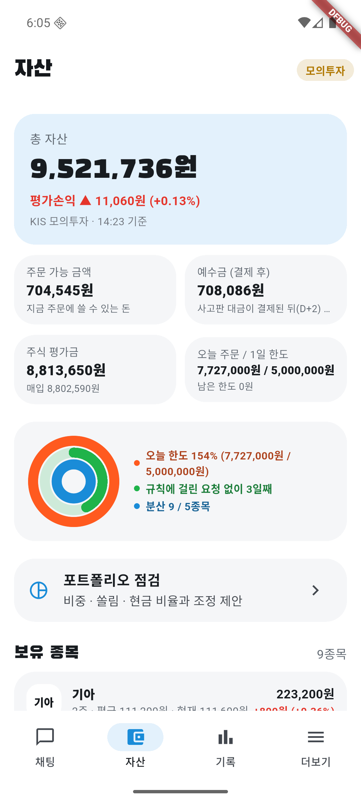
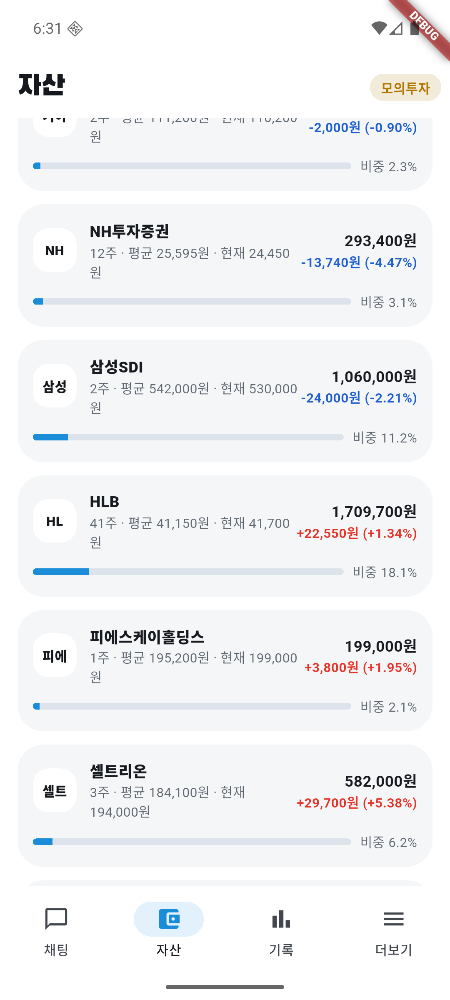

# 10/16 모의 자동매매 6일차: 반등장에서 처음 많이 산 날, 오후에 오른 만큼 돌려줌

- 계좌: KIS 모의투자 (10/8 시작 1,000만 원)
- 기준: 앱 자산 화면 캡처(15:31)와 KIS 모의 현재가·지수 조회 (15:3x)
- 사람이 한 일: 아침에 오늘 계획 승인. 장중에 버그 3개를 고침 (아래 4). 주문·매도 결정에는 손대지 않음
- 이날 코스피 5,668.05 (**+2.05%**), 코스닥 794.77 (**+4.46%**). 7거래일 연속 하락 뒤 첫 반등
- 이날 처음 적용: 후보를 상승 추세·강한 순으로, 반등 확인 절반 매수, 상승 추세 관찰 종목 실시간 재판단, 흑자 전환 지표, 강제 손절(−10%·−15%), 하락장 절반 매수

## 1. 결과

| | 값 |
|---|---|
| 총자산 | 9,428,986원 (전날 9,461,096원) |
| 하루 | **−0.34%** (코스피 +2.05%, 코스닥 +4.46%) |
| 장중 최고 (캡처 기준) | **9,616,136원 (14:10 캡처, 화면 표시 14:04 기준, 전날 대비 +1.64%)** → 마감까지 187,150원 돌려줌 |
| 6일 누적 (10/7 종가 대비) | 계좌 **−5.71%**, 코스피 **−16.69%** |
| 오늘 체결 | **매수 6건** (7,727,000원어치), 매도 0 |
| 현금 | 708,086원 (전날 약 842만 원 → 주식 비중 약 92%) |
| AI 판단 | 106건 (매수 검토 17, 관찰 31, 보유 58, 매도 0). 검증 반려 17번 (13:21 수정 뒤 2번) |

### 오늘 산 종목

| 시각 | 종목 | 수량 | 체결가 | 산 뒤 장중 최고 (오늘 고가 기준) | 종가 | 체결가 대비 |
|---|---|---|---|---|---|---|
| 09:36 | 피에스케이홀딩스 | 1 | 195,200 | 201,500 (+3.23%) | 199,000 | **+1.95%** |
| 09:37 | HLB | 41 | 41,150 | 42,500 (+3.28%) | 41,700 | **+1.34%** |
| 10:01 | 삼성SDI | 2 | 542,000 | 미확인 (오늘 고가 550,000은 시가) | 530,000 | **−2.21%** |
| 11:33 | 고영 | 48 | 32,950 | 33,750 (+2.43%) | 32,800 | **−0.46%** |
| 12:02 | 한화시스템 | 22 | 81,400 | 83,200 (+2.21%) | 79,000 | **−2.95%** |
| 13:01 | 솔브레인 | 4 | 345,500 | 348,500 (+0.87%) | 336,000 | **−2.75%** |

"산 뒤 장중 최고"는 오늘 고가가 산 뒤에 나왔다고 보고 계산했다. 1분봉으로 확인하지 않았다.

### 전부터 갖고 있던 종목

| 종목 | 매입가 | 종가 | 매입가 대비 |
|---|---|---|---|
| 셀트리온 | 184,100 | 194,000 | **+5.38%** (장중 최고 195,500, +6.19%) |
| 기아 | 111,200 | 110,200 | −0.90% |
| NH투자증권 | 25,595 | 24,450 | −4.47% |

## 2. 장중 캡처 (앱 자산 화면)

오늘 산 종목이 체결가 대비 +3%를 넘을 때, 30분마다, 장 마감 때 자동으로 찍었다. 계좌번호는 화면에 없다.

| 14:10 HLB +3% 돌파 | 14:33 | 15:05 | 15:31 마감 |
|---|---|---|---|
|  |  |  |  |

| 시각 | 총자산 | 평가손익 |
|---|---|---|
| 14:10 (화면 표시 14:04 기준) | 9,616,136원 | +105,460원 (+1.20%) |
| 14:22 | 9,605,036원 | +94,360원 (+1.07%) |
| 14:33 | 9,577,736원 | +67,060원 (+0.76%) |
| 15:05 | 9,521,736원 | +11,060원 (+0.13%) |
| 15:31 마감 | 9,428,986원 | **−81,690원 (−0.93%)** |

마감 보유 종목: 

## 3. 판단을 돌아보면

- **산 것은 처음으로 판단대로 동작했다**: 상승 추세 후보 → 실시간 재확인 → 반등·VWAP 위면 매수. 대주전자재료(종가 −8.02%)는 실시간으로 보고 관찰로 바꿔 피했다
- **오후에 오른 만큼 돌려줬다**: 14:10 캡처 +1.20%에서 마감 −0.93%. 오늘 산 6종목 중 4종목이 산 뒤 +2~3%까지 갔다가 내려왔다. 이익을 정해진 선에서 확정하는 규칙이 없고, AI는 "추세·반등 유지"로 계속 보유했다
- **늦게 산 종목이 손실**: 12:02 한화시스템(이미 오늘 +7%대에 삼), 13:01 솔브레인, 10:01 삼성SDI가 −2~3%. 오전에 산 HLB·피에스케이홀딩스만 이익
- **하루에 현금 대부분을 썼다**: 계획이 "주문 가능 금액 전부"라 하루에 약 773만 원(현금의 92%)을 썼다. 하락장 절반 규칙은 종목당 몫만 줄였고, 종목 수가 9개라 전체로는 거의 다 샀다
- 매도 0건: 손절선(−7%)에 닿은 종목이 없었고, AI는 오르는 종목을 계속 보유로 봤다

## 4. 장중에 고친 것

| 시각 | 문제 | 고친 것 | 위치 |
|---|---|---|---|
| 09:15 | 09:05 피에스케이홀딩스: 실행 직전 가격이 1% 넘게 바뀌어 처리안이 다시 왔는데, 앱이 체결로 보고 "7주 매수"로 기록 (주문은 안 나감) | 다시 온 처리안도 같은 기준으로 확인해 최대 2번 더 승인, 계속 바뀌면 주문 안 함 | `auto_trader.dart` `_order` |
| 09:00 | 서버가 08:20에 꺼져 있어 아침 브리핑을 놓침 | 장중에 서버가 켜지면 놓친 브리핑을 바로 만듦, 로그인 시 서버 자동 시작 | `briefing.py` `missed_morning`, `scripts/autostart.ps1` |
| 13:21 | 삼성SDI 보유 판단 6번 반려: 흑자 전환이라 계산 안 하는 `op_income_yoy`를 AI가 계속 붙임 | 계산할 수 없는 지표 ID는 코드가 떼어 냄 | `analysis.py` `drop_uncomputable_metrics` |
| 13:21 | "(출처: 지표: volatility_60d)" 반려 2번 | "지표:" 앞말을 떼어 냄 | `analysis.py` `fix_source_id` |

13:21 수정 뒤 검증 반려는 2번으로 줄었다 (그 전 15번).

## 5. 문제점

0. **14:32부터 AI 판단이 멈췄다**: 하루 분석 한도 100번이 14:32에 다 차서(보유 판단 58, 매수 후보 48), 14:32~15:27 분석이 26번 거절됐고 그중 17번이 보유 종목 매도 판단이었다 (서버 기록). 계좌가 +0.76%(14:33) → −0.93%(15:31)로 빠지는 동안 AI가 한 번도 판단하지 못했다. 장 마감 뒤 한도 150, 보유 종목 몫 30번으로 고침 ([AI 수정 기록](../AI_CHANGELOG.md))
1. **이익 실현 규칙이 없다**: 장중 +1.64%(캡처 기준)가 마감 −0.34%. 오늘 산 종목 4개가 +2~3%를 찍고 내려왔다 (사용자와 정할 것, 아래 6)
2. **하루에 다 산다**: 7거래일 하락 뒤 첫 반등 날 현금 92%를 썼다. 다음 날 다시 빠지면 손실이 계좌 전체에 걸린다
3. **늦은 시각·이미 많이 오른 종목 매수**: 오후에 산 종목이 손실. 급등 종목 제외는 +10%부터라 +7%대 한화시스템은 걸러지지 않았다
4. 앱 기록에 피에스케이홀딩스 7주가 잘못 남아 이 종목은 1주만 샀다 (실제 잔고와 맞추는 코드 필요)
5. 앱 자산 화면의 "기준 시각"이 캡처 시각과 다르다: 14:10 캡처는 "14:04 기준", 14:33·15:05 캡처는 "14:23 기준" (숫자는 바뀜). 14:22·15:31 캡처는 맞다. 표시 버그로 보이며 원인 미확인. 처음 리포트에 쓴 장중 최고 9,631,436원(+1.80%)은 남은 기록에서 확인되지 않아 캡처 값으로 바꿨다
6. 앱 자산 화면에 "오늘 한도 154% (7,727,000원 / 5,000,000원)", "분산 9 / 5종목"이 경고처럼 뜬다. 모의투자는 10/13부터 금액 한도를 쓰지 않아 주문은 막히지 않았지만, 화면은 실전 한도 기준으로 보여 준다 (화면과 실제 규칙이 다름)

## 6. 이익 실현 선 (장 마감 뒤 사용자 결정: 숫자 규칙 대신 AI 판단)

오늘 숫자로 보면 이익 실현 규칙이 있었어도 크게 바뀌지 않았다. 산 뒤 최고가 +3.3%를 넘은 종목이 없어서, 흔히 쓰는 +5%·+8% 선에는 하나도 닿지 않았다 (셀트리온만 +6.19%). 오늘 손실은 **이익을 못 지켜서보다 늦게·많이 사서** 생겼다.

사용자는 +5% 절반 매도 같은 숫자 규칙 대신 AI가 시장·뉴스·차트를 보고 그때그때 판단하게 정했다. 그래서 장 마감 뒤 이렇게 고쳤다 ([AI 수정 기록](../AI_CHANGELOG.md)):
- 분석 한도 100 → 150, 그중 30번은 보유 종목 매도 점검 전용 (14:32 뒤 판단이 멈춘 문제)
- 오늘 매입가 대비 최고 +2%를 넘은 뒤 1.5%p 내려오면 30분을 기다리지 않고 바로 AI에게 묻기, 14:30 마감 전 점검
- AI 자료에 오늘 시가·고가, 고가 때와 지금 수익, 하루 동안 본 현재가 흐름 (전에는 최근 30분 1분봉만)
- 투자 AI 지시: "판다"와 "든다"를 같은 무게로 비교, 보유는 기본값이 아님, 확신이 없으면 절반 매도

오후 보유 판단 10건(13:31~14:21)을 새 지시로 다시 돌려 보니 모두 보유였다. 그때는 10건 모두 VWAP 위였고 대부분 반등 중이었다. 실제 하락은 판단이 막힌 14:32 뒤라 다시 볼 자료가 없다. 새 판단이 하락 때 파는지는 다음 거래일에 확인한다 (미확인).

## 7. 다음에 볼 것

- 바꾼 매도 판단이 실제로 동작하는지 (KIS 모의 응답의 오늘 시가·고가 값 포함)
- 하루 매수 한도, 늦은 시각 매수 제한을 정한 뒤 반영
- 강제 손절·하락장 절반 규칙은 오늘 걸린 일이 없다 (−10% 종목 없음, 반등장)
- 공공데이터 10/15·10/16 종가로 관찰 판단 점수 다시 계산

모의투자 결과이며 투자 권유가 아니다.
