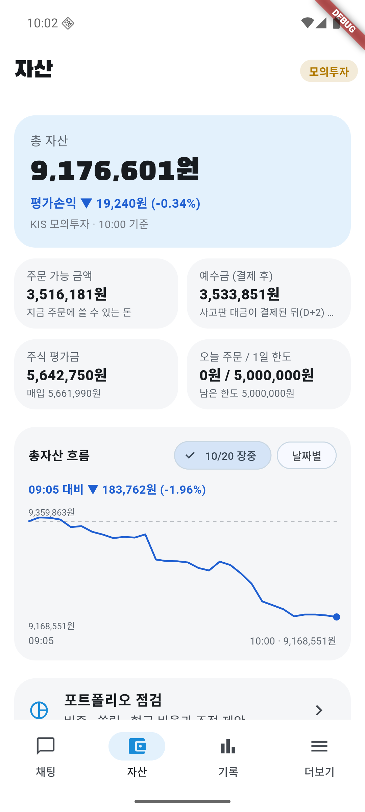

# 10/20 모의 자동매매 8일차: 코스피 −3.73% 급락장, 계좌 −3.28%로 시장보다 0.45%p 덜 빠짐

- 계좌: KIS 모의투자 (10/8 시작 1,000만 원)
- 기준: **종가는 정규장 종가(15:30)** — 15:47에 KIS 모의 현재가·지수로 조회. 총자산 마감 값은 그 종가 × 보유 수량 + 현금 (폰이 15:34에 올린 값 9,115,405원과 같음). 16시 뒤엔 KIS 모의 현재가·일별 값이 시간외 거래로 조금씩 바뀌어(예: S-Oil 144,000 → 144,100, 지수는 그대로) 쓰지 않았다. 공식 종가는 내일 14시 금융위원회 수집 뒤 점수표에서 다시 본다. 장중 값은 폰이 5분마다 서버에 올린 총자산, 주문·AI 판단·검증은 서버 기록
- 사람이 한 일: 06:30 오늘 계획 승인. 장 전에 앱·서버 반영(아래 1번 표). 장중 1시간마다 점검·캡처. 주문·매도 결정에는 손대지 않음. **장중에 서버만 5번 다시 띄워 고침** (사용자 요청, 앱은 다시 빌드하지 않음)
- 이날 코스피 **5,552.74 (−3.73%)**, 코스닥 781.97 (−3.33%). 장중 최저 약 −4.4% (10:14·14:28 무렵)
- 이날 처음 적용: **시장 탓 하락이면 매도 판단을 30분 미룸**, 장 시작 30분엔 −7% 손절선도 기다림, 투자·검증 AI에 "시장 하락만으로 팔지 않는다", 장중 공시(12:18부터), 자동매매 관찰 판단은 처리안 없이(13:56부터), 분석 한도 200(15:28부터)

## 1. 결과

| | 값 |
|---|---|
| 총자산 (종가 계산) | **9,115,405원** (전날 9,424,763원) |
| 하루 | **−3.28%** (−309,358원). 코스피 −3.73%, 코스닥 −3.33% → **코스피보다 0.45%p 덜 빠짐** |
| 장중 최저 | 9,092,921원 (14:09, −3.52%). 아침 최저 9,093,471원 (10:14) |
| 8일 누적 | 계좌 **−8.85%** (시작 1,000만 원 대비), 코스피 **−18.39%** (10/7 종가 6,803.90 대비) |
| 오늘 체결 | **매도 2건**(S-Oil, SK이노베이션), **매수 1건**(KT&G 583,500원어치). 주문 실패 0 |
| 판 것의 확정 손익 (계산) | **−84,300원** (매입가 대비, 세금·수수료 별도) |
| 판 것 vs 종가 | 2건 모두 **종가보다 높게** 팔았다 (+12,700원 덜 잃음) |
| 현금 | 3,542,605원 (주식 비중 약 61%) |
| AI 판단 | 146건 (보유 93, 관찰 42, 매수 검토 6, 매도 검토 5). 검증 반려 20번 |
| 분석 한도 | 146번. 안 가진 종목 몫(120)에 **6번 막힘** (15:28에 한도 200·보유 몫 50으로 올림) |

### 판 종목

| 시각 | 종목 | 수량 | 체결가 | 매입가 대비 | 왜 팔았나 (앱 기록·AI 근거) | 종가 (그날 저가) | 판 가격 대비 종가 |
|---|---|---|---|---|---|---|---|
| 09:41 | S-Oil | 5 (전부) | 146,300 | **−7.05%** | 09:34 −6.5% 급락 질문엔 보유. 09:40 −7.2% 손절선에서 다시 물음 → 첫 제안은 검증이 "시장 하락만으로 매도"라 반려 → 다시 쓴 매도 제안 승인 | 144,000 (142,200) | **−1.57%** (11,500원 덜 잃음) |
| 15:18 | SK이노베이션 | 4 (전부) | 148,400 | −4.63% | 14:28·14:44엔 "시장과 같이 빠짐"으로 보유. 15:17 **20일 평균(150,550원) 아래로 내려감**, VWAP 아래, 5분 저가 연속 하락, 오늘 고가 162,100원에서 −8.4% → 매도 | 148,100 (148,100) | −0.20% (1,200원 덜 잃음) |

### 산 종목

| 시각 | 종목 | 수량 | 체결가 | 어떻게 정했나 | 종가 | 체결가 대비 |
|---|---|---|---|---|---|---|
| 10:02 | KT&G | 3 | 194,500 | 10:00 다시 찾은 후보. 코스피 −3.3%인데 20·60일 평균 위, 저점에서 반등, 시장 대비 +28%p | 194,000 (+0.47%) | −0.26% |

### 시장 탓이라 매도 판단을 미룬 종목 (새 규칙)

09:33~09:35 코스피 −2.3%일 때 "시장과 같이 빠진 것"이라 30분 미뤘다. 그 뒤 판단은 모두 보유였다(SK이노베이션만 15:18 매도).

| 종목 | 미룬 때 가격 | 종가 | 미룬 때 대비 |
|---|---|---|---|
| NH투자증권 | 24,550 | 24,200 | −1.43% |
| HLB | 42,000 | 43,000 | **+2.38%** |
| 고영 | 31,100 | 30,300 | −2.57% |
| LG에너지솔루션 | 423,500 | 414,000 | −2.24% |
| SK이노베이션 | 155,500 | 148,400 (15:18 매도) | −4.57% |

미룬 때 다 팔았다면 **약 59,500원 덜 잃었다** (계산, 세금·수수료 전). 시장이 −2.3%에서 −3.7%로 계속 빠진 날이라 미룬 것이 손해였다. 아침 급락 뒤 반등한 10/13·10/19와 반대다.

### 남은 종목 (종가, 매입가 대비)

| 종목 | 수량 | 매입가 | 종가 (그날 등락) | 매입가 대비 |
|---|---|---|---|---|
| 셀트리온 | 3 | 184,100 | 197,400 (−0.40%) | **+7.22%** |
| HLB | 21 | 41,150 | 43,000 (+0.12%) | +4.50% |
| 삼성SDI | 2 | 542,000 | 556,000 (−6.08%) | +2.58% |
| 기아 | 2 | 111,200 | 112,400 (−3.10%) | +1.08% |
| KT&G | 3 | 194,500 | 194,000 (+0.47%) | −0.26% |
| LG에너지솔루션 | 1 | 428,000 | 414,000 (−4.17%) | −3.27% |
| NH투자증권 | 12 | 25,595 | 24,200 (−1.83%) | −5.45% |
| 고영 | 48 | 32,950 | 30,300 (−6.05%) | **−8.04%** |

평가손익 합계 −50,290원.

## 2. 장중 흐름

| 시각 | 총자산 | 무엇이 있었나 |
|---|---|---|
| 전날 마감 | 9,424,763원 | |
| 09:05 | 9,352,313원 | 장 시작부터 −0.77% |
| 09:33~09:35 | | 코스피 −2.32% 알림. 5종목 매도 판단 30분 미룸 |
| 09:41 | 9,198,501원 | S-Oil 손절 매도 |
| 10:02 | | KT&G 매수 |
| 10:14 | **9,093,471원** | 아침 최저 (코스피 −4.29%) |
| 11:03 | 9,172,971원 | |
| 12:04 | 9,184,071원 | |
| 13:03 | 9,127,771원 | |
| 14:09 | **9,092,921원** | 오늘 최저 (−3.52%) |
| 15:18 | | SK이노베이션 매도 |
| 15:34 (종가) | **9,115,405원** | |

| 09:41 S-Oil 매도 | 10:02 KT&G 매수 | 13:23 | 15:18 SK이노베이션 매도 | 마감 |
|---|---|---|---|---|
|  |  |  |  |  |

정기 캡처는 11:23·12:23·13:23·14:27·15:36. 09:23·10:23 점검은 사용량 한도로 건너뛰었다 (그 사이 주문은 자동 캡처로 남음). 계좌번호는 화면에 없다.

## 3. 판단을 돌아보면

- **급락장에서 시장보다 덜 빠졌다**: 코스피 −3.73%, 계좌 −3.28%. 현금 비중이 아침 약 30%에서 마감 39%로 늘었다
- **판 2건은 종가보다 높게 팔았다**: S-Oil 146,300원 → 종가 144,000원, SK이노베이션 148,400원 → 종가 148,100원(그날 저가). SK이노베이션은 "시장과 같이 빠짐"으로 두 번 보유한 뒤 20일 평균이 깨지자 팔았다. 새 지시문이 말한 "종목만의 근거(추세 꺾임)"로 판 첫 사례
- **산 1건(KT&G)은 시장 −3.7% 날 +0.47%로 버텼다**: "시장보다 강하고 반등 중" 근거가 맞았다
- **검증 AI가 시장 하락만으로 낸 매도 제안을 7번 반려했다** (삼성SDI 4번, S-Oil·셀트리온·LG에너지솔루션 각 1번). S-Oil만 다시 쓴 매도 제안이 승인돼 팔렸고, 나머지는 다시 쓴 판단이 모두 보유. 삼성SDI는 −6.08% 마감, 그래도 매입가보다 +2.58%
- **매도를 미룬 것은 오늘은 손해였다**: 5종목 중 4종목이 미룬 때보다 낮게 끝났다 (약 −59,500원). 시장이 계속 빠지면 미루는 것이 불리하다는, 아침에 적어 둔 위험 그대로다. 미루기 규칙은 코스피 −3%가 넘으면 멈추게 돼 있었고 실제로 10시 무렵 넘었는데, 그 뒤 AI가 지시문("시장 하락만으로 팔지 않는다")에 따라 보유를 골랐다
- **고영이 −8.04%까지 왔다**: 09:56 손절선(−7.9%)에서 한 번 물었을 때 보유, 그 뒤로는 정기 점검으로만 물었다. 강제 손절(−10%)까지 2%p 남았다
- **1등급 종목**: 새로 산 1등급 종목은 없다. 들고 있는 LG에너지솔루션(횡령·배임 공시)은 12번 모두 보유였고, 검증이 1등급 공시를 반대 근거에서 빠뜨린 판단을 1번 반려했다
- **자동매매 매수 처리안 21건이 "만료"로 쌓였다**: AI가 주문 직전 "관찰"이라 한 것인데 처리안이 만들어져 기록에 놓친 주문처럼 보였다. 13:56에 고침
- **분석 한도**: 매수 후보 몫(120)에 6번 막혔다. 급락장이라 살 후보가 적어 큰 손해는 없었지만, 15:28에 200(보유 몫 50)으로 올렸다

### 10/19 판단 점수 (공공데이터 종가, 오늘 14시 수집 뒤)

- 관찰 평균 +1.57%, 매수 검토 평균 +3.60% (코스피 +1.76%인 반등일). 놓친 기회 4 (현대오토에버 +9.92%), 피한 손실 2 (엘앤씨바이오 −4.71%)
- 판 4건 모두 판 뒤 더 오름, 들고 있었으면 **+260,300원** (금융위원회 종가. 어제 리포트의 +284,800원은 KIS 모의 종가 기준)
- 오늘 15:40 장 마감 요약에 이 점수가 처음 자동으로 붙었다

## 4. 오늘 고친 것

| 언제 | 무엇이 있었나 | 어떻게 바꿨나 | 위치 |
|---|---|---|---|
| 장 전 08:16 | 10/13·10/19 시장 탓 하락에 판 7종목이 모두 다시 오름 | 시장 탓 하락(지수 −1.5%~−3%, 종목이 지수보다 3%p 넘게 나쁘지 않음)이면 매도 판단 30분 미룸. 장 시작 30분엔 −7% 손절선도 기다림. 투자·검증 AI 지시문 | `auto_trader.dart` `marketDriven`·`deferSell`, `llm.py` |
| 장 전 | 판 종목 결과를 손으로 계산 | 점수표에 매도 점수, 장 마감 요약에 전 거래일 점수 | `scorecard.py`, `briefing.py` |
| 장 전 | 서버가 꺼지면 로그인 화면으로 감, 화면이 줄글 | 연결 안 됨 화면 + 재시도, 더보기·자동매매·기록·자산·브리핑 화면 줄이기, 기록 날짜 접기·달력, 공시 원문 열기 | `main.dart`, 화면 파일들 |
| 12:18 | 공시를 07·14시에만 받아 장중 악재를 몰랐음 | 분석할 때 그 종목 오늘 공시를 30분마다 DART에서 받음 (새 공시면 위험등급 다시 계산). 반영 직후 셀트리온 자기주식취득결과 들어옴 | `analysis.py` `refresh_disclosures` |
| 12:42 | "(출처: 지표 volatility_60d)"로 HLB 반려 | 콜론 없는 "지표 " 접두어도 뗌 | `analysis.py` `fix_source_id` |
| 13:56 | 자동매매 매수 처리안 21건 만료 | AI가 관찰이면 처리안을 만들지 않고 기록만 | `agents/order.py` `auto_declined` |
| 14:27 | "pbr:0.77배", "market:KOSDAI"로 4건 반려 | 지표 ID 뒤 값·단위를 떼고, KOSD·KOSP 오타를 바로잡음 | `analysis.py` `fix_source_id` |
| 15:28 | 분석 한도 매수 몫에 6번 막힘 | 하루 200, 보유 몫 50 (사용자 결정, 기본값) | `analysis.py` `MAX_ANALYSES_PER_DAY` |

## 5. 문제점

1. **매도 미루기가 계속 빠지는 날엔 손해**: 오늘 4/5종목이 더 내려갔다 (약 −59,500원). 반등한 날(10/13·10/19)엔 맞았던 규칙이라 표본 3일로 판단하기 이르다. 점수표로 날마다 미룬 것의 결과를 쌓아야 한다 (지금은 앱 기록에만 남아 손으로 계산)
2. **고영 −8.04%**: 손절선 질문은 하루 한 번이라, 그 뒤 더 빠져도 정기 점검으로만 묻는다
3. **삼성SDI 매도 제안이 4번 되풀이**: 매번 검증이 반려하고 결론은 보유. 분석 횟수만 쓴다
4. **장중 정기 점검 2번이 빠짐** (09:23·10:23, 사용량 한도)
5. 검증 요약 문장이 "시장 급락과 장중 약세에 따른 매도"처럼 시장을 먼저 쓴다 (SK이노베이션, 판단 자체는 추세 꺾임 근거)

## 6. 다음에 볼 것

- 매도 미루기의 결과를 점수표에 자동으로 (미룬 시각·가격 → 종가)
- 고영처럼 손절선 아래에서 더 빠질 때 다시 묻는지, −10% 강제 손절이 실제로 도는지
- 장중 공시가 판단 근거에 실제로 쓰이는지 (오늘은 반영 뒤 3건, 근거 인용은 미확인)
- 자동매매 관찰 판단이 처리안 없이 깔끔하게 끝나는지 (13:56 뒤 0건 확인)
- 10/20 관찰·매도 점수 (`python -m app.scorecard 2026-10-20`, 내일 14시 공공데이터 종가 수집 뒤)

모의투자 결과이며 투자 권유가 아니다.
