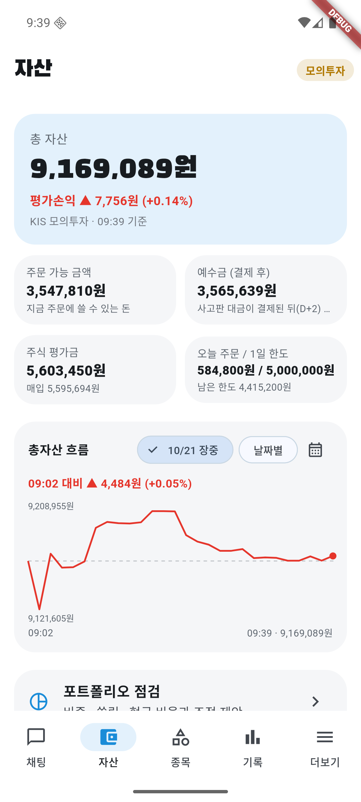
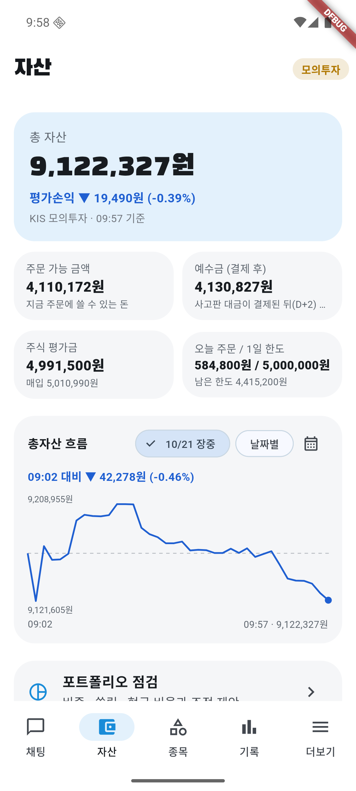
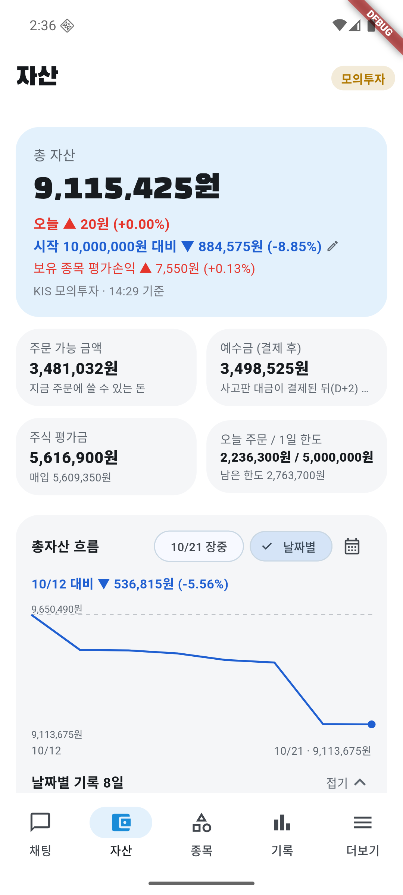

# 10/21 모의 자동매매 9일차: 코스피 +3.29% 반등일에 계좌 −0.15%, 시장보다 3.4%p 뒤짐

- 계좌: KIS 모의투자 (10/8 시작 1,000만 원)
- 기준: **종가는 정규장 종가(15:30)** — 15:47에 KIS 모의 현재가·지수로 조회. 총자산 마감 값은 그 종가 × 보유 수량 + 현금 (폰이 15:35에 올린 값 9,102,175원과 같음). 공식 종가는 내일 14시 금융위원회 수집 뒤 점수표에서 다시 본다. 장중 값은 폰이 5분마다 서버에 올린 총자산, 주문·AI 판단·검증은 서버 기록
- 사람이 한 일: 06:14 오늘 계획 승인. 장중 1시간마다 점검·캡처. 주문·매도 결정에는 손대지 않음. **장중에 서버를 3번 다시 띄우고 앱은 핫 리로드·리스타트로 고침** (사용자 요청, 아래 4장)
- 이날 코스피 **5,735.66 (+3.29%)**, 코스닥 792.76 (+1.38%). 어제(−3.73%) 급락 뒤 반등
- 이날 처음 적용 (10/20 장 마감 뒤 고친 것): 재무 금액 조·억 병기, 손절선 다시 묻기, 미룬 매도 서버 기록, 미룬 뒤 지수 1%p 더 빠지면 바로 묻기, 오늘 매도 반려 이유를 투자 AI에게

## 1. 결과

| | 값 |
|---|---|
| 총자산 (종가 계산) | **9,102,175원** (전날 9,115,405원) |
| 하루 | **−0.15%** (−13,230원). 코스피 +3.29%, 코스닥 +1.38% → **코스피보다 3.4%p 뒤짐** |
| 장중 | 최고 9,208,955원 (09:27, +1.03%), 최저 9,084,625원 (15:02, −0.34%) |
| 9일 누적 | 계좌 **−8.98%** (시작 1,000만 원 대비), 코스피 **−15.70%** (10/7 종가 6,803.90 대비) |
| 오늘 주문 | 체결 **9건** (매수 4, 매도 5). **HLB 매도 1건은 접수만 되고 체결 0주** (아래). 주문 실패 0 |
| 판 것의 확정 손익 (계산) | **−52,836원** (매입가 대비, 세금·수수료 별도) |
| 판 것 vs 종가 | 5건 중 **3건이 판 뒤 더 오름**, 2건은 같음. 들고 있었으면 +30,000원 |
| 현금 | 3,498,525원 (주식 비중 약 62%) |
| AI 판단 | 147건 (보유 79, 관찰 44, 매수 검토 12, 매도 검토 12). 검증 반려 5번, 2번 고쳐도 통과 못 함 1번 |
| 분석 한도 | 150/200 (다른 테스트 계정 포함). 막힌 적 없음 |

### 판 종목

| 시각 | 종목 | 수량 | 체결가 | 매입가 대비 | 왜 팔았나 (AI 근거) | 종가 | 판 가격 대비 종가 |
|---|---|---|---|---|---|---|---|
| 09:35 | 셀트리온 | 1 (3주 중) | 197,600 | +7.33% | 오늘 고가 때 이익 +10.5%에서 +7.5%로 돌려줌, VWAP 아래 | 197,600 | 0% |
| 09:36 | LG에너지솔루션 | 1 (전부) | 411,500 | −3.86% | **장중 공시**: 불성실공시법인 지정예고·횡령·배임 혐의 (위험 1등급), 시장 반등에도 약세 | 411,500 | 0% |
| 09:57 | 한화시스템 | 8 (전부) | 70,800 | −3.13% | **산 지 18분**. 매입가 −3%로 바로 물음 → VWAP 아래, 5분 저가 연속 하락 | 74,300 | **+4.94%** (28,000원 놓침) |
| 10:09 | NH투자증권 | 12 (전부) | 23,900 | −6.62% | 20·60일 평균 아래, 20일 평균 하락 중, 장중 약세 | 24,000 | +0.42% |
| 13:21 | 피에스케이홀딩스 | 4 (전부) | 183,700 | −1.50% | 오늘 10:02에 산 것. VWAP·20일 평균 아래로 내려감 | 183,900 | +0.11% |
| 14:35 | HLB | 21 (전부) | **체결 0주** | — | 오늘 고가에서 이익 반납. 첫 제안은 검증이 "상승 추세·호재 공시가 유지되는데 단기 장중 흐름만으로 전량 매도"라 반려, 다시 쓴 제안 승인 | 42,350 | 지정가 42,450원 아래에 머물러 체결 안 됨 |

### 산 종목

| 시각 | 종목 | 수량 | 체결가 | 어떻게 정했나 | 종가 | 체결가 대비 |
|---|---|---|---|---|---|---|
| 09:39 | 한화시스템 | 8 | 73,087 | 브리핑 관찰 → 실시간 다시 판단해 매수 (실적 개선, 장중 반등) | (09:57 매도) | −3.13% |
| 10:02 | 피에스케이홀딩스 | 4 | 186,500 | 20·60일 평균 위, 반기 영업이익 +27.67% | (13:21 매도) | −1.50% |
| 11:33 | SK이노베이션 | 5 | 151,900 | 11:02엔 출처 ID 형식으로 3번 반려 → 11:40 고친 뒤 통과 | 154,300 | +1.58% |
| 12:34 | 한화시스템 | 2 | 73,000 | **09:57에 70,800원에 판 종목을 더 비싸게 다시 삼** | 74,300 | +1.78% |

사지 못한 것: 엘앤씨바이오(09:06·09:38·11:33)와 HMM(13:02)은 AI·검증이 매수를 승인했지만 **급등 경고(5일 +17.4%·+10.1%)라 사람 확인이 필요**했고, 확인이 없어 10분 뒤 만료됐다. 엘앤씨바이오 11:33 가격 67,100원 → 종가 64,300원(**−4.17%**), HMM 23,350원 → 23,400원(+0.21%).

### 시장 탓이라 매도 판단을 미룬 종목

없음 (서버 `sell_deferrals` 0건). 지수가 오르는 날이라 미룰 조건(지수 −1.5%~−3%)이 생기지 않았다.

### 남은 종목 (종가, 매입가 대비)

| 종목 | 수량 | 매입가 | 종가 (그날 등락) | 매입가 대비 |
|---|---|---|---|---|
| 셀트리온 | 2 | 184,100 | 197,600 (+0.10%) | **+7.33%** |
| HLB | 21 | 41,150 | 42,350 (−1.51%) | +2.92% |
| 삼성SDI | 2 | 542,000 | 554,000 (−0.36%) | +2.21% |
| 한화시스템 | 2 | 73,000 | 74,300 (+5.24%) | +1.78% |
| SK이노베이션 | 5 | 151,900 | 154,300 (+4.19%) | +1.58% |
| KT&G | 3 | 194,500 | 194,000 (0.00%) | −0.26% |
| 기아 | 2 | 111,200 | 110,500 (−1.69%) | −0.63% |
| 고영 | 48 | 32,950 | 31,000 (+2.31%) | **−5.92%** |

평가손익 합계 −5,700원. 기아는 10/7에 직접 산 종목이라 자동매매가 맡지 않는다.

## 2. 장중 흐름

| 시각 | 총자산 | 무엇이 있었나 |
|---|---|---|
| 전날 마감 | 9,115,405원 | |
| 09:02 | 9,164,605원 | 장 시작부터 +0.54% |
| 09:27 | **9,208,955원** | 오늘 최고 (+1.03%) |
| 09:35~09:57 | | 셀트리온 1주·LG에너지솔루션 매도, 한화시스템 매수 → 18분 뒤 매도 |
| 10:02~10:09 | | 피에스케이홀딩스 매수, NH투자증권 매도 |
| 10:08 | 9,089,477원 | 아침 최저 (−0.28%) |
| 11:01 | 9,161,964원 | |
| 11:33 | | SK이노베이션 매수 |
| 12:02 | 9,152,264원 | |
| 12:34 | | 한화시스템 다시 매수 |
| 13:04 | 9,118,094원 | |
| 13:21 | | 피에스케이홀딩스 매도 |
| 14:04 | 9,129,175원 | |
| 14:35 | | HLB 매도 주문 (체결 0주) |
| 15:02 | **9,084,625원** | 오늘 최저 (−0.34%) |
| 15:35 (종가) | **9,102,175원** | |

| 09:39 한화시스템 매수 | 09:57 한화시스템 매도 | 12:34 다시 매수 | 14:35 HLB 매도 주문 | 마감 |
|---|---|---|---|---|
|  |  |  |  |  |

정기 캡처는 09:29·10:29·11:29·12:29·13:29·14:29·15:41. 15시 점검은 15:41에 돌아 마감 캡처와 함께 찍었다. 계좌번호는 화면에 없다.

## 3. 판단을 돌아보면

- **반등일에 시장을 못 따라갔다**: 코스피 +3.29%, 계좌 −0.15%. 반등일에 크게 뒤진 것은 10/16(+2.05% vs −0.34%)·10/19(+1.76% vs −0.04%)에 이어 세 번째. 떨어지는 날엔 덜 빠지고(10/13·10/15·10/20) 오르는 날엔 덜 오르는 모습이 이어진다
- **몇 분짜리 신호로 팔았다**: 판 5건의 근거가 대부분 "VWAP 아래·5분 저가 연속 하락·고가 대비 밀림"이었다. 상승일엔 이런 신호가 하루에도 여러 번 나왔다 사라진다. 한화시스템은 산 지 18분 만에 −3.1%에 팔았는데 종가는 판 가격보다 +4.94%였다
- **판 종목을 더 비싸게 다시 샀다**: 한화시스템 70,800원 매도 → 3시간 뒤 73,000원 매수. 판 사실을 투자 AI가 몰랐다
- **판 것의 확정 손실 −52,836원**이 보유 종목 평가손익(−5,700원)보다 컸다. 하루 손익을 끌어내린 것은 들고 있는 종목이 아니라 사고판 것
- **급등 경고로 안 산 것은 맞았다**: 엘앤씨바이오는 11:33 가격보다 −4.17%로 마감
- **장중 공시가 처음 실제 근거로 쓰였다**: LG에너지솔루션 매도 근거에 오늘 받은 불성실공시법인 지정예고가 인용됐고, 판 가격과 종가가 같았다
- **재무 금액 단위 반려 0건** (어제 6건). 조·억 병기가 효과를 냈다. 반려 5건은 출처 ID 형식 4건(`fin:…#91`, `per:계산 불가`, `metric: op_income_yoy`)과 HLB 단기 흐름 매도 1건
- **1등급 종목**: 새로 산 것 없음. LG에너지솔루션(불성실공시 지정예고)은 팔았고, 한국타이어(횡령·배임)는 관찰
- **HLB 매도가 체결되지 않았다**: 현재가 그대로 낸 지정가 42,450원이 그 아래(종가 42,350원)에 머물렀다. 앱은 "접수"를 판 것으로 보고 자동매매 보유에서 빼서 그 뒤로 HLB를 점검하지 않았다 (버그, 장 마감 뒤 고침)
- **어제 고친 것 중 확인 못 한 것**: 손절선 다시 묻기, 미룬 매도 기록, 미룬 뒤 바로 묻기는 오늘 조건(−7%·지수 하락)이 생기지 않아 미확인

### 10/20 판단 점수 (공공데이터 종가, 오늘 14시 수집 뒤)

- 관찰 13종목 평균 **−5.73%** (코스피 −3.73%인 급락일). 피한 손실 8 (한화시스템 −13.90%, 한화에어로스페이스 −11.71%, 한화솔루션 −10.01%), 놓친 기회 0. 씨젠·엘앤씨바이오는 종가 없음(미확인)
- 판 2건 모두 종가보다 높게 팔았다 (S-Oil −1.57%, SK이노베이션 −0.20%, 들고 있었으면 12,700원 더 잃음). 리포트 숫자와 같다

## 4. 오늘 고친 것

| 언제 | 무엇이 있었나 | 어떻게 바꿨나 | 위치 |
|---|---|---|---|
| 장 전 | 지난 날의 장중 흐름, 날짜별 손익, 시작 대비가 안 보임. 종목을 이름으로만 찾음 (사용자) | 총자산 그래프에 달력·누른 점의 시각·금액, 하단 **종목** 탭(150종목 16개 주제, 검색), 자산 카드에 "오늘"·"시작 대비", 날짜별 표(접기) | 앱 화면, `GET /api/themes`, `/api/equity` |
| 11:07 | 한화시스템 산 지 18분 만에 −3%로 바로 물어 팜 | 산 뒤 30분은 매도 판단을 묻지 않음 (강제 손절만) | `auto_trader.dart` `autoBuyHoldMin` |
| 11:07 | 엘앤씨바이오 사람 확인 처리안이 10분 만료로 반복 | 사람 확인 때문에 멈춘 매수는 그날 다시 묻지 않음 | `auto_trader.dart` `auto_needs_person` |
| 11:07 | 자동 매도 근거에 "사용자의 지시에 따라" (사실과 다름) | 자동매매 주문엔 '사용자 지시'라고 쓰지 않게 | `analysis.py` `invest_context` |
| 11:40 | SK이노베이션 출처 ID 형식으로 3번 반려 | `per:계산 불가`, `fin:…#번호` 바로잡기 | `analysis.py` `fix_source_id` |
| 15:41 | 몇 분짜리 신호로 팔고, 판 종목을 더 비싸게 다시 삼 | 장중 단기 신호만으로는 팔지 않음(검증 AI 반려). 오늘 판 기록을 투자·검증 AI에게 보여 다시 사는 근거를 쓰게 (일괄 금지는 사용자와 상의해 하지 않음) | `llm.py`, `analysis.py` `today_sells` |
| 16:13 | HLB 매도 체결 0주인데 판 것으로 기록 | 지난 날 체결 안 된 자동 매도는 다음 날 첫 점검 때 보유로 되돌림. 자동 매도 지정가는 한 호가 낮게. `metric:` 출처 ID 앞머리 | `routers/orders.py` `unfilled_sells`, `auto_trader.dart`, `order.py` `tick_below` |

## 5. 문제점

1. **오르는 날 너무 조심스럽다**: 세 번의 반등일 모두 시장보다 크게 뒤졌다. 15:41 고친 "단기 신호만으로 팔지 않기"가 매도 쪽을 줄일지 봐야 한다. 매수 쪽(현금 약 38%, 후보 대부분 관찰)은 내일 점수표로 오늘 관찰 종목이 얼마나 올랐는지 보고 정한다
2. **고영 −5.92%**: 손절선(−7%)까지 1%p 남짓. 오늘 판단은 모두 보유(실적 개선, 20일 평균 위)
3. **급등 경고 매수는 사람 확인 없이는 안 산다**: 오늘은 맞았지만(엘앤씨바이오 −4.17%), 장중에 아무도 확인하지 않으면 늘 못 산다
4. 검증 반려 5건 중 4건이 아직도 출처 ID 형식 (매번 새 모양)

## 6. 다음에 볼 것

- HLB가 내일 첫 점검 때 자동매매 보유로 돌아오는지, 자동 매도가 한 호가 낮게 나가 체결되는지
- "단기 신호만으로 팔지 않기" 뒤 매도 건수와 판 뒤 종가 비교
- 판 종목을 다시 살 때 투자 AI가 판 이유를 다루는지
- 손절선 다시 묻기·미룬 매도 기록 (하락일에)
- 10/21 관찰·매도 점수 (`python -m app.scorecard 2026-10-21`, 내일 14시 공공데이터 종가 수집 뒤)

모의투자 결과이며 투자 권유가 아니다.
