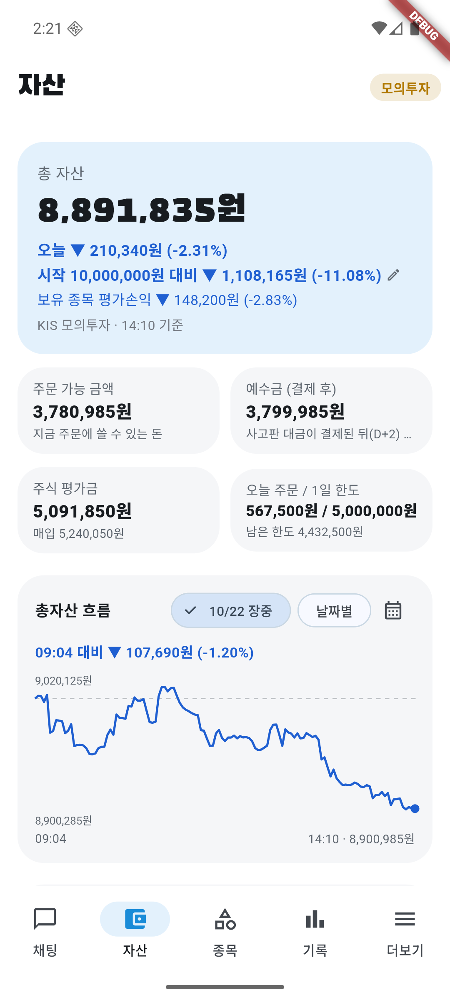

# 10/22 모의 자동매매 10일차: 코스피 −3.52% 폭락일에 계좌 −2.55%, 첫 매도는 13:37에야 나왔다

- 계좌: KIS 모의투자 (10/8 시작 1,000만 원)
- 기준: **종가는 정규장 종가(15:30)** — 15:47에 KIS 모의 현재가·지수로 조회. 총자산 마감 값은 그 종가 × 보유 수량 + 현금 (폰이 15:35에 올린 값 8,870,286원과 같음). 공식 종가는 내일 14시 금융위원회
- 사람이 한 일: 06:32 서버·에뮬레이터·앱을 켬. 장중 1시간마다 점검·캡처. 주문·매도 결정에는 손대지 않음. **장중에 서버를 2번 다시 띄움** (09:34 지수 %를 계좌 기록과 같이 저장, 09:52 점검 이유 전달). 마감 뒤 17:21에 한 번 더 (아래 4장)
- 이날 코스피 **5,533.77 (−3.52%)**: 시가 5,670.11 (갭 −1.14%), 고가 5,740.28, 저가 5,485.98 (−4.35%). 코스닥 764.10 (−3.62%)
- 이날 처음 적용 (10/21 마감 뒤 고친 것): 체결 안 된 자동 매도 되돌리기, 자동 매도 지정가 한 호가 낮게, 장중 단기 신호만으로는 팔지 않기, 오늘 판 기록을 AI에게

## 1. 결과

| | 값 |
|---|---|
| 총자산 (종가 계산) | **8,870,286원** (전날 9,102,175원) |
| 하루 | **−2.55%** (−231,889원). 코스피 −3.52%, 코스닥 −3.62% → **코스피보다 0.97%p 덜 빠짐** |
| 장중 | 최고 9,020,125원 (10:08, −0.90%), 최저 8,868,386원 (14:51, −2.57%) |
| 10일 누적 | 계좌 **−11.30%** (시작 1,000만 원 대비), 코스피 **−18.67%** (10/7 종가 6,803.90 대비) |
| 오늘 주문 | 체결 **6건** (매수 1, 매도 5). 주문 실패 0, 체결 0주 0 |
| 판 것의 확정 손익 (계산) | **−245,804원** (매입가 대비, 세금·수수료 별도). 고영 −143,904원이 가장 큼 |
| 판 것 vs 종가 | 5건 중 **3건은 판 뒤 더 내림** (판 게 나음), 2건은 같음. 팔아서 종가 기준 **+12,196원** |
| 현금 | 6,249,136원 (70%) |
| AI 판단 | 148건 (보유 79, 관찰 51, 매도 검토 11, 매수 검토 7). 검증 반려 6번 |
| 분석 한도 | 148/200 (다른 테스트 계정 포함). 막힌 적 없음 |
| 서버 오류 | Gemini 일시 오류 6번 (503 수요 폭주 3, 429 한도 3). AI 판단이 통째로 실패한 기록 없음 |

### 판 종목 (5건, 모두 체결)

| 시각 | 종목 | 수량 | 지정가 → 체결가 | 매입가 대비 | 왜 팔았나 (AI 근거) | 종가 | 판 가격 대비 종가 |
|---|---|---|---|---|---|---|---|
| 13:37 | 고영 | 24 (절반) | 29,950 → 30,054 | −8.79% | **손절선(−7%) 이탈**(−8.95%), 20일 평균 −7.5% 아래, VWAP 아래, 코스닥 −2.8% | 29,850 | −0.68% (판 게 나음) |
| 13:44 | 한화시스템 | 2 (전부) | 74,700 → 74,800 | +2.47% | 오늘 고가 77,100 대비 −2.98%(이익 3.15%p 반납), 20일 평균(77,145) −3.04% 아래, VWAP 아래, 코스피 −3.52% | 73,900 | −1.20% (판 게 나음) |
| 14:20 | 고영 | 24 (나머지) | 29,800 → 29,850 | −9.41% | 14:19 **코스피 −3.86%로 보유 전체를 다시 물음**. 손절선 이탈이 이어짐, 5분 저가 3번 연속 하락, 20·60일 평균 아래 | 29,850 | 0% |
| 14:36 | 삼성SDI | 2 (전부) | 512,000 → 512,000 | −5.54% | 14:30 마감 전 점검. 20일 평균 −6.2% 아래, VWAP −3.6% 아래, 고가 대비 이익 7.75%p 반납 | 512,000 | 0% |
| 14:37 | SK이노베이션 | 5 (전부) | 142,600 → 142,800 | −5.99% | 14:30 마감 전 점검. 20일 평균 −6.05% 아래, VWAP 아래, 5분 저가 3번 연속 하락 | 141,700 | −0.77% (판 게 나음) |

지정가는 모두 **그때 현재가보다 한 호가 낮게** 냈고 5건 모두 체결됐다 (어제 HLB처럼 체결 0주로 끝난 일 없음). 체결가가 지정가보다 높은 것은 매도 지정가가 시장가보다 낮아 바로 체결됐기 때문이다.
고영은 −7.3%에 처음 닿은 11:14에는 AI와 검증 AI가 "보유"로 판단했고(실적 개선 +328% 등), 13:36 −8.8%에서 팔자고 했다.
삼성SDI·SK이노베이션·한화시스템의 **주문 단계 근거 문장**이 "마감 전 점검 기준(매입가 대비 −5.5%)에 도달해서 매도"처럼 없는 기준을 적었다. 매도 판단 자체는 위 표의 실제 근거(20일 평균 이탈 등)였다. 4장에서 고쳤다.

### 산 종목

| 시각 | 종목 | 수량 | 체결가 | 어떻게 정했나 | 종가 | 체결가 대비 |
|---|---|---|---|---|---|---|
| 12:34 | HMM | 25 | 22,700 | 09시대엔 VWAP 아래 −3.6%라 관찰. 12:33 오늘 저가 22,700원 뒤 추가 하락 없이 반등, 20·60일 평균 위 | 22,650 | −0.22% |

사지 못한 것:
- **급등 경고(사람 확인 필요)**: 유한양행(10:33, 84,100원 → 종가 84,000원 −0.12%), 하이브(11:33, 178,900원 → 종가 177,200원 −0.95%). AI·검증 AI는 승인했지만 "급등 직후 매수예요" 확인이 필요해 자동으로 사지 않았다. 처리안은 대기 상태. 안 산 게 맞았다 (작은 차이)
- **위험 1등급 · 관찰**: 삼천당제약(불성실공시), LG에너지솔루션(불성실공시 지정예고), 한국타이어(횡령·배임)
- **주문 직전 관찰**: LG유플러스(13:02, 20·60일 평균 아래로 내려옴). 메리츠금융지주(14:01)는 처리안이 만들어지지 않았다 (앱 기록 미확인)
- 09시대 후보(HMM 등)는 하락 중이라 관찰. NC는 20·60일 평균 아래라 관찰

### 시장 탓이라 매도 판단을 미룬 종목 (10:41, 6건, 코스피 −1.76%)

| 종목 | 미룬 때 가격 | 마감 | 변화 | 수량 | 그때 팔았으면 |
|---|---|---|---|---|---|
| 삼성SDI | 531,000 | 512,000 | −3.58% | 2 | +38,000원 |
| 고영 (급락 `drop`) | 30,700 | 29,850 | −2.77% | 48 | +40,800원 |
| 한화시스템 | 75,700 | 73,900 | −2.38% | 2 | +3,600원 |
| 셀트리온 | 196,300 | 194,300 | −1.02% | 2 | +4,000원 |
| KT&G | 194,300 | 193,800 | −0.26% | 3 | +1,500원 |
| HLB | 41,350 | 41,300 | −0.12% | 21 | +1,050원 |

**6건 모두 마감이 더 낮았다.** 그때 팔았으면 약 +88,950원(세금·수수료 전) 나았다. 코스피는 미룰 때 −1.76%에서 마감 −3.52%까지 더 빠졌다. 10/20(−59,500원)에 이어 이틀 모두 하락이 이어진 날이라 미룬 쪽이 손해였다. 반대로 10/13·10/19(반등일)에는 아침에 판 쪽이 손해였다.

### 남은 종목 (종가, 매입가 대비)

| 종목 | 수량 | 매입가 | 종가 (그날 등락) | 매입가 대비 |
|---|---|---|---|---|
| 셀트리온 | 2 | 184,100 | 194,300 (−1.67%) | **+5.54%** |
| HLB | 21 | 41,150 | 41,300 (−2.48%) | +0.36% |
| HMM | 25 | 22,700 | 22,650 (−3.21%) | −0.22% |
| KT&G | 3 | 194,500 | 193,800 (−0.10%) | −0.36% |
| 기아 | 2 | 111,200 | 108,800 (−1.54%) | −2.16% |

평가손익 합계 +15,400원. 기아는 10/7에 직접 산 종목이라 오늘까지 자동매매가 맡지 않았다 (내일부터 맡음, 4장). **HLB 21주는 09:07에 자동매매 보유로 되돌아와** 하루 종일 점검을 받았다.

## 2. 장중 흐름

오늘부터 계좌 기록에 **그때 코스피·코스닥 %를 같이 저장**한다.

| 시각 | 코스피 | 총자산 | 무엇이 있었나 |
|---|---|---|---|
| 전날 마감 | | 9,102,175원 | |
| 09:04 | | 9,008,675원 (−1.03%) | 갭 하락 출발 (코스피 시가 −1.14%) |
| 09:07 | | | HLB 21주가 자동매매 보유로 되돌아옴 |
| 09:34 | | **8,954,175원** | 아침(09시대) 최저 (−1.63%) |
| 09:36 | | | SK이노베이션 −7.3% 손절선 질문. 매도는 승인됐지만 주문 단계에서 반려 → 주문 0건 (4장) |
| 10:08 | −0.99% | **9,020,125원** | 오늘 최고 (−0.90%) |
| 10:41 | −1.76% | | 시장 탓 하락으로 6종목 매도 판단 30분 미룸 (처음 실제로 동작) |
| 11:14 | −2.05% | | 고영 −7.3% 손절선 질문 → 보유 |
| 11:24 | −2.31% | 8,958,825원 | |
| 12:34 | 약 −2.8% | | HMM 25주 매수 |
| 13:05 | −3.0% | 8,924,545원 | |
| 13:37 | 약 −3.5% | | 고영 24주 매도 (손절선) |
| 13:44 | −3.5% | | 한화시스템 2주 매도 |
| 14:19 | −3.86% | | 시장 급락 → 보유 종목 전체 다시 물음 |
| 14:20 | | | 고영 나머지 24주 매도 |
| 14:36~14:37 | | | 마감 전 점검: 삼성SDI 2주, SK이노베이션 5주 매도 |
| 14:51 | | **8,868,386원** | 오늘 최저 (−2.57%) |
| 15:35 (종가) | −3.52% | **8,870,286원** | |

| 12:34 HMM 매수 | 13:37 고영 매도 | 14:21 고영 매도 | 14:37 SK이노베이션 매도 | 마감 |
|---|---|---|---|---|
|  |  |  |  |  |

정기 캡처는 09:40·10:26·11:26·12:26·13:26·14:26·15:35. 계좌번호는 화면에 없다.

### 장 초반 흐름 (10/20~10/22, 계좌 기록)

| 날 | 09시 첫 값 | 09~10시 최저 (시각) | 10:30 | 하루 최고 | 하루 최저 | 마감 |
|---|---|---|---|---|---|---|
| 10/20 | 9,352,313 (09:05) | 9,169,751 (09:55) | 9,193,871 | 9,359,863 (09:06) | 9,092,921 (14:09) | 9,115,405 |
| 10/21 | 9,164,605 (09:02) | 9,121,605 (09:07) | 9,146,514 | 9,208,955 (09:27) | 9,084,625 (15:02) | 9,102,175 |
| 10/22 | 9,008,675 (09:04) | 8,954,175 (09:34) | 8,992,475 | 9,020,125 (10:08) | 8,868,386 (14:51) | 8,870,286 |

지수 일봉 300거래일(2025-07-29~2026-10-22, KIS 모의 일봉)로 본 아침 하락 뒤 모습: 코스피가 하락 출발(시초가 −0.3% 이하)한 99일 중 **시초가보다 오른 채 마감한 날은 49%**, 장중 −2% 넘게 빠진 84일 중에는 30%. 최저점에서 마감까지 평균 1.6~2%p 올랐다. 일봉이라 최저가 몇 시였는지는 모른다 (오늘부터 쌓는 지수 % 기록으로 본다).

## 3. 판단을 돌아보면

- **시장이 거의 전부였다**: 코스피 −3.52%(갭 −1.14%로 시작해 저가 −4.35%), 계좌 −2.55%. 현금 비중이 계좌를 0.97%p 지켜 줬다. 10일 누적은 계좌 −11.30%, 코스피 −18.67% (10/6 이후 코스피 −20.3%)
- **아침엔 한 건도 팔지 않았다**: 09시대 매도 0건. 09:30 이후 첫 점검에서 매도 제안은 SK이노베이션 한 건뿐이었고 주문 단계에서 막혔다. 나머지는 모두 보유. 첫 매도는 13:37. 10:41 시장 탓 미룸 6건은 **모두 틀렸다** (약 88,950원). 10/20(−59,500원)과 이틀 연속 하락이 이어진 날의 미룸이 손해. 10/13·10/19처럼 반등일에는 아침에 판 것이 손해였다. 양쪽 다 틀린 날이 있어 이 규칙을 바꿀 근거는 아직 부족하다
- **손절선에서 AI가 바로 팔지 않았다**: 고영은 −7.3%(11:14)에 보유 판단 → −8.8%(13:36)에 매도. 두 시간 반 동안 −2%p 더 내렸다. 반대로 SK이노베이션은 −7.3%(09:36)에서 막혔다가 오후에 −4~−5%대로 올라와 정기 점검에서 보유, 14:37에야 −6.0%에 팔렸다. AI가 손절선을 보고도 장중 흐름·실적을 더 따지는 것이 오늘은 비용이었다
- **단기 신호만으로 팔지 않기는 동작했다**: 판 5건 모두 20일 평균 이탈·손절선·이익 반납 같은 더 긴 근거가 있었고, 09:36 SK이노베이션의 단기 신호만 근거였던 제안은 검증이 반려했다
- **어제 고친 것**: HLB 되돌리기 09:07 작동, 한 호가 낮은 지정가 5건 모두 체결, 오늘 판 종목을 다시 산 일이 없어 `today_sells`는 실제로 못 봤다 (테스트로만 확인)
- **확정 손익 −245,804원** 중 고영이 −143,904원. 팔아서 종가 기준 +12,196원 아낀 셈이지만, 매입가보다 낮게 판 것이라 확정 손실이다
- **급등 경고로 안 산 것은 맞았다** (유한양행 −0.12%, 하이브 −0.95%). HMM은 반등을 확인하고 샀지만 마감까지 −0.22%
- **반려 6건**: 출처 ID 형식 2 (`ID: op_income_yoy` SK이노베이션 첫 매도 검증, `per/pbr/revenue_yoy 지표` HMM), 단기 신호만으로 매도 1, NC 관찰의 반대 근거 분류 1, 결론 일관성 부족 2 (14:20 고영, 14:37 SK이노베이션 — 투자 AI가 매도 대신 보유를 써서). 모두 고쳐 재제출돼 통과했다
- **10/21 판단 점수** (공공데이터 종가, 오늘 14:23): 관찰 11종목 평균 **−0.28%**, 매수 검토 4종목 평균 **+2.99%** (한화시스템 +5.24%, SK이노베이션 +4.19%, 피에스케이홀딩스 +2.74%, HMM −0.21%, 엘앤씨바이오는 종가 없음 미확인). 놓친 기회 2 (삼천당제약 +3.66%, 대한광통신 +12.24%), 피한 손실 2 (NC −2.95%, 서진시스템 −10.88%). 10/21에 판 5건은 들고 있었으면 +30,000원

### 10일 동안 왜 손해인가 (주문 기록으로 계산, 근사)

- 매도 24건 중 **21건이 손실**, 확정 손실 합계 약 **−114만 원**(세금 0.2% 포함). 전체 손실(약 −113만 원)과 거의 같다. 확정 손실의 약 65%는 10/13·10/19 **아침 급락에 판 것**(현대건설 −18.6만 원, 한화시스템 −16.6만 원, 솔브레인 −9.1만 원 등), 22%는 오늘 손절 3건
- 코스피가 10/6 6,941에서 오늘 5,534까지 **−20.3%**. 10/8(473만 원)·10/12(368만 원)에 산 물량은 코스피 −2.6%·−3.65% 하락일에 샀고 그 뒤 −8~−13% 더 빠졌다. 10/16 반등일 매수 772만 원도 그 뒤 −2%대. 추세 있는 종목만 고르는 방식이 시장 전체가 무너지는 시기에는 통하지 않았다
- 세금·수수료는 약 3.6만 원으로 손실의 3%. 원인이 아니다

## 4. 오늘 고친 것

| 언제 | 무엇이 있었나 | 어떻게 바꿨나 | 위치 |
|---|---|---|---|
| 아침 | 체결 안 된 매도를 되돌리는 기능이 서버를 못 읽어도 "오늘 했다"고 표시해 그날 다시 안 함 | 서버에서 받은 뒤에만 오늘 처리 표시 | `auto_trader.dart` `_restoreUnfilledSells` |
| 09:34 | "아침 하락 뒤 반등하나"를 계좌와 나란히 볼 기록이 없음 | 계좌 기록 때 그때 코스피·코스닥 %를 같이 저장 (`account_snapshots.kospi_pct`·`kosdaq_pct`, 마이그레이션 022). 서버를 마이그레이션보다 먼저 켜 스냅샷 3건이 500 (일회성) | `routers/snapshot.py`, `auto_trader.dart` |
| 09:52 | SK이노베이션 손절선 매도가 점검에서 승인됐는데 주문 단계에서 이유를 몰라 반려 → 주문 0건 | 앱이 손절선 이유를 주문 단계에 보내 투자·검증 AI가 보게 함. 13:37 고영에서 처음 동작 | `routers/chat.py` `auto_reason`, `analysis.py`, `llm.py` |
| 17:21 | 마감 전·정기 점검 이유와 "매입가 대비 −5.5%"를 보냈더니 AI가 "마감 전 점검 기준에 도달해서 매도"처럼 없는 기준을 근거로 적음 | **손절선일 때만** 이유를 보내고, 매입가 대비 %·"이미 승인" 문구를 뺌. 투자 AI에게 "행동은 sell, [자료]에서 확인한 사실만 근거로" | `auto_trader.dart` `sellBasis`, `analysis.py` |
| 17:21 | 출처 ID가 매일 새 모양으로 반려 (`ID: …`, `a/b/c 지표`) | 앞머리·꼬리를 떼고 슬래시로 이은 것은 쪼갬. 모르는 ID는 그대로 반려 | `analysis.py` `fix_source_id_list` |
| 17:21 | 사람이 직접 산 종목(기아 등)은 자동 점검 밖이라 계속 들고 있음 (사용자 결정) | 5분 점검 때 계좌 보유 중 맡지 않은 종목을 함께 점검. **모의투자만, 서버 분석 대상 종목만** | `auto_trader.dart` `adoptable` |

바꾼 파일·함수·테스트는 [수정 기록](../AI_CHANGELOG.md) 10/22 장중. 테스트 서버 336, 앱 45.

## 5. 문제점

1. **하락이 이어지는 날 시장 탓 미룸이 손해**: 10/20 −5.95만 원, 10/22 −8.9만 원. 지금은 코스피가 20일 평균보다 −13% 아래인데도 하루짜리 하락처럼 미룬다. 규칙을 바꿀지 사용자와 정한다 (이번엔 제외)
2. **하락장 신규 매수**: 10/8·10/12에 하락일에 산 물량이 손실의 큰 구조적 원인. 하락장에서 신규 매수를 쉴지는 사용자 결정 (이번엔 제외)
3. **손절선에서 AI가 두 시간 반 더 들고 있었다** (고영 −7.3% → −8.8%). 손절선은 AI 판단 기준이라 장중 흐름·실적을 따진다. 강제 손절은 −10%
4. 점검에서 승인된 매도를 주문 단계에서 AI가 다시 판단하는 이중 구조. 오늘 문구로 줄였지만 근본은 그대로
5. 사람이 산 종목 자동 점검은 내일 처음 동작한다 (직접 산 직후 5분 안에 AI가 팔 수 있음)
6. 위험 1등급 종목과 급등 경고 종목은 계속 관찰·확인 대기만 한다 (오늘은 맞았다)
7. Gemini 일시 오류 6번 (503·429). 판단이 실패한 기록은 없지만 모델 사용량이 몰리면 위험

## 6. 다음에 볼 것

- **내일 아침 첫 점검에서 기아가 자동매매 보유로 들어오는지**, 셀트리온·HLB와 같이 점검받는지
- 오늘 판 종목을 다시 살 때 투자 AI가 판 이유를 다루는지 (`today_sells`)
- 계좌 기록에 쌓이는 코스피 %로 아침 하락 뒤 반등 여부를 계속 확인 (몇 주 뒤 분봉 수준으로)
- 손절선(−7%)에서 AI가 바로 파는지, 마감 전 점검 근거 문장이 사실만 쓰는지
- 10/22 관찰·매도 점수 (`python -m app.scorecard 2026-10-22`, 내일 14시 공공데이터 종가 수집 뒤)

모의투자 결과이며 투자 권유가 아니다.
