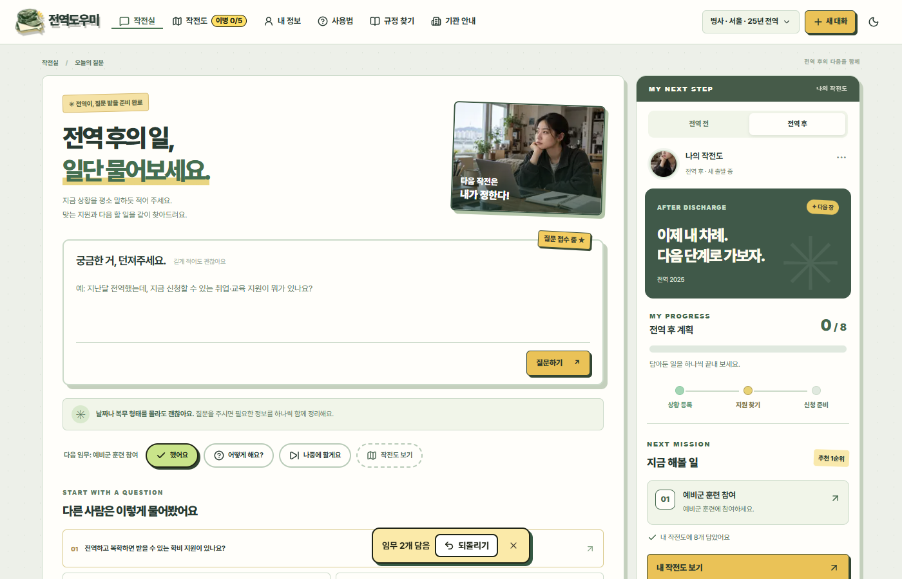
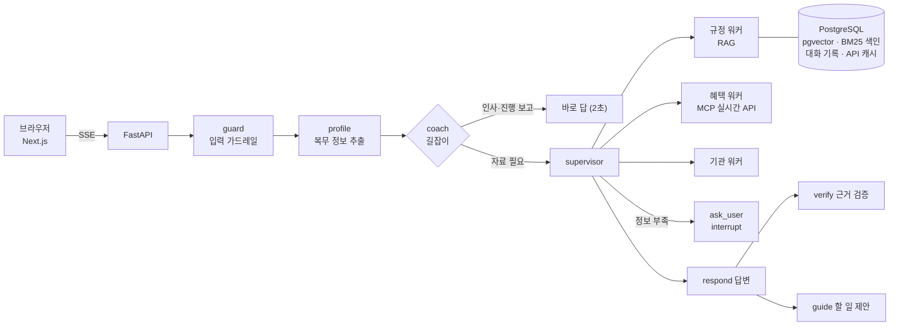
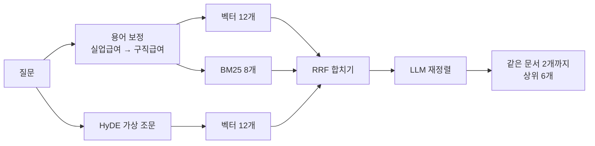

# 전역도우미

> 전역한 사람이 "나는 뭘 받을 수 있지?"라고 물으면 **받을 수 있는 혜택, 그 법적 근거, 신청할 곳**을 찾아 주고,
> 해야 할 일을 하나씩 안내하는 AI 에이전트입니다.

| 답변 평가 | 검색 골든셋 | RAGAS 근거 충실도 | 검색 자료 |
|:---:|:---:|:---:|:---:|
| **202 / 205** 문항 통과 | **Recall@6 100%** (84문항) | **0.886** (178문항) | **10,143** 조각 (법령·조례·안내서) |

## 왜 만들었나

**전역자들은 자기가 받을 수 있는 혜택을 잘 모릅니다.** 찾아보려 해도 제대로 아는 실무자가 드물어, 결국 본인이 직접 찾아야 합니다.

저는 병사와 간부로 총 8년 반을 복무하고 전역했습니다. 전역을 앞두고 무엇을 신청해야 하는지 알려 주는 곳이 없어 애를 먹었습니다.
혜택은 법령(제대군인지원법·국민연금법·병역법…), 보훈부·국방부 안내서, 지자체 조례, 공공기관 누리집에 흩어져 있고,
병사·단기 간부·중장기 복무·보훈대상자인지, 어디 사는지, 언제 전역하는지에 따라 받을 수 있는 것이 달랐습니다.

그래서 **흩어진 자료를 모아 근거(조문 번호)와 함께 답하고, 답에서 끝나지 않고 내가 할 일의 목록(작전도)으로 이어 주는 에이전트**를 만들었습니다.

## 화면

| 처음 온 사람: 묻거나 복무 형태를 고르면 | 버튼 몇 번으로 작전도 완성 |
|---|---|
|  |  |

| "어떻게 해요?" → 근거와 함께 답변 | "했어요" → 계급이 오르고 다음 임무 |
|---|---|
|  |  |

<details><summary>화면 더 보기 (작전도, 내 정보, 다크 모드, 모바일)</summary>

| 다시 온 사람: 다음 임무부터 | 나의 전역 작전도 |
|---|---|
|  |  |

| 내 정보 | 사용법 | 다크 모드 |
|---|---|---|
|  |  |  |

| 모바일 첫 화면 | 모바일 대화 |
|---|---|
|  |  |

</details>

## 구조



LangGraph 슈퍼바이저가 질문에 맞는 워커를 고르고(규정·혜택은 동시에 실행), 답변은 워커가 가져온 **도구 원문만** 근거로 씁니다.
모든 저장(벡터, 키워드 색인, 대화 기록, 프로필, API 응답, 피드백, 작전도)은 PostgreSQL 하나에 둡니다.

## 기술을 어떻게 썼고, 무엇이 나아졌나

### 1. 하이브리드 검색 (pgvector + BM25 + HyDE + 재정렬)

| | |
|---|---|
| **문제** | "군대 갔다온 거 연금에 쳐주나요" 같은 구어체는 "가입기간 추가 산입" 같은 조문 문장과 벡터 거리가 멀고, "공무상요양비"·"제25조"처럼 정확한 용어는 벡터 검색이 놓친다 |
| **적용** | ① 벡터 검색(gemini-embedding-001, pgvector) ② **HyDE**: 모델이 법령 문체의 가상 조문을 써서 한 번 더 검색 ③ **BM25**: Kiwi 형태소 분석(조사 제거) 키워드 검색 → 셋을 **RRF**로 합치고 ④ LLM **재정렬** 후 같은 문서는 2개까지 |
| **결과** | 골든셋 84문항 Hit@6 100%, **Recall@6 99% → 100%** (BM25 추가, 두 번 측정 모두). BM25 없이 놓치던 "휴가 중 사고, 민간병원" 질문의 공무상요양비 조문을 찾음 |
| **그래서 지금은** | 키워드 가중치를 0.3~1.0으로 바꿔 비교했고, 근거를 하나도 놓치지 않은 1.0을 씀. BM25 색인(28MB)은 Postgres에 저장해 DB 지문(md5)이 같으면 다시 만들지 않음 |



- 조례는 사용자 지역 것만 찾습니다(지자체마다 비슷한 조례가 수백 개라 섞이면 법령이 밀려남).
- 600쪽짜리 안내서가 상위를 다 차지하던 문제를 "같은 문서 2개까지"로 막았습니다(제한 전 평가 24/30까지 하락).

### 2. 평가: 키워드 채점 + 검색 골든셋 + RAGAS

| | |
|---|---|
| **문제** | "좋아 보이는데"로는 프롬프트·자료를 바꿀 때 무엇이 망가졌는지 알 수 없다 |
| **적용** | ① 답변 평가 205문항(근거 출처·핵심 내용·되묻기·도구·프로필 추출·나오면 안 되는 말 채점. 전제가 틀린 질문 등 어려운 질문 34개, 가드레일 8개 포함) ② 검색 골든셋 84문항(Hit·Recall·MRR) ③ **RAGAS**: 근거 충실도(faithfulness)·답변 관련성·자료 관련성 |
| **결과** | RAGAS가 키워드 채점이 놓친 문제를 찾음: 나라사랑가게 목록에 원문에 없는 "대상·내용"을 지어 넣음(근거 충실도 **0.09 → 0.97**), 위탁병원 목록에서 "위탁병원인지 확인할 수 없다"고 얼버무림(답변 관련성 **0 → 0.97**) |
| **그래서 지금은** | 프롬프트·검색을 바꾸면 세 평가를 다시 돌림. 평가를 63 → 205문항으로 늘리자 지어낸 전역일, 자격 질문을 검색 없이 답하는 문제가 새로 드러나 고침. 최종 **202/205**, RAGAS 근거 충실도 0.886·답변 관련성 0.864·자료 관련성 0.942 |

- 정답은 검색 결과를 베끼지 않고 조문·쪽 내용으로 정했고, 금액·기한처럼 바뀌는 사실은 채점 기준에 넣지 않았습니다.
- 회귀를 실제로 잡았습니다: 프로필 추출 항목을 늘리자 41/41 → 37/41로 떨어져 되돌렸고, 자료를 늘리자 24/30까지 떨어져 원인(큰 문서가 법령을 밀어냄)을 고쳤습니다.

### 3. 환각 줄이기: 원문 기준 답변 + 근거 검증

| | |
|---|---|
| **문제** | 모델이 그럴듯한 금액·기한·자격을 지어내거나, 5년 미만 복무자에게 전직지원금을 안내한다 |
| **적용** | 답변 모델에는 워커 요약이 아닌 **도구 원문**만 근거로 줌 → **verify 노드**가 초안 문장마다 원문에 있는지 대조해 고칠 문장만 돌려받음(구조화 출력) → 기한은 출처에 그 문구가 있을 때만 남김 |
| **결과** | 답 전체를 다시 쓰던 방식 대비 검증 단계 수 초 단축, 줄바꿈 등 형식이 깨지지 않음. 이 단계가 빈 답을 만드는 경우도 초안으로 대체 |

### 4. LangGraph 에이전트: 검색기가 아니라 길잡이

| | |
|---|---|
| **문제** | 사용자는 "무슨 혜택이 있는지"보다 "그래서 나는 뭘 해야 하지?"가 궁금하다. 인사에도 검색을 돌리면 느리다 |
| **적용** | 맨 앞에 **coach 노드**: 인사·진행 보고는 검색 없이 답하고, 자료가 필요한 질문만 supervisor로. 버튼(복무 형태 고르기, 했어요·어떻게 해요?)은 **LLM이 아니라 규칙**으로 만들어 매번 같게 |
| **결과** | 인사·진행 보고는 2~3초, 자료 질문 평균 14.9초. 버튼 두세 번으로 작전도 완성 |

### 5. Human-in-the-loop (interrupt)

| | |
|---|---|
| **문제** | 정보가 모자라 되물으면 그래프가 끝나고, 사용자가 답하면 처음부터(프로필 → 라우팅 → 워커) 다시 돌았다 |
| **적용** | `ask_user`가 `interrupt()`로 멈추고, 사용자의 답을 API가 `Command(resume=답)`으로 넘겨 **멈춘 자리에서 이어 감**. 대화 상태는 Postgres 체크포인터에 남음 |
| **결과** | 되묻기 전에 찾은 자료를 다시 검색하지 않음(테스트로 워커 호출 1회 확인). 화면 쪽 이벤트 형식은 그대로 |

### 6. MCP 실시간 도구 + 응답 저장

| | |
|---|---|
| **문제** | 혜택·채용·병원 목록은 계속 바뀌어 임베딩해 둘 수 없고, 매번 받으면 느리다 |
| **적용** | 정부24·온통청년·제대군인지원센터 채용·보훈 채용·보훈 위탁병원·나라사랑가게·관할 보훈청을 **MCP 서버 도구 10개**로 묶음. 응답은 메모리 + Postgres에 유효 시간(1~24시간) 동안 저장 |
| **결과** | 서버를 다시 켠 뒤 나라사랑가게 2,625건 **4.3초 → 0.2초**, 온통청년 3,264건 **4.2초 → 0.2초**. 키가 없거나 API가 실패하면 직접 찾아볼 기관 링크로 대체 |

### 7. 안정성: 가드레일 · 장애 대응 · 메모리

| 기술 | 적용 | 결과 |
|---|---|---|
| **가드레일** | 프롬프트 인젝션은 검색 전에 규칙으로 차단, 주민번호·카드번호·군번은 LLM과 대화 기록에 닿기 전에 가림 | 실제 서버에서 대화 기록(Postgres)에 원래 번호 0건 확인. LLM 판단을 쓰지 않아 질문마다 1~2초 절약 |
| **TimeoutPolicy · RetryPolicy · error_handler** | 답변 작성 노드에 90초 제한, 끊긴 연결만 재시도, 실패 시 안내 문구로 종료 | 응답이 멈춰 화면이 계속 도는 일 방지. 워커는 동시 실행이라 노드 안에서 45초 제한(병렬 노드에서 error_handler가 동작하지 않는 것을 확인함) |
| **Postgres 체크포인터 · trim_messages** | 대화 기록·프로필을 SQLite에서 Postgres로, LLM에는 최근 약 4,000토큰만 | 서버 여러 대로 늘릴 수 있는 구조, 대화가 길어져도 속도·비용 일정 |

### 8. 응답 속도

| 바꾼 것 | 효과 |
|---|---|
| 규정·혜택 워커 동시 실행, 워커 두 곳이 찾으면 다시 판단하지 않고 답변 | 약 1초씩 |
| 근거 검증은 답 전체 대신 고칠 문장만, 말풍선은 검증과 동시에 | 고칠 때 수 초, 말풍선 2~3초 |
| 답변은 생각 예산 1,024, 나머지 판단은 생각 끔 (0·1,024·기본값을 평가로 비교해 결정) | 27.1초 → 21.4초 (같은 30/30) |
| 같은 질문·같은 조건은 1시간 동안 저장한 답 | 0초 |

평가 평균 17.2초 → **14.9초**. "15년 복무, 부산"처럼 101초까지 걸리던 질문은 시간 상한으로 22초.

## 트러블슈팅

| 문제 | 원인 | 해결 | 결과 |
|---|---|---|---|
| "실업급여 받을 수 있어요?"에 고용보험법 조문을 못 찾음 | 벡터 검색이 "실업급여"와 법령 용어 "구직급여"를 가깝게 보지 못함 (후보를 30개로 늘려도 못 찾음) | 생활 용어 → 법령 용어 사전으로 질문에 덧붙임, 이후 BM25 추가 | 골든셋 Hit 100% |
| 자료를 늘렸더니 답변 평가 30/30 → 24/30 | 600쪽 안내서 조각이 상위를 다 차지해 법령이 밀려남, 워커가 도구 없이 답함 | 같은 문서 2개 제한, 워커는 도구 호출을 강제(미들웨어) | 30/30 회복 |
| "전역 후 혜택 있어요?"에 "정부24에서 조회해 보세요"로 끝남 | 복무 형태를 모르면 모델이 답을 피함 | 병사 기준으로 구체적으로 답하고 그 기준을 첫 문단에 밝히도록 프롬프트 | 사이트로 떠넘기는 답 사라짐 |
| 나라사랑가게마다 "대상: 병역의무 이행자"를 지어 넣음 (RAGAS로 발견) | 혜택 카드 틀(대상·내용·근거)을 장소 목록에도 강제 | 장소는 "이름: 주소, 전화" 목록으로, 도구 결과에 목록 설명 추가 | 근거 충실도 0.09 → 0.97 |
| Postgres 체크포인터가 Windows에서 연결 실패 | psycopg 비동기가 Windows 기본 이벤트 루프(Proactor)를 지원하지 않음 | Windows에서만 Selector 루프 사용 (Docker·Linux는 무관) | 로컬 테스트·명령 정상 |

## 기술 스택

| 영역 | 기술 |
|---|---|
| LLM · 에이전트 | Gemini 2.5 Flash, LangChain, **LangGraph** (슈퍼바이저, interrupt, TimeoutPolicy, 구조화 출력) |
| RAG | **PostgreSQL + pgvector**, BM25(Kiwi) + RRF, HyDE, LLM 재정렬 |
| 도구 연동 | **MCP** 서버 (정부24, 온통청년, 제대군인지원센터 채용, 보훈 채용, 위탁병원, 나라사랑가게) |
| 서버 | **FastAPI** (SSE 스트리밍), SQLAlchemy 2.0 + Alembic, LangGraph Postgres 체크포인터·스토어 |
| 화면 | Next.js 16 (App Router), React 19, TypeScript, Tailwind CSS 4 |
| 품질 | pytest 226개, vitest 50개, ruff, ESLint, 평가 3종(답변·검색 골든셋·RAGAS), GitHub Actions CI |
| 배포 | Docker Compose |

## 실행

```bash
cp backend/.env.example backend/.env   # 키 입력 (아래 표)
docker compose up --build              # http://localhost:3000
```

`GOOGLE_API_KEY`가 없으면 데모 모드로 열립니다. 쳐 볼 질문은 [테스트 질문 모음](docs/테스트_질문모음.md), 순서대로 따라 하는 안내는 [사용·테스트 안내](docs/사용_테스트_안내.md)에 있습니다.

| 키 | 발급처 | 용도 |
|---|---|---|
| `GOOGLE_API_KEY` | [Google AI Studio](https://aistudio.google.com/apikey) | Gemini |
| `LAW_API_OC` | [국가법령정보센터 Open API](https://open.law.go.kr) | 법령, 조례 수집 |
| `DATA_GO_KR_SERVICE_KEY` | [공공데이터포털](https://www.data.go.kr) | 공공서비스(혜택), 보훈 위탁병원, 나라사랑가게 |
| `YOUTHCENTER_API_KEY` | [온통청년](https://www.youthcenter.go.kr) | 청년정책 |

<details><summary>개발 모드와 명령</summary>

```bash
docker compose up -d db    # PostgreSQL(pgvector)
cd backend && uv sync && uv run jeonyeok-serve        # http://127.0.0.1:8000
cd frontend && npm install && npm run dev             # http://localhost:3000
```

| 명령 (backend/) | 설명 |
|---|---|
| `uv run jeonyeok-rag laws` / `ordinances` / `interpretations` / `files` / `web` | 법령·조례·해석례·PDF·기관 페이지 수집 (끝나면 BM25 색인도 저장) |
| `uv run jeonyeok-rag search "질문" [--region 부산]` | 검색 결과 확인 |
| `uv run jeonyeok-chat` | 터미널에서 대화 |
| `uv run jeonyeok-mcp` | MCP 서버 (stdio) |
| `uv run jeonyeok-eval` | 답변 평가 205문항 |
| `uv run --group eval jeonyeok-eval --ragas` | 답변 평가 + RAGAS |
| `uv run jeonyeok-eval --retrieval [--ablation]` | 검색 골든셋, 검색 설정 비교 |
| `uv run pytest && uv run ruff check .` | 테스트, 린트 |

</details>

<details><summary>API와 MCP 도구</summary>

| API | 설명 |
|---|---|
| `POST /chat` | SSE (`thread`, `step`, `delta`, `answer`, `guide`, `journey`, `question`, `error`, `done`) |
| `GET·PUT /profile/{user_id}` | 사용자 프로필 |
| `GET /journey/{user_id}`, `POST .../generate`, `POST .../items`, `PATCH·DELETE .../items/{id}` | 작전도 |
| `POST /feedback`, `GET /health` | 피드백, 상태 |

| MCP 도구 | 하는 일 |
|---|---|
| `search_regulations` | 법령·조례·안내서 하이브리드 검색 |
| `search_benefits`, `get_benefit_detail` | 정부24 공공서비스 |
| `search_youth_policies` | 온통청년 청년정책 |
| `search_jobs`, `search_veteran_jobs` | 제대군인지원센터 채용, 보훈 채용 |
| `find_stores`, `find_hospitals`, `find_veterans_office`, `find_institutions` | 나라사랑가게, 위탁병원, 관할 보훈청, 기관 안내 |

</details>

## 한계

자료 질문은 평균 약 15초가 걸리고, 조례·정부24에 없는 지역 사업은 안내하지 못합니다. 자세한 내용은 [한계 점검](docs/한계_점검.md)과 [작업 기록](docs/작업기록.md)에 있습니다.

> 이 서비스의 답변은 참고용입니다. 실제 자격과 신청 방법은 소관 기관에 꼭 확인하세요.
