# 전역도우미

> 전역한 사람이 "나는 뭘 받을 수 있지?"를 물으면, **받을 수 있는 혜택, 그 법적 근거, 신청할 곳**을 찾아
> 한 걸음씩 안내하는 AI 에이전트입니다.

전역자 지원은 법령(제대군인지원법, 국민연금법, 병역법…), 보훈부·국방부 안내서, 지자체 조례, 공공 API에 흩어져 있고,
복무 형태(병사·단기 간부·중장기)와 지역, 전역 시기에 따라 받을 수 있는 것이 달라집니다.
전역도우미는 이 흩어진 자료를 RAG로 모아 **근거와 함께** 답하고, 답에서 끝나지 않고 **내가 해야 할 일의 목록(작전도)** 으로 이어 줍니다.

## 한눈에

| 하는 일 | 어떻게 |
|---|---|
| 근거 있는 답 | 법령·행정규칙·법령해석·조례·안내서 PDF·기관 웹 페이지 10,143조각을 검색해 조문 번호와 함께 답하고, 자료에 없으면 모른다고 답함 |
| 내 상황 맞춤 | 대화에서 복무 형태·지역·전역일을 읽어 반영. 5년 미만 복무자에게 전직지원금을 안내하는 식의 실수를 조건으로 걸러 냄 |
| 최신 정보 | 정부24·온통청년·제대군인지원센터·보훈 위탁병원 등 실시간 API를 MCP 도구로 연결 |
| 길 안내 | 질문에 답하는 검색기가 아니라, 복무 형태 → 지역 → 전역일을 버튼으로 묻고 다음 할 일을 하나씩 권하는 길잡이 |
| 진행 관리 | 끝낸 임무 수로 계급이 오르고, 기한이 있는 것은 전역일 기준 D-day로 표시. 완료·빼기·담기 모두 되돌릴 수 있음 |

## 화면

| 처음 온 사람: 전역이가 먼저 묻기 | 버튼으로 답하면 작전도 완성 |
|---|---|
| 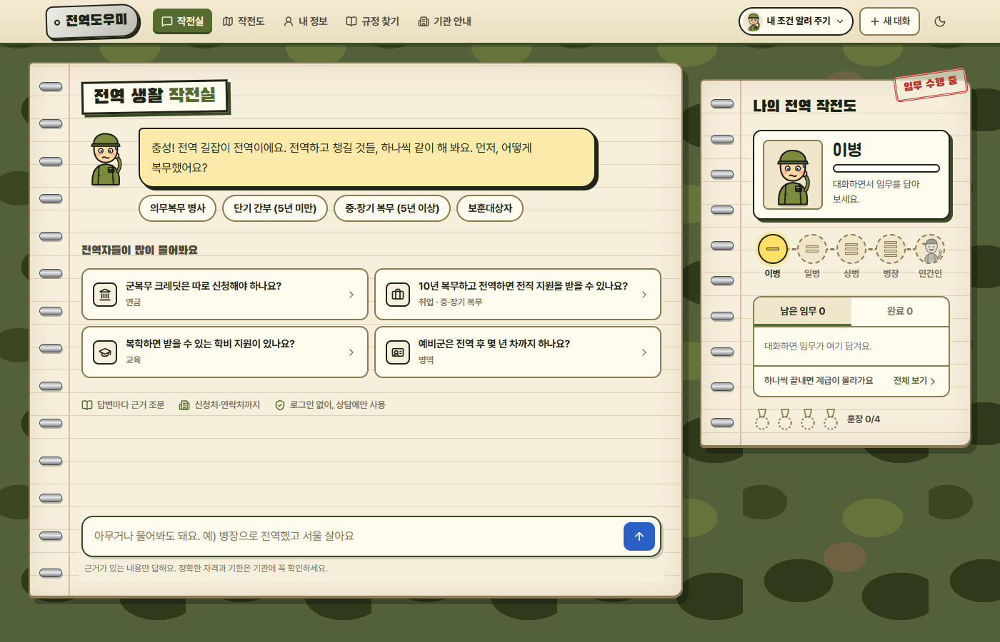 | 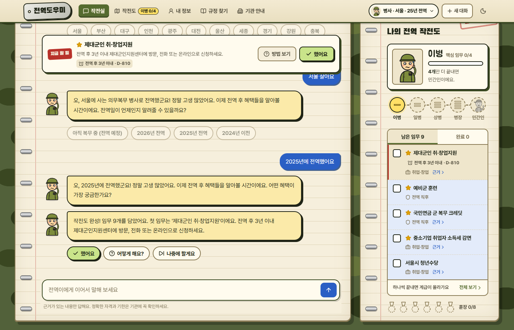 |

| "어떻게 해요?" → 한마디 + 자세히 보기 | "했어요" → 계급이 오르고 다음 임무 |
|---|---|
| 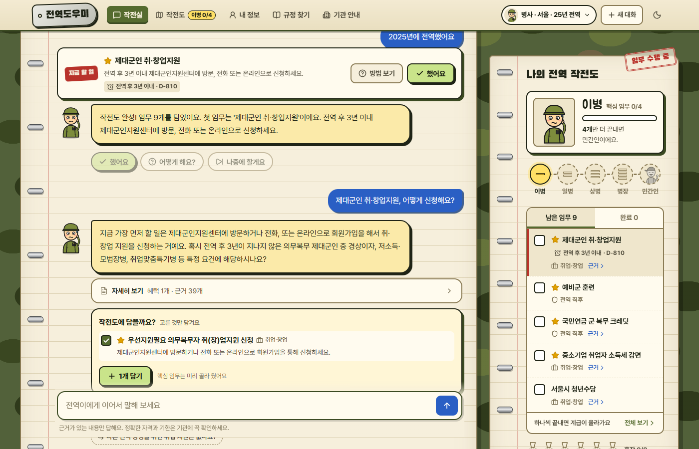 | 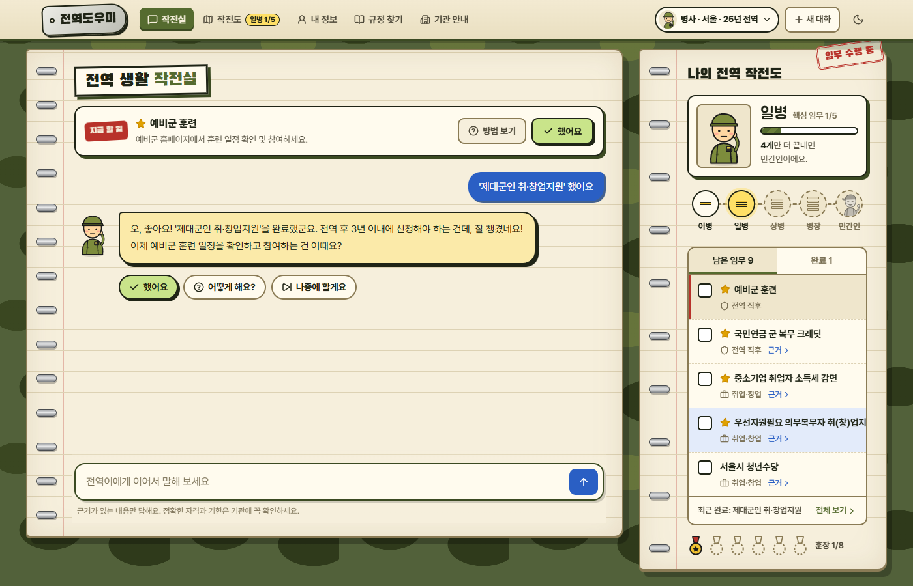 |

| 나의 전역 작전도 | 사용법 | 다크 모드 |
|---|---|---|
| 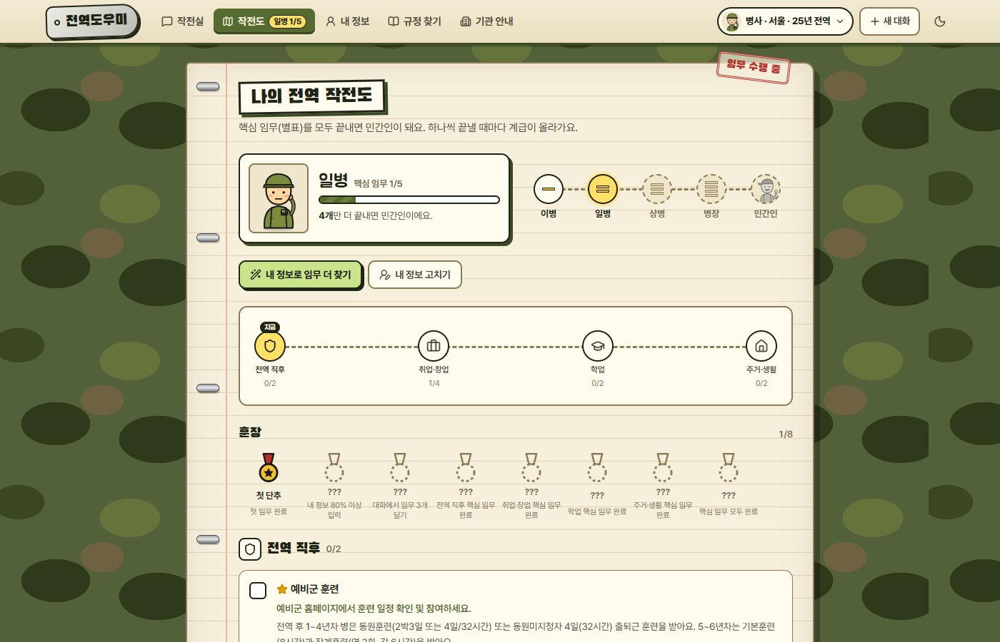 | 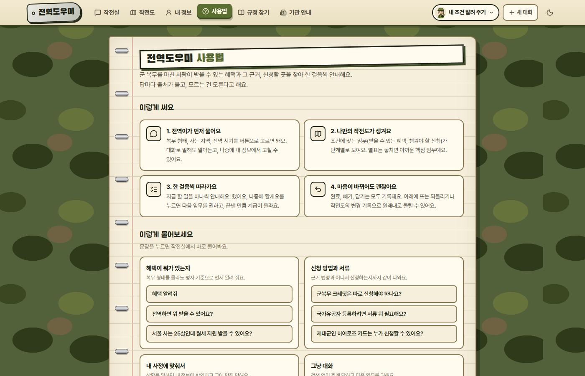 | 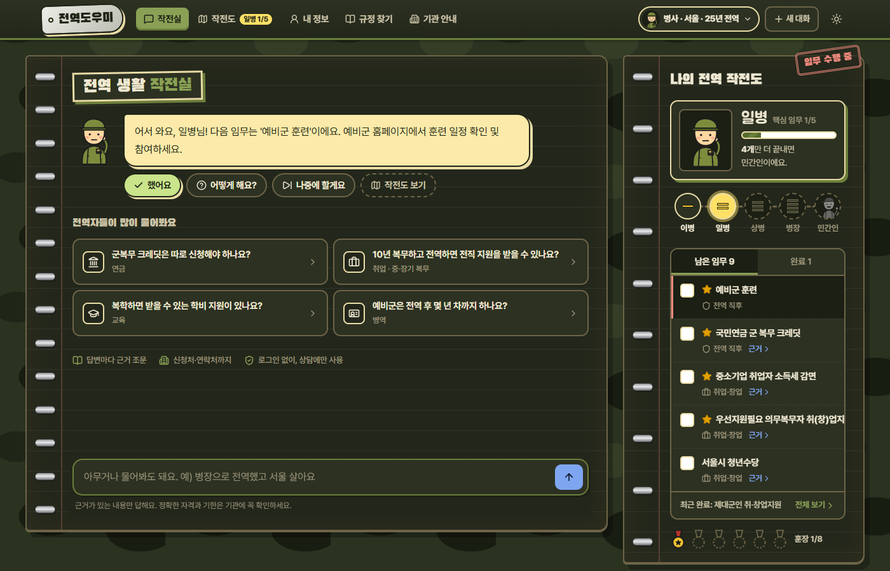 |

| 모바일 | 임무 카드 | 내 정보 |
|---|---|---|
| 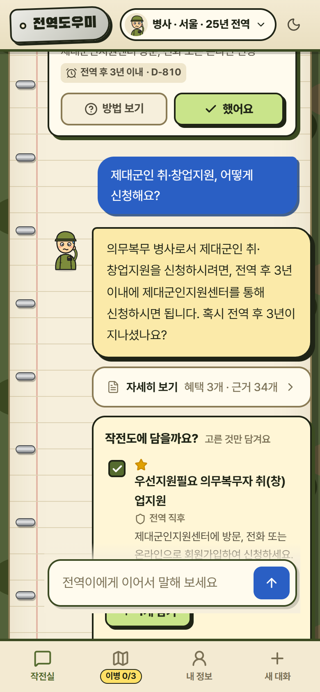 | 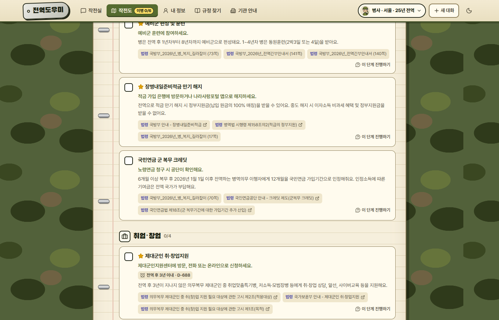 | 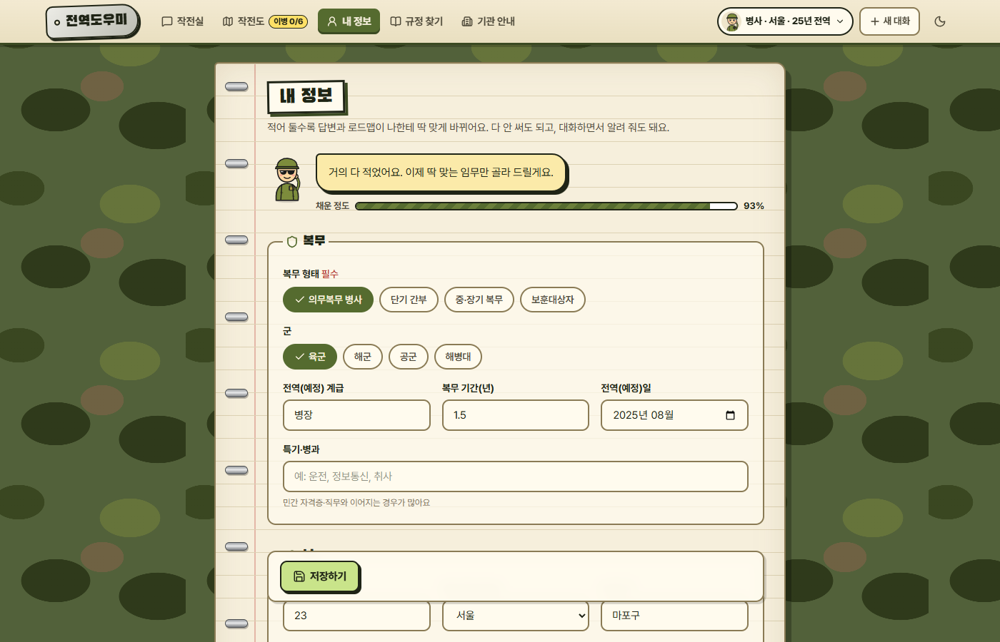 |

## 기능마다 무엇을 썼나

한 요청 안에서 **검색(RAG)이 필요한 곳, 모델(LLM) 호출이 필요한 곳, 실시간 API가 필요한 곳, 규칙으로 충분한 곳**을 나눴습니다.
모델을 부르지 않아도 되는 곳에는 부르지 않아서 속도와 일관성을 지켰습니다.

| 기능 | 방식 | 어떻게 |
|---|---|---|
| 근거 있는 규정 답변 | **RAG** + LLM | 법령·조례·안내서를 임베딩해 pgvector에서 검색(HyDE·재정렬) → 답변 모델이 검색 원문만 근거로 작성 |
| 답변 근거 검증 | LLM (구조화 출력) | 초안의 문장마다 도구 원문에 있는지 대조해, 없는 혜택·금액·기한을 지움 |
| 혜택 조회 | **MCP 도구**(실시간 API) + LLM | 정부24·온통청년 API를 도구로 호출. 어떤 도구를 부를지는 ReAct 워커(LLM)가 고름. 임베딩 안 씀 |
| 채용·위탁병원·나라사랑가게 | MCP 도구(실시간 API) | 제대군인지원센터·보훈관서 채용, 보훈 위탁병원 등을 그때그때 조회 |
| 기관·신청처 안내 | 규칙(YAML 조회) | `institutions.yaml`, `veterans_offices.yaml`에서 찾아 줌. 모델 호출 없음 |
| 대화에서 내 정보 읽기 | LLM (구조화 출력) | 복무 형태·복무 기간·전역일·나이·지역·보훈 여부 6개 칸을 스키마로 추출 |
| 길잡이 판단(말로 답할지, 찾아 답할지) | LLM + 규칙 | 길잡이 모델이 `talk`/`research`를 고르되, "신청·서류·자격" 같은 낱말은 규칙이 먼저 검색으로 보냄 |
| 질문에 붙는 버튼 | 규칙 | 모르는 정보를 고르는 버튼 → 없으면 다음 임무 버튼. 모델이 만들지 않음 |
| 답변 위 한마디와 임무 제안 | LLM (구조화 출력) + 규칙 | 모델이 후보를 내면 규칙이 출처 없는 것·중복·기한 없는 지어낸 기한·안 맞는 임무를 거름 |
| 첫 작전도 만들기 | **RAG + 실시간 API** → LLM | 주제별 규정 검색 + 정부24·온통청년 조회를 병렬로 모은 뒤, 모델이 단계별 임무로 정리하고 규칙이 후처리 |
| 계급·D-day·되돌리기 | 규칙 | 끝낸 개수로 계급, 전역일로 D-day, 변경 기록으로 되돌리기. 모델 호출 없음 |

## RAG 파이프라인

### 자료를 넣는 쪽 (수집 → 조각내기 → 임베딩 → 저장)

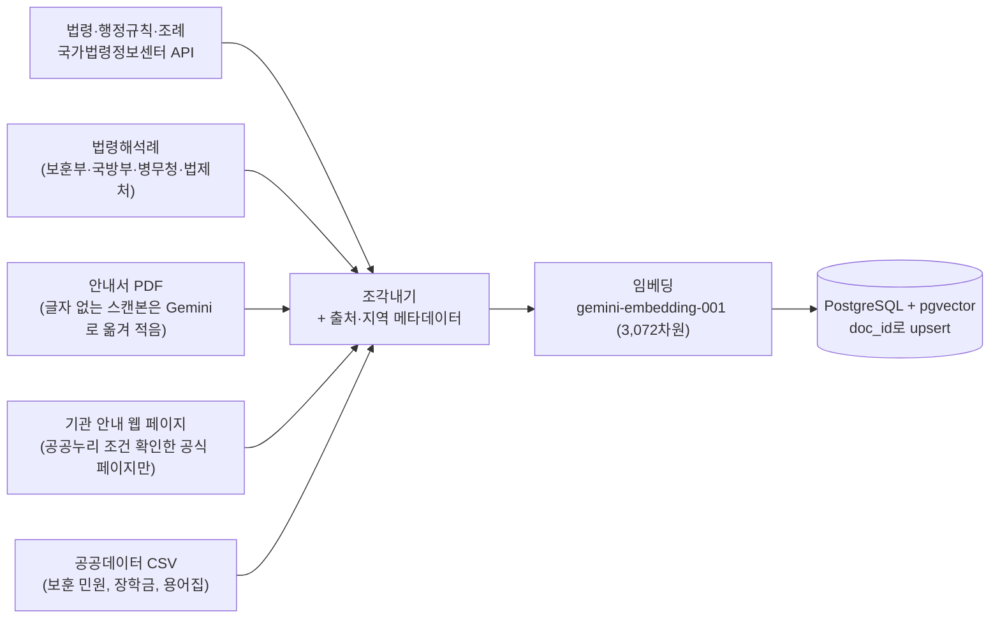

| 자료 | 조각 수 | 조각내는 방법 |
|---|---|---|
| 지자체 조례 | 5,575 | **조문 1개 = 1조각**. 시·도, 시·군·구를 메타데이터로 달아 지역 필터에 씀 |
| 법령 | 2,056 | 조문 1개 = 1조각. "[국민연금법 제18조(…)]"처럼 조문 이름을 본문 앞에 붙여 출처로도 씀 |
| 안내서 PDF | 1,174 | 쪽 단위로 읽어 800자·겹침 120자로 분할. 문단·항목 기호(`○`, `-`)에서 먼저 끊음. 쪽 번호를 출처에 남김 |
| 법령해석례 | 550 | 1건 = 1조각 |
| 공공데이터 | 414 | 항목 1개 = 1조각 |
| 행정규칙(훈령·고시) | 292 | 조문 1개 = 1조각 |
| 기관 웹 페이지 | 82 | 본문 영역만 뽑아(`selector`·`start`·`end`) 800자로 분할 |

- 합계 **10,143조각**. 같은 `doc_id`로 덮어써서(upsert) 다시 수집해도 중복이 생기지 않습니다.
- 굵은 글씨가 겹쳐 뽑히는 PDF는 `undouble`로 겹친 글자를 되돌려 읽고, 글자 정보가 없는 PDF만 Gemini로 한 쪽씩 옮겨 적습니다.
- 임베딩이 3,072차원이라 pgvector의 HNSW 색인(최대 2,000차원)을 쓰지 못합니다. 1만 건 규모에서는 전체 비교로도 충분히 빨라서 정확 검색을 씁니다.
- 처음에는 Chroma였다가, 배포(PostgreSQL 하나로 통합)·동시 접근·백업을 위해 pgvector로 옮겼습니다.

### 질문이 들어왔을 때 (검색 → 재정렬 → 근거 선택)

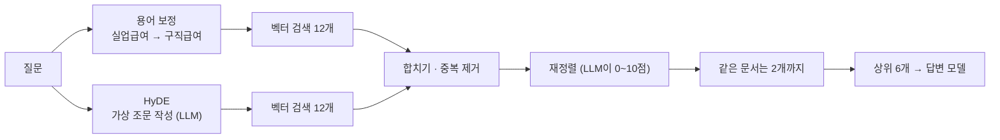

- **HyDE**: "군대 갔다온 거 연금에 쳐주나요" 같은 구어체는 "가입기간 추가 산입" 같은 조문 문장과 벡터 거리가 멉니다. 모델이 법령 문체의 가상 조문을 쓰고, 원래 질문과 가상 조문 **둘 다**로 검색합니다(가상 조문을 쓰는 동안 원래 질문으로 먼저 검색해 시간을 겹침).
- **재정렬**: 후보를 넓게 모은 뒤 모델이 질문과의 관련도를 매깁니다. 질문과 대상(병사·간부·보훈대상자)이 다르면 낮게 줍니다. 점수는 상위만 받아 출력을 짧게 해서 시간을 줄였습니다.
- **같은 문서 2개 제한**: 600쪽이 넘는 안내서가 상위를 다 차지해 법령 근거가 밀려나는 것을 막습니다(제한 전에는 평가가 24/30까지 떨어졌음).
- **지역 필터**: 조례는 사용자 지역 것만 검색합니다. 지역을 모르면 조례는 빼고 법령·안내서만 찾습니다. 시·도 표기가 통합 전후로 다른 경우(`광주`, `(구)광주`, `전남광주통합`)도 같이 봅니다.
- 모델이 없거나 호출이 실패하면 해당 단계만 건너뛰고 벡터 검색 결과를 그대로 씁니다.

## 모델은 어디서 부르나

모델은 모두 Gemini 2.5 Flash이고, 단계에 따라 **생각 예산**(thinking budget)만 다르게 둡니다.

| 단계 | 설정 | 하는 일 |
|---|---|---|
| 답변 작성 | 온도 0, 생각 1,024 | 도구 원문(evidence)만 근거로 최종 답 |
| 프로필 추출 · 라우팅 · 근거 검증 · 길잡이 · 임무 정리 · 워커 · HyDE · 재정렬 | 온도 0, 생각 끔 | 짧고 형식이 정해진 판단. 구조화 출력(Pydantic)으로 받음 |
| 임베딩 | `gemini-embedding-001` | 수집할 때, 질문과 가상 조문을 검색할 때 |

- 답변은 깊게 생각하고, 나머지 판단은 생각을 꺼서 빠르게 돌립니다. 답변 모델의 생각 예산을 0, 1,024, 기본값으로 바꿔 평가하며 정했습니다(0은 "혜택 다 알려줘"에서 답이 좁아졌음).
- 워커의 요약은 근거로 쓰지 않습니다. 답변과 검증은 도구 **원문**만 보게 해서, 요약에 섞인 모델 지식이 근거로 둔갑하지 못하게 했습니다.
- 한 질문에는 프로필 추출 → 길잡이 판단 → 라우팅 → 워커(도구 호출 반복, 검색마다 HyDE와 재정렬) → 답변 → 근거 검증 → 길잡이 한마디가 차례로 일어납니다. 인사 같은 말은 길잡이에서 끝내 2~3초에 답합니다.

## 설계에서 고민한 것

### 1. RAG를 대화 안으로: 검색기가 아니라 길잡이

처음에는 질문하면 답을 길게 뽑는 RAG 챗봇이었습니다. 그런데 사용자는 "무슨 혜택이 있는지"보다 "그래서 나는 뭘 해야 하지?"가 궁금합니다.
그래서 그래프 맨 앞에 **길잡이(coach) 노드**를 두었습니다.

```
start → profile(복무 정보 추출) → coach ─┬ talk: 인사·진행 보고·내 정보 → 검색 없이 2초 안에 짧게 답
                                         └ research → supervisor ─┬ regulation / benefit / institution 워커
                                                                  ├ ask_user (정보가 부족하면 되묻기)
                                                                  └ respond → verify(근거 검증) → guide(한마디·할 일 제안)
```

- 자료가 필요한 질문만 RAG로 보냅니다. "안녕하세요"에 검색을 돌리지 않습니다.
- **버튼은 LLM이 아니라 규칙으로** 만듭니다(모르는 정보가 있으면 고르는 버튼, 없으면 다음 할 일 버튼). 버튼이 매번 달라지거나 틀리지 않게 하기 위해서입니다.
- 다음 할 일은 안 끝낸 것 중 핵심 → 기한 빠른 것 → 단계 순으로 고릅니다.
- 긴 답변은 "자세히 보기"로 접고, 위에 "지금 이것부터" 한마디만 보여 줍니다.

### 2. 환각을 줄이는 장치

- **근거 검증(verify)**: 초안의 문장마다 도구 원문에 실제로 있는지 대조합니다. 원문에 없는 혜택·금액·기간·연령·연락처는 지우고, 엉뚱한 출처 번호는 바로잡습니다(워커의 요약은 근거로 인정하지 않음).
- **기한은 출처에 그 문구가 있을 때만** 남깁니다(`ground_deadline`). "전역 후 3년 이내" 같은 말을 모델이 지어 붙이지 못합니다.
- **떠넘기기 금지**: "정부24에서 조회해 보세요"로 끝내는 답은 서비스를 쓸 이유가 없으므로, 복무 형태를 몰라도 병사 기준으로 구체적으로 답하고 그 기준을 첫 문단에 밝힙니다.
- 할 일 제안은 혜택·규정 출처가 있는 것만 받고, 기관 안내만 있는 제안은 버립니다.

### 3. 검색 품질

수집·조각내기·HyDE·재정렬·지역 필터는 위 [RAG 파이프라인](#rag-파이프라인)에 정리했습니다.
각 장치는 골든셋에서 놓친 문항이 생긴 뒤에 넣었고, 용어 사전(`LEGAL_TERMS`)이 그 예입니다. 벡터 검색은 "실업급여"와 "구직급여"를 가깝게 보지 못해
고용보험법 조문을 놓쳤고(후보를 30개로 늘려도 못 찾음), 사람들이 쓰는 말을 법령에 적힌 말로 바꿔 덧붙여 해결했습니다.

### 4. 평가를 먼저 만들고, 회귀를 잡았습니다

"좋아 보이는데"로 끝내지 않으려고 평가 세트를 같이 키웠습니다.

| 평가 | 규모 | 보는 것 |
|---|---|---|
| 답변 평가 | 56문항 | 되묻기/바로 답변, 근거 출처, 핵심 내용, 사용한 도구, 프로필 추출 |
| 규정 검색 골든셋 | 84문항 | 상위 6개에 정답 근거가 있는지 (Hit@6, Recall@6, MRR). 구어체·경계 조건·돌려 말하기 14문항 포함 |

- 정답은 검색 결과를 베끼지 않고 조문·쪽 내용으로 정했습니다. 금액·기한처럼 바뀌는 사실은 기준에 넣지 않았습니다.
- 프로필 추출 항목을 늘렸더니 답변 평가가 41/41에서 37/41로 떨어진 일이 있었습니다. 되돌린 뒤 같은 일이 없도록 스키마를 지키는 테스트를 넣었습니다.
- "혜택 알려줘"가 복무 형태를 되묻던 문제, "병장으로 전역"을 병사로 못 읽던 문제, 한 임무만 끝냈는데 민간인이 되던 계급 버그는 모두 평가 문항이나 테스트로 남겼습니다.

결과 (2026-10-13)

| 평가 | 결과 |
|---|---|
| 답변 평가 63문항 | 전부 통과 59개, 체크 통과율 98%, 평균 18초. 이후 채점 기준 오류(h13)와 되묻기 누락(h17)을 고쳐 두 문항을 다시 돌려 통과 (61/63에 해당). 어려운 질문 19문항 포함 |
| 규정 검색 84문항 | Hit@6 100%, Recall@6 100%, MRR 0.85. 구어체·경계 조건 14문항도 Hit 100% (검색은 실행마다 조금 달라 MRR 0.84~0.85) |
| 아직 못 푸는 문항 | `m03` 보훈보상대상자와 국가유공자의 차이: 답은 맞지만 근거가 법 조문이 아니라 법령해석례로 잡힘. `t10` 한국장학재단 장학금: 출처 제목에 기관명이 없어 근거 확인에 걸림 |

어려운 질문에는 "병장인데 전직지원금 서류 알려줘"처럼 전제가 틀린 질문, "그거 신청 어디서 해요?"처럼 대상이 없는 질문,
세 가지를 한 번에 묻는 질문이 들어 있습니다. 전제가 틀리면 서류부터 알려 주지 않고 대상이 아니라고 바로잡는지, 대상이 없으면 되묻는지를 봅니다.

### 5. 마음이 바뀌어도 되돌릴 수 있게

완료·빼기·담기·"내 정보로 작전도 만들기"는 모두 변경 기록에 쌓이고, 아래 알림이나 작전도의 "여기까지 N개 되돌리기"로
되돌릴 수 있습니다. 뺀 임무를 되돌리면 완료 여부, 핵심 표시, 출처까지 그대로 복원됩니다. 계급은 임무 한 개로 민간인이 되지 않도록,
핵심 임무 3개 이상을 모두 끝내고 병장 수준(8개)을 채워야 합니다.

## 구조

```
브라우저 ─▶ Next.js (frontend) ─/api/*─▶ FastAPI (backend) ─▶ LangGraph 에이전트 (Gemini)
                                                               ├─ 규정 워커  (RAG: pgvector)
                                                               ├─ 혜택 워커  (MCP → 공공서비스 API)
                                                               └─ 기관 워커
                                                            ─▶ 근거 검증 ─▶ 길잡이 ─▶ SSE 스트리밍
```

| 영역 | 기술 |
|---|---|
| 화면 | Next.js 16 (App Router), React 19, TypeScript, Tailwind CSS 4, 손으로 그린 SVG 캐릭터와 계급장 |
| LLM·에이전트 | Gemini, LangChain, LangGraph (구조화 출력, 노드별 역할 분리) |
| RAG | PostgreSQL + pgvector, HyDE, Re-ranking |
| 도구 연동 | MCP 서버 (정부24, 온통청년, 제대군인지원센터 채용, 보훈 채용, 위탁병원, 나라사랑가게) |
| 서버 | FastAPI (SSE 스트리밍), SQLAlchemy 2.0 + Alembic, SQLite(대화 기록) |
| 품질 | pytest 191개, vitest 43개, ruff, ESLint, 평가 세트 2종, GitHub Actions |
| 배포 | Docker Compose |

```
backend/                      # Python (uv)
├─ src/jeonyeok_helper/
│  ├─ rag/                    # 법령·문서 수집, 검색(HyDE·재정렬)
│  ├─ benefits/               # 공공서비스 API, 기관 링크, MCP 서버
│  ├─ agents/                 # LangGraph: coach, supervisor, 워커, verify, guide
│  ├─ api/                    # FastAPI
│  └─ evaluation.py           # 평가 채점
├─ tests/
└─ data/                      # 수집 대상 목록, 기관 목록, 평가 질문
frontend/                     # Next.js (app, components, lib)
docs/                         # 기획서, 개발 순서, 작업 기록, 테스트 안내
```

## 시작하기

### Docker로 한 번에

```bash
cp backend/.env.example backend/.env   # 키 입력
docker compose up --build              # http://localhost:3000
```

`GOOGLE_API_KEY`가 없으면 자동으로 데모 모드로 열려 예시 응답을 보여 줍니다.

### 개발 모드

백엔드 ([uv](https://docs.astral.sh/uv/), Docker 필요):

```bash
docker compose up -d db    # PostgreSQL(pgvector), localhost:5432
cd backend
uv sync
cp .env.example .env
uv run jeonyeok-serve      # http://127.0.0.1:8000
```

프런트엔드 (Node 24):

```bash
cd frontend
npm install
npm run dev                # http://localhost:3000, /api/* 는 API_URL(기본 127.0.0.1:8000)로 전달
```

### 직접 써 보기

- 순서대로 따라 하는 안내: [사용·테스트 안내](docs/사용_테스트_안내.md)
- 쳐 볼 질문 60여 개와 기대 결과: [테스트 질문 모음](docs/테스트_질문모음.md)
- 앱 안의 **사용법** 메뉴에서 예시 문장을 누르면 바로 물어봅니다.

## 키 (`backend/.env`)

| 키 | 발급처 | 용도 |
|---|---|---|
| `GOOGLE_API_KEY` | [Google AI Studio](https://aistudio.google.com/apikey) | Gemini |
| `LAW_API_OC` | [국가법령정보센터 Open API](https://open.law.go.kr) | 법령, 조례 수집 |
| `DATA_GO_KR_SERVICE_KEY` | [공공데이터포털](https://www.data.go.kr) | 공공서비스(혜택), 보훈 위탁병원, 나라사랑가게 |
| `YOUTHCENTER_API_KEY` | [온통청년](https://www.youthcenter.go.kr) | 청년정책 |

키 값은 `.env`에만 두고 저장소에는 올리지 않습니다.

## 명령

| 명령 (backend/) | 설명 |
|---|---|
| `uv run jeonyeok-rag laws` / `ordinances` / `interpretations` | 법령·행정규칙, 지자체 조례, 법령해석례 수집 |
| `uv run jeonyeok-rag files` | `data/raw/`의 PDF·TXT·MD 수집 (글자 없는 PDF는 Gemini로 옮겨 적음) |
| `uv run jeonyeok-rag web` | `data/webpages.yaml`의 기관 안내 페이지 수집 |
| `uv run jeonyeok-rag search "질문" [--region 부산]` | 검색 결과 확인 |
| `uv run jeonyeok-chat` | 터미널에서 에이전트와 대화 |
| `uv run jeonyeok-mcp` | MCP 서버 (stdio) |
| `uv run jeonyeok-eval` | 답변 평가, `data/eval/results/`에 보고서 |
| `uv run jeonyeok-eval --retrieval [--ablation]` | 규정 검색 골든셋, 검색 설정 비교 |
| `uv run pytest && uv run ruff check .` | 테스트와 린트 |
| `npm test && npm run lint && npm run typecheck` (frontend/) | 프런트 검사 |

<details><summary>API</summary>

| API | 설명 |
|---|---|
| `POST /chat` | `{message, thread_id?, user_id?, action?}` → SSE (`thread`, `step`, `delta`, `answer`, `guide`, `journey`, `question`, `error`, `done`). `action`은 버튼 동작(`done`·`later`) |
| `GET·PUT /profile/{user_id}` | 사용자 프로필 (보낸 칸만 바꾸고 빈 값은 지움) |
| `GET /journey/{user_id}` | 작전도 임무 목록 (단계 순) |
| `POST /journey/{user_id}/generate` | 내 정보로 임무를 한 번에 모아 담기 |
| `POST /journey/{user_id}/items` | 고른 임무 담기 |
| `PATCH·DELETE /journey/{user_id}/items/{id}` | 완료 체크, 빼기 |
| `POST /feedback` | 답변 피드백 `{rating, question, answer, comment?}` |
| `GET /health` | 상태, 에이전트 준비 여부, 키 설정 여부 |

</details>

<details><summary>MCP 도구</summary>

| 도구 | 하는 일 |
|---|---|
| `search_regulations` | 법령·보훈부 자료에서 근거 조문 검색 (지역을 주면 그 지역 조례도) |
| `search_benefits`, `get_benefit_detail` | 정부24 공공서비스 조회, 선정기준·구비서류·신청방법 |
| `search_youth_policies` | 온통청년 청년정책 3,000여 건 (지역·나이·키워드) |
| `search_jobs`, `search_veteran_jobs` | 제대군인지원센터 채용, 보훈관서 채용(보훈특별고용·공무원 특별채용) |
| `find_stores` | 병무청 나라사랑가게 |
| `find_veterans_office`, `find_hospitals` | 관할 보훈청, 지역별 보훈 위탁병원 |
| `find_institutions` | 주제별 기관 사이트·연락처 |

키가 없거나 호출이 실패하면 오류 대신 직접 찾아볼 수 있는 기관 링크를 돌려줍니다. Claude Desktop 같은 MCP 클라이언트에는 아래처럼 연결합니다.

```json
{
  "mcpServers": {
    "jeonyeok_helper": {
      "command": "uv",
      "args": ["--directory", "<레포 경로>/backend", "run", "jeonyeok-mcp"]
    }
  }
}
```

</details>

## 한계와 다음 단계

실제로 재 보고, 서버에 입력을 넣어 보고, 코드를 열어서 찾은 한계를 [한계 점검](docs/한계_점검.md)에 정리했습니다. 요약:

고친 것
- **첫 작전도 속도**: 20~30초 → 약 15초 (정리는 빠른 모델로, 같은 조건의 자료 재사용, 지역을 답한 시점에 미리 모으기).
- **안 맞는 임무**: 전역한 사람에게 복무 중 제도, 병사에게 5년 이상 복무자 제도, "위원회 확대" 같은 정책 기구를 걸러 냅니다.
- **엉뚱한 출처**: 답변이 `[n]`으로 인용한 근거만 보이고 나머지는 접힙니다.
- **대상 없는 질문**: "그거 신청 어디서 해요?"처럼 무엇을 묻는지 모르는 첫 마디는 검색하지 않고 되묻습니다.
- **요청 제한**: 사용자별 1분 20회(`CHAT_RATE_LIMIT_PER_MINUTE`). 공개해도 모델 쿼터를 한 사람이 소진하지 못합니다.

남은 것
- 일반 질문은 15~25초 걸립니다(모델 호출이 순서대로 4~6번). 근거 검증과 길잡이 한마디를 병렬화하려면 정확도 평가를 다시 해야 합니다.
- 평가는 키워드로 채점하고 표본이 작습니다(답변 63, 검색 84). CI는 평가를 돌리지 않습니다.
- 로그인이 없고(브라우저 ID가 열쇠), 내 정보·대화를 전부 지우는 기능과 서버 확장(대화 기록이 SQLite), 관측 도구가 없습니다.
- 못 넣은 공식 자료와 미연동 API(고용24, Q-Net)가 있습니다([추가할 자료](docs/추가할_자료.md)).

자세한 기획과 작업 과정은 [기획서](docs/기획서.md), [개발 순서](docs/개발순서.md), [작업 기록](docs/작업기록.md)에 있습니다.

## 안내

이 서비스의 답변은 참고용입니다. 실제 자격과 신청 방법은 소관 기관에 꼭 확인하세요.
