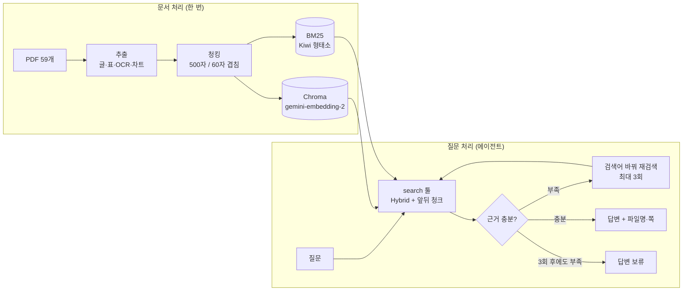

# 한국어 문서 RAG Agent


> 금융·공공·의료·법률·커머스 PDF 59개를 근거로 답하는 RAG 에이전트.
> 근거가 부족하면 검색어를 바꿔 다시 찾고, 끝내 없으면 지어내지 않고 **답변을 보류**한다.
> 실패 원인을 단계별로 분석해 고치면서 정답률을 **0.79 → 0.90**까지 올렸다.

| 항목 | 내용 |
|---|---|
| 기간 | 2026.10.14 ~ 2026.10.16 (3일) |
| 형태 | RAG Agent 실습 과제, 3인 실습 |
| 진행 방식 | 설계 방향(파이프라인, 추출·청킹·검색 기준)은 3명이 함께 논의해 결정 |
| AI 도구 | Claude(Claude Code)만 사용 → [AI 도구 사용](#ai-도구-사용) |

<br>

## 왜 어려운 문제인가

- **정보가 글자로만 있지 않다**: 보고서의 핵심 숫자는 표·차트·스캔 이미지 안에 있다. PDF에서 글자만 뽑으면 "2021년 이커머스 광고비는?" 같은 질문에 답할 근거 자체가 사라진다.
- **LLM은 모르면 지어낸다**: 의료·법률·금융 문서에서 그럴듯한 오답은 오답보다 위험하다. 근거가 없으면 **답하지 않는 것**도 성능이다.
- **한 번 검색으로 안 찾히는 질문이 많다**: 질문 표현과 문서 표현이 다르거나("속이 쓰려요" vs "위산 속쓰림"), 질문이 여러 부분으로 되어 있다.
- **어디서 틀렸는지 알기 어렵다**: 추출 → 검색 → 답변 중 어느 단계 문제인지 나눠 보지 않으면 엉뚱한 곳을 고치게 된다.

<br>

## 핵심 결과

| 지표 (200문제, 2회 평균) | 결과 |
|---|---|
| **정답률** | **0.896** (시작 0.791 → +10.5%p) |
| 같은 조건의 기본 RAG 대비 | **+4.1%p** (0.855) |
| 표 질문 정답률 | 0.55 → **0.82** |
| 답이 없는 질문 보류율 | **100%** (지어낸 답 없음) |
| 평균 응답 시간 | 4.1초 (질문당 검색 평균 1.3회) |

- 평가: 골든셋 309문제(제공 267 + 직접 작성·검수 42), 비교 실험은 비율을 맞춰 뽑은 200문제
- 채점: LLM 채점(openevals) + 근거 쪽 적중 + 보류 판단 + 검색 과정(agentevals) + 실패 원인(RAGAS)

<br>

## 동작 예시

```bash
python -m pipeline.agent "핀테크 혁신펀드 1호는 몇 년간 운용됐고 목표 금액과 실제 조성 금액은 얼마인가요?"
```

아래는 에이전트의 **답변 출력**이다 (골든셋 형식이 아님).

**근거가 있을 때** → 답변 + 출처(파일·쪽·원문)

```json
{
  "judgement": "운용 기간은 4년간('20~'23년), 목표 금액은 5,000억원, 실제 조성 금액은 5,133억원으로 문서에 명시되어 있어 근거가 충분합니다.",
  "status": "answered",
  "answer": "핀테크 혁신펀드 1호는 4년간('20~'23년) 운용되었으며, 목표 금액은 5,000억원, 실제 조성 금액은 5,133억원입니다.",
  "citations": [{
    "file_name": "240409(보도자료) 금융위 핀테크 투자 생태계 활성화 나선다.pdf",
    "page_no": 3,
    "quote": "1,500억원 모펀드에 민간투자를 매칭하여 4년간('20~'23년) 총 5,000억원 조성 목표 → '24.3월말 현재 총 5,133억원 조성"
  }]
}
```

**근거가 없을 때** → 지어내지 않고 보류

```json
{
  "question": "역류성 식도염 약은 한 달 치 가격이 얼마나 돼요?",
  "judgement": "문서에는 치료 약물(PPI, H2RA, P-CAB 등)의 종류와 용법·용량은 있으나, 한 달 치 약값에 대한 언급은 전혀 없습니다.",
  "status": "withheld",
  "answer": "제공된 문서에서 역류성 식도염 약의 가격이나 한 달 치 비용에 대한 정보를 찾지 못하여 답변을 드릴 수 없습니다.",
  "citations": []
}
```

출력은 `근거 판단 → 답변/보류 → 답변 → 근거` 순서의 구조화 출력이다. 근거 판단을 먼저 쓰게 해서, 판단과 답변/보류가 어긋나지 않게 했다.

<br>

## 아키텍처



<br>

## 기술 스택

| 영역 | 사용 |
|---|---|
| 에이전트 | LangChain `create_agent`, `ToolCallLimitMiddleware`(검색 3회 제한), Pydantic 구조화 출력 |
| LLM | Gemini 3.5 Flash-Lite (답변·채점), Gemini 3.6 Flash (차트·다이어그램 변환) |
| 검색 | Chroma + gemini-embedding-2, BM25(rank-bm25 + Kiwi), RRF Hybrid |
| PDF 추출 | pdfplumber, RapidOCR(PP-OCRv5 한국어), rapid-layout, rapid-table |
| 평가 | openevals(LLM-as-judge), RAGAS, agentevals |

<br>

## 주요 구현

### 1. 멀티모달 PDF 추출
글만 읽으면 표·차트·스캔 페이지의 정보가 빠진다. 콘텐츠 종류마다 다른 방법을 썼다.

| 콘텐츠 | 방법 | 결과 |
|---|---|---|
| 글 | pdfplumber + 여백 제거 + 2단 편집 감지 | 1,258쪽 |
| PDF 표 | `find_tables()` → 마크다운 표 (1행·1열 가짜 표, 셀 글자가 빠진 깨진 표는 텍스트로) | 130개 |
| 이미지 속 글자·표 | RapidOCR + rapid-layout + rapid-table | 462곳, 표 56개 |
| 차트·다이어그램 | rapid-layout으로 찾기 → Gemini로 마크다운 변환 | 429개 |

### 2. 청킹
- 일반 문서: 500자 / 60자 겹침, **청크는 페이지를 넘지 않음** (출처 쪽을 정확히 남기기 위해)
- 의학 논문: 문단 단위 / 표: 행 단위로 자르고 헤더 반복 / 차트: 그림 하나 = 한 청크

### 3. 검색
- **Hybrid**: 벡터 검색 + BM25를 RRF로 합침 (의미 + 정확한 단어 둘 다 잡기)
- **앞뒤 청크 붙이기**: 찾은 청크의 같은 쪽 앞뒤 청크를 한 덩어리로 넘김 → 작게 찾고 넓게 읽기
- **분야 보완**: 에이전트가 분야를 골라도 전체 검색 결과를 섞어서, 분야를 잘못 골라도 놓치지 않게 함

### 4. 에이전트
- 검색 툴 하나를 가진 단일 에이전트. 근거 판단 → 재검색(최대 3회, 미들웨어로 강제) → 답변 또는 보류
- 출력은 구조화: `근거 판단 → 답변/보류 → 답변 → 근거(chunk_id, 파일, 쪽, 원문)`
- 실행 기록(질문, 답변, 검색어, 청크 ID, 시간)을 JSONL로 저장

<br>

## 실험과 개선 과정

평가 → 실패 원인 분석 → 수정 → 다시 평가를 반복했다. 같은 설정도 LLM 응답이 매번 달라 정답률이 1~2%p 흔들리므로, **중요한 비교는 두 번씩 돌려 확인**했다.

| 단계 | 바꾼 것 | 정답률 | 근거 |
|---|---|---|---|
| 모델 | 3.6-flash → **3.5-flash-lite** (답변·채점) | - | 속도 약 2.5배, 아래 "모델 선택" |
| 시작 | 300/50 청킹, 표=MMR, 분야 필터 | 0.791 | |
| 청킹 | 300/50 → **500/60** | 0.819 | 300/50·500/60·800/100 비교 |
| 검색 | **앞뒤 청크 + 표도 Hybrid + 분야 보완** | 0.885 | RAGAS·agentevals 실패 분석 |
| 프롬프트 | 계산 허용, 질문 부분별 확인, 판단 먼저 | **0.896** | 남은 실패 패턴 분석 |

### 모델 선택: 3.6-flash → 3.5-flash-lite (2.5 계열은 탈락)

처음에는 gemini-3.6-flash로 만들었지만, 평가 309문제에 약 1시간이 걸려 더 가벼운 모델을 비교했다.

**문제 푸는 모델** (같은 질문 3개)

| 모델 | 질문당 시간 | 재검색 | 답 없는 질문 보류 | 토큰 (입력 / 출력) | 결과 |
|---|---|---|---|---|---|
| gemini-3.6-flash | 11.1초 | 함 | 함 | - | 정확하지만 느림 |
| **gemini-3.5-flash-lite** | **4.4초** | **함** | **함** | 4,074 / 259 | **선택** |
| gemini-2.5-flash | 5.5초 | 안 함 (모두 1번 검색) | 함 | 2,731 / 556 | 탈락 |
| gemini-2.5-flash-lite | 5.0초 | 안 함 | **"찾을 수 없다"고 쓰고 상태는 '답변'** | 2,738 / 398 | 탈락 |

- 2.5 계열은 3.5-flash-lite보다 빠르지도 않고, **재검색을 하지 않아** 에이전트의 핵심 기능을 쓰지 못했다
- 2.5 계열의 입력 토큰이 적은 건 효율이 좋아서가 아니라 **재검색을 안 해서**다 (검색할 때마다 검색 결과가 입력으로 들어감). 출력 토큰은 오히려 더 많다
- 대가: 3.6-flash가 맞힌 문제를 lite가 틀린 경우가 있었다 (비슷한 두 숫자 중 다른 쪽을 고름)

**채점 모델** (맞은 답 8개 + 일부러 틀리게 만든 답 4개)

| 모델 | 판정 정확 | 채점 1회 시간 |
|---|---|---|
| gemini-3.6-flash | 12 / 12 | 4.0초 |
| **gemini-3.5-flash-lite** | **12 / 12** | **1.1초** |
| gemini-2.5-flash | 12 / 12 | 4.3초 |
| gemini-2.5-flash-lite | 12 / 12 | 1.1초 |

- 채점은 네 모델 모두 정확해서 가장 빠른 3.5-flash-lite로 정하고, 이후 모든 실험에서 **고정**했다 (실험끼리 공정하게 비교하려고)
- 앞선 테스트에서는 3.6-flash가 "2개 중 1개만 답한" 불완전한 답을 정답으로 봐준 적도 있어, 큰 모델이 채점을 더 잘한다고 볼 수도 없었다

결과: 309문제 평가 약 1시간 → 약 25분, 200문제 두 개를 동시에 돌리면 약 15분.
한계: 문제 푸는 모델은 3문제, 채점 모델은 12문제로만 비교했고, 3.6-flash로는 전체 평가를 돌리지 않았다.

### 의사결정 기록: 무엇을 보고 무엇을 정했나

| 결정 | 무엇으로 확인했나 | 발견한 것 | 정한 것 | 결과 |
|---|---|---|---|---|
| **검색 방식** | 검색 평가 (LLM 없이, 309문제) | Hybrid가 MRR 0.830으로 가장 좋음. 표 질문만 보면 MMR이 hit@5 가장 높음 | 일반 질문 Hybrid, 표 질문 MMR | 처음 설정 (아래에서 표는 다시 바꿈) |
| **모델** | 같은 질문 3개 속도·행동 비교, 채점 12문제 | 2.5 계열은 재검색을 안 함. 3.5-lite가 가장 빠르고 재검색·보류도 정상 | 답변·채점 모두 3.5-flash-lite | 평가 1시간 → 25분 |
| **청킹** | 에이전트 평가 200문제 × **2회** (300/50·500/60·800/100) | 검색 점수는 300/50이 최고, 실제 정답률은 500/60이 두 번 다 최고. 검색 횟수·시간도 500/60이 적음 | 500/60 | 0.791 → 0.819 |
| **앞뒤 청크 붙이기** | **RAGAS** context recall (실패 34 + 성공 34) | 실패 34개 중 24개가 검색 문제. 정답 쪽은 찾았지만 답이 적힌 조각은 못 가져옴. 보류 22개 중 19개는 받은 근거에 정말 답이 없었음 | 찾은 청크의 앞뒤 청크를 같이 넘김 | 단독으로는 효과 없음, 아래 두 가지와 함께 효과 |
| **표 검색 방식** | **agentevals** 검색 과정 채점 | 표 질문에 MMR을 쓰면 정답률이 오히려 낮음 (MMR은 같은 표의 한 줄만 가져옴) | 표 질문도 Hybrid | 표 정답률 0.55 → 0.67 |
| **분야 필터** | **agentevals** 검색 과정 채점 | 에이전트가 분야를 잘못 고르면 정답률 0.25~0.33 | 고른 분야 결과 + 전체 결과를 섞음 | 세 가지 함께 0.819 → 0.885 |
| **프롬프트** | 두 번 다 틀린 17문제를 직접 읽고 분류 | 표 숫자로 계산하면 되는데 "비교 문장이 없다"며 보류, 질문 일부만 답함, 연도가 다른 숫자를 고름 | 계산 허용, 질문 부분별 확인, 연도·단위 일치, 근거 판단을 먼저 쓰기, 쓸모없어진 `is_table` 제거 | 0.885 → 0.896, 표 0.71 → 0.82 |
| **에이전트 유지** | 같은 조건 기본 RAG와 200문제 × 2회 | 에이전트가 4%p 높고 1.7배 느림. 두 번 다 에이전트만 맞힌 문제 9개 vs 3개 | 정확도가 중요한 문서라 에이전트 | 0.896 vs 0.855 |

**판단을 바꾼 순간**: 처음에는 "정답 쪽을 90% 찾았으니 실패는 대부분 판단 문제"라고 봤다. RAGAS로 청크 **내용**을 보니 정답 쪽은 찾았어도 답이 적힌 조각은 빠진 경우가 많았다. 쪽 단위 지표만 믿었다면 엉뚱하게 프롬프트부터 고쳤을 것이다.

**검증 원칙**: 같은 설정도 LLM 응답이 매번 달라 정답률이 1~2%p 흔들린다. 그래서 결정에 쓰인 비교는 두 번씩 돌려, 차이가 이 흔들림보다 크고 두 번 다 같은 방향일 때만 채택했다.

### Before / After 실제 사례
아래는 평가 때 **두 번 모두** 같은 결과가 나온 문제다.

**① 분야를 잘못 골라서 못 찾던 문제 → 분야 보완 후 해결**

> Q. 은행법에 의거 예비인가를 신청할 수 있는지와, 그 경우 금융위원회가 검토했어야 하는 요건은 무엇인가요?

| | 검색 | 결과 |
|---|---|---|
| Before | `은행법 예비인가 신청 금융위원회 요건` (분야: **law**) → 재검색도 law | ❌ "문서에 관련 내용이 없어" 보류. 답은 **finance** 문서에 있었음 |
| After | 같은 검색어지만 law 결과에 전체 결과를 섞음 | ✅ 은행법 제11조의2에 따른 예비인가 신청과 심사 사항을 답함 (근거: 지방은행의 시중은행 전환시 인가방식 및 절차 p.4, p.12) |

**② 숫자는 찾았는데 계산을 안 하던 문제 → 프롬프트 수정 후 해결**

> Q. 교당 평균 지원단가는 23년도와 24년도 사이에 어느 정도 변화하였나요? 그리고 이 변화율은 어느 정도인가요?

| | 답변 | 결과 |
|---|---|---|
| Before (p1) | 123.5억 원 → 154.3억 원으로 30.8억 원 증가하였습니다. | ❌ 질문의 두 번째 부분(변화율) 누락 |
| After (p2) | 123.5억 원 → 154.3억 원으로 30.8억 원 증가하였으며, **약 24.94%의 증가율**을 보입니다. | ✅ "질문의 모든 부분에 답한다", "수치로 계산할 수 있으면 근거로 본다" 규칙 |

<br>

## 설계 선택과 이유

| 선택 | 대안 | 이유 |
|---|---|---|
| 단일 에이전트 + 검색 툴 하나 | 분야별 에이전트 + 슈퍼바이저 | 기능이 검색 하나뿐이라 나눌 이유가 없음. 분야는 메타데이터로만 두고 검색 필터로 씀 |
| LangChain `create_agent` + 미들웨어로 검색 3회 제한 | LangGraph로 흐름 직접 구현 | 재검색 반복은 에이전트 루프로 충분. 횟수 제한만 미들웨어로 강제 |
| 청크가 페이지를 넘지 않게 자름 | 문서 전체를 이어서 자름 | 답변에 출처 쪽을 정확히 남기기 위해. 대신 앞뒤 청크 붙이기로 맥락을 보충 |
| 작게 찾고 넓게 읽기 (500자 청크 + 앞뒤 청크) | 큰 청크 (800자) | 큰 청크는 검색이 덜 정확해짐(MRR 0.812). 찾을 때는 작게, LLM에 넘길 때는 넓게 |
| 근거 없으면 보류 허용 | 항상 답변 | 의료·법률·금융 문서에서 지어낸 답이 더 위험함 |
| 채점 모델 고정 + 같은 비교를 2회 | 실험마다 1회 | LLM 응답이 흔들려서, 작은 차이를 진짜 개선으로 착각하지 않으려고 |
| 평가는 저장된 결과로 재분석 (RAGAS·agentevals) | 분석할 때마다 에이전트 재실행 | 실행 기록(질문, 검색어, 청크 ID, 답변)을 남겨 두고, 분석은 다시 돌리지 않고 했음 |

<br>

## 골든셋 만든 방법

| 출처 | 문제 수 | 만든 방법 |
|---|---|---|
| 제공 골든셋 (Allganize) | 267 | 그대로 사용 |
| 직접 작성 | 12 | PDF를 읽고 질문·정답·근거 쪽 작성 |
| 의료 문서 질문 | 30 | 실제 환자가 물을 법한 말투로 작성 (답이 없는 질문 4개, 두 문서를 같이 봐야 하는 질문 1개 포함) |
| **합계** | **309** | 겹치는 35문제는 한 번만 |

**형식: CSV** (`data/goldenset_all.csv` 309문제, `data/goldenset_200.csv` 200문제, `data/goldenset_my.csv` 직접 작성분)

제공 골든셋(`golden_set.csv`)의 6개 열에 7개 열을 더했다.

| 열 | 내용 | 예 |
|---|---|---|
| `id` | 문제 번호 (제공 문제는 원래 행 번호를 딴 `gs-001`) | `my-01` |
| `domain` | 분야 | `commerce` |
| `question` / `target_answer` | 질문 / 기준 답변 | |
| `evidence` | 근거 구절 (직접 작성분) | |
| `target_file_name` / `target_page_no` | 정답 파일과 쪽. 여러 문서면 `A.pdf \|\| B.pdf`, `1 \|\| 13,14` | `10` |
| `context_type` | 근거 유형: paragraph / table / image / text | `paragraph` |
| `answerable` | 답이 문서에 있는지. `false`면 보류해야 정답 | `true` |
| `question_type` / `difficulty` / `must_not` | 질문 유형, 난이도, 하면 안 되는 답 (직접 작성분) | |
| `source` | 출처: `golden_set.csv` / `my` / `medical_v1` | `my` |

- **검수**: 직접 쓴 문제는 정답 쪽을 PDF 추출 결과와 하나씩 대조해서 확인
- **답이 없는 질문**: 약 가격, 금식 시간처럼 일반 지식으로 그럴듯하게 답할 수 있지만 문서에는 없는 질문 → 지어내는지 시험
- **200문제 부분집합**: 분야 × 근거 유형(문단·표·이미지·텍스트) 비율을 전체와 같게 맞춰 뽑음 (seed 고정)
- 골든셋은 검색 DB에 넣지 않음 (과제 규칙)

<br>

## 주어진 것과 직접 한 것

| 주어진 것 | 직접 한 것 |
|---|---|
| 과제 안내 ([PRACTICE.md](rag-agent-practice/PRACTICE.md)): 필수 기능, 비교 실험 항목 | 추출·청킹·검색·에이전트·평가 파이프라인 전체 구현 |
| PDF 59개, 제공 골든셋 267문제 | 골든셋 42문제 작성·검수, 309문제 합본과 200문제 부분집합 |
| | 평가 지표 선정, 채점 도구(openevals·RAGAS·agentevals) 연결 |
| | 모델·청킹·검색·프롬프트 비교 실험과 실패 분석, 개선 |

<br>

## 비교 실험

### 청킹 (검색 방식 고정)
| 청킹 | 검색 MRR (309문제) | 에이전트 정답률 (200문제, 2회) |
|---|---|---|
| 300/50 | **0.830** | 0.786 / 0.796 |
| **500/60** | 0.819 | **0.827 / 0.811** |
| 800/100 | 0.812 | 0.806 |

검색 점수는 300/50이 가장 좋았지만 실제 답 정확도는 500/60이 두 번 모두 높았다. **검색 지표만으로 청킹을 고르면 안 된다**는 걸 확인했다.

### 검색기 (청킹 고정, 309문제)
| 검색기 | MRR | hit@5 |
|---|---|---|
| Similarity | 0.822 | 0.938 |
| MMR | 0.814 | 0.895 |
| BM25 | 0.779 | 0.892 |
| **Hybrid** | **0.830** | **0.941** |

### 기본 RAG vs 에이전트 (최종 설정, 200문제, 2회)
기본 RAG는 검색기·모델·답변 규칙을 똑같이 두고 **재검색과 검색어 고르기만 뺐다**.

| | 에이전트 | 기본 RAG |
|---|---|---|
| 정답률 | **0.888 / 0.903** | 0.867 / 0.842 |
| 잘못된 보류 | **13 / 12** | 18 / 19 |
| 표 질문 | **0.818 / 0.818** | 0.758 / 0.697 |
| 답이 없는 질문 보류 | 100% | 100% |
| 응답 시간 | 4.1초 | **2.4초** |

- 에이전트가 약 4%p 더 정확하고 약 1.7배 느리다
- 두 번 다 에이전트만 맞힌 9문제: 재검색 덕분 5개, 검색어를 핵심어로 다듬은 덕분 4개
- 기본 RAG가 보류할 때만 에이전트로 넘기면(추정) 정답률은 비슷하고 시간은 3.0초로 줄어든다

<br>

## 배운 점
- **쪽 단위 지표는 원인을 잘못 짚게 할 수 있다.** 쪽을 찾은 것과 답이 적힌 조각을 찾은 것은 다르다. RAGAS로 내용 단위로 다시 보고서야 진짜 원인(검색)을 찾았다.
- **검색 점수 ≠ 답변 정확도.** 검색에 유리한 작은 청크가 답변에는 불리할 수 있다.
- **LLM 평가는 흔들린다.** 같은 설정을 두 번 돌려 차이가 흔들림보다 큰지 확인하고 결론을 냈다.
- **모르면 보류하게 만드는 것도 성능이다.** 남은 실패는 틀린 답보다 보류가 많다.

## 한계와 다음 단계
- 남은 "답이 있는데 보류"의 대부분은 **그래프·이미지 속 숫자** → 추출 품질 개선이 다음 과제
- 답이 없는 질문이 4개뿐이라 "지어내지 않음"을 보이기엔 부족 → 골든셋 보강·검수
- 채점도 LLM이 하므로 개별 판정에 오차가 있을 수 있음
- 기본 RAG → 에이전트 섞어 쓰기는 추정치 → 실제 구현해서 검증

<br>

## 결과물 둘러보기

### 예시: 차트 이미지 → 검색할 수 있는 표


```markdown
### [차트] 이커머스 디지털 광고비 증감 추이
- 출처: 리서치애드, 2022 / 단위: 억, %

| 연도 | 배너 (비중) | 동영상 (비중) | 총 광고비 | 전년대비 증감률 |
| --- | --- | --- | --- | --- |
| 2019 | 76% | 24% | 3,237억 | [표기 없음] |
| 2020 | 75% | 25% | 3,513억 | 9% |
| 2021 | 74% | 26% | 4,743억 | 35% |
```

글자로 된 PDF 텍스트에는 이 숫자들이 없다. 차트를 찾아 Gemini로 표로 바꿔야 "2021년 이커머스 광고비는?" 같은 질문에 답할 수 있다.

### 추출
| 보기 | 파일 |
|---|---|
| 59개 PDF 추출 결과 목록 (쪽 유형·표·이미지 수) | [INDEX.md](rag-agent-practice/output/extracted/INDEX.md) |
| 차트가 많은 보고서 (원본 이미지 + 변환 결과) | [MezzoMedia e커머스 보고서](<rag-agent-practice/output/extracted/preview/commerce/MezzoMedia 산업 보고서 e커머스.md>) |
| 표가 많은 자료집 (PDF 표 + 이미지 속 표) | [한-호주 퇴직연금 포럼](<rag-agent-practice/output/extracted/preview/finance/한-호주 퇴직연금 포럼_책자(최종).md>) |

### 청킹 (최종 500/60)
| 보기 | 파일 |
|---|---|
| 청크 수·길이 통계 (문서 유형·콘텐츠 종류·분야별) | [STATS.md](rag-agent-practice/output/chunks/base_500_60/STATS.md) |
| 표를 행 단위로 자르고 헤더를 반복한 예 | [한-호주 퇴직연금 포럼 청크](<rag-agent-practice/output/chunks/base_500_60/preview/finance/한-호주 퇴직연금 포럼_책자(최종).md>) |
| 차트 하나를 한 청크로 만든 예 | [MezzoMedia 청크](<rag-agent-practice/output/chunks/base_500_60/preview/commerce/MezzoMedia 산업 보고서 e커머스.md>) |
| 비교용 청킹 통계 | [300/50](rag-agent-practice/output/chunks/base_300_50/STATS.md) · [800/100](rag-agent-practice/output/chunks/base_800_100/STATS.md) |

### 평가 보고서
| 보기 | 파일 |
|---|---|
| 최종 에이전트 (분야별·근거 유형별 점수, 실패 사례) | [report.md](rag-agent-practice/output/eval/agent/goldenset_200__base_500_60__gemini-3.5-flash-lite__nb1_hybrid_fb_p2/report.md) |
| 같은 조건의 기본 RAG | [report.md](rag-agent-practice/output/eval/agent/goldenset_200__base_500_60__gemini-3.5-flash-lite__nb1_hybrid_fb_p2_rag/report.md) |
| RAGAS 실패 원인 분석 (검색 / 판단 / 지어냄 / 근거 읽기) | [report.md](rag-agent-practice/output/eval/ragas/goldenset_200__base_500_60__gemini-3.5-flash-lite/report.md) |
| agentevals 검색 과정 채점 | [report.md](rag-agent-practice/output/eval/trajectory/goldenset_200__base_500_60__gemini-3.5-flash-lite/report.md) |
| 검색기 비교 (309문제) | [report.md](rag-agent-practice/output/eval/retrieval/goldenset_all__base_500_60/report.md) |

> 결과 폴더 이름 규칙: `<골든셋>__<청킹>__<모델>__<검색 설정>_<프롬프트>`.
> 검색 설정 표시가 없는 폴더는 개선 전 검색 방식의 결과다.

<br>

## 실행 방법

Python 3.13 기준. 청크(`output/chunks/`)는 저장소에 들어 있어서, PDF 없이 **임베딩만 만들면** 바로 질문할 수 있다.

**1. 설치와 API 키**

```bash
cd rag-agent-practice
pip install -r requirements.txt
cp .env.example .env
```

`.env`에 `GOOGLE_API_KEY`를 넣는다.

**2. 벡터DB 만들기** (청크 4,747개 임베딩, 약 3분)

```bash
python -m pipeline.embed
```

**3. 질문하기**

```bash
python -m pipeline.agent "DC 퇴직연금에서 투자위험은 누가 부담하나요?" --show-searches
```

**4. 평가하기** (200문제 약 13분, 끊겨도 다시 실행하면 이어서)

```bash
python -m pipeline.evaluate_agent --golden data/goldenset_200.csv
```

PDF 추출부터 다시 하려면 [Allganize 데이터셋](https://huggingface.co/datasets/allganize/RAG-Evaluation-Dataset-KO)의 PDF를 `data/<분야>/`에 넣는다. 전체 실행 순서와 옵션은 [rag-agent-practice/README.md](rag-agent-practice/README.md)에 있다.

## 폴더 구조

```
rag_agent_practice/
├─ docs/                       설계·추출·날짜별 작업 정리
└─ rag-agent-practice/
    ├─ pipeline/               추출 → 청킹 → 임베딩 → 검색 → 에이전트 → 평가
    ├─ data/                   골든셋 (PDF 원본은 git 제외)
    └─ output/                 추출·청킹 결과, 평가 보고서 (eval/agent, ragas, trajectory, retrieval)
```

## 문서
- [설계](docs/agent와_설계.md) · [추출 정리](docs/추출.md) · [10/15 작업](docs/10_15.md) · [10/16 작업 (평가·개선)](docs/10_16.md)

## AI 도구 사용

AI 도구는 **Claude(Claude Code)만** 사용했다.

- **함께 한 것**: 코드 작성과 리팩터링, 실험 실행, 결과 집계, 문서 정리
- **결과를 보고 정한 것**: 청킹 후보(500/60, 800/100)와 200문제로 줄여 비교하기, 병렬 실행, 모델 비교와 3.5-flash-lite 선택, RAGAS → agentevals로 원인 찾기, 프롬프트 수정, 각 개선의 채택 여부
- **검증 방법**: 리팩터링 후 추출·청킹·검색 결과가 이전과 같은지 비교, 중요한 비교는 두 번씩 실행, LLM 채점 판정은 실패 사례를 직접 읽어 확인
- 커밋 메시지의 `Co-Authored-By: Claude`는 이 사용을 표시한 것이다

---

데이터: [Allganize RAG-Evaluation-Dataset-KO](https://huggingface.co/datasets/allganize/RAG-Evaluation-Dataset-KO)
